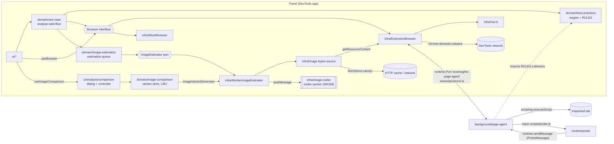
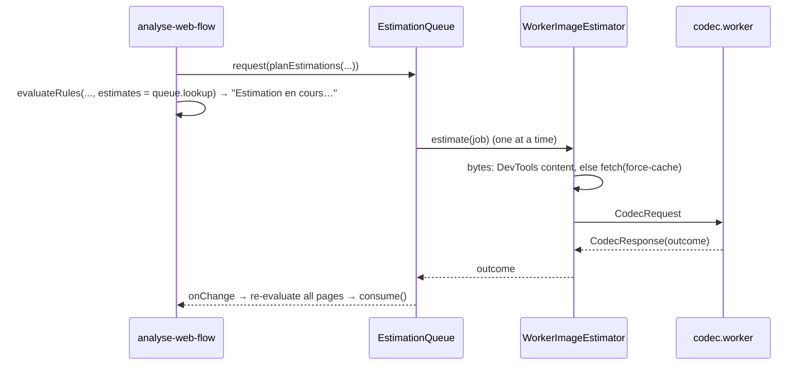
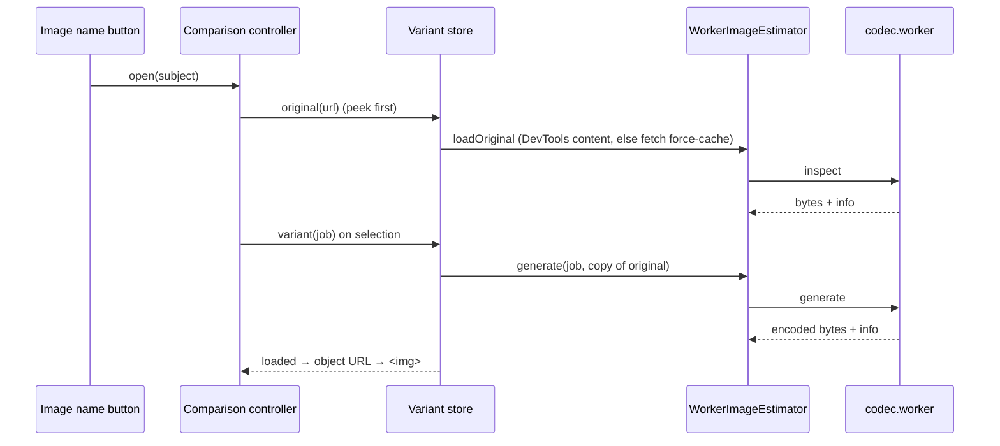

# EcoInsights Profiler: architecture

> Target architecture introduced by the REFACTOR-001 plan ([TECH-REFACTOR-001-plan.md](TECH-REFACTOR-001-plan.md)), following [the architecture review](../review/ARCHITECTURE-REVIEW.md).
> Decisions and their reasons: `ARCH-DECISION-*.md` in this folder.

## 1. Runtime contexts

A WebExtension runs code in four isolated contexts. EcoInsights uses all four, **identically on Chrome and Firefox**.

| Context | Entry point | Built by | Role |
|---|---|---|---|
| DevTools page | `src/devtools.html` → `src/devtools/index.ts` | Vite | Registers the "EcoInsights" panel. |
| Panel (DevTools app) | `src/index.html` → `src/app/index.tsx` | Vite | SolidJS UI, domain logic, `ExtensionBrowser` adapter. Has `chrome.devtools.*` and `runtime.connect` only. |
| Background (Page agent) | `src/background/index.ts` → `scripts/background.js` | esbuild | Executes in the inspected tab on behalf of the panel: `scripting`, `tabs`, `permissions`, `browsingData`. Chrome: service worker. Firefox: event page. |
| Content script (Probe) | `src/content/probe.ts` → `scripts/probe.js` | esbuild | Injected on demand by the Page agent; reports link clicks and form submissions. |



## 2. Layers inside the panel

```
ui/  ──►  domain/  ◄──  infra/
           ▲  models/       (Browser and ImageEstimator ports, NetworkRequest, BestPractice, image-estimation…)
           │  use-case/     (analyse-web-flow, ecoindex, export-csv)
           │  best-practices/ (rule.ts, engine.ts, index.ts, rules/*.rule.ts)
           │  image-estimation/ (policy, estimation-queue, image-gain, image-requests, signature)
           │  image-comparison/ (comparison-subject, variant-store, lru-byte-cache)
```

- `domain/` never references `chrome`/`browser` and never imports `infra/` or `ui/`. ESLint enforces this.
- `infra/` implements `domain/models/browser.ts`. `browser-factory.ts` picks `ExtensionBrowser` when `chrome.devtools` exists, `MockBrowser` otherwise (`npm run dev`).
- `ui/` gets the `Browser` from a Solid context (`useBrowser()`) and passes it to use cases. Only `src/app/index.tsx` imports the factory.
- The `ImageEstimator` port (`domain/models/image-estimator.ts`) follows the same pattern: `getImageEstimator()` returns a `WorkerImageEstimator` in the extension and a `FakeImageEstimator` otherwise (`npm run dev` loads no WASM). The UI gets it with `useImageEstimator()` and passes it to `analyseWebFlow` as `options.imageEstimator`.

## 3. Key flows

### 3.1 Request / response

1. `ExtensionBrowser` sends `{type:"request", id, tabId, method, params}` and starts a timeout (5 s, or 30 s for `page.reload`).
2. The Page agent dispatches to `handlers[method]` and replies `{type:"response", id, ok, result | error}`.
3. On timeout or port disconnect, the promise rejects with `AgentError` (`TIMEOUT` / `DISCONNECTED`). If the port dropped (Chrome service-worker restart), `ExtensionBrowser` reconnects on the next call and re-sends `navigation.watch` if listeners are still registered.

### 3.2 Recording a web flow (`analyse-web-flow`)

- **DOM profile:** the use case calls `browser.getPageInfo()` every second; there is no timer in adapters.
- **Requests:** `browser.onNetworkRequest`.
- **Page boundaries:** `browser.onNavigation`.
  - `url-changed` closes the page if the path or query changed.
  - `link-clicked` and `form-submitted` close it only when the matching option is enabled.
- **Best practices:**
  1. The use case calls `browser.collectPageData(ruleIds)` on its own cadence: at start, then when the DOM changes significantly (throttled), and just before a page is closed by a navigation intent.
  2. On every update, for each page, it requests the rules' estimation jobs (`planEstimations`), then calls `evaluateRules(RULES, { url, requests, pageData, estimates })`, which is pure. See §3.4 for the estimates.

### 3.3 Best-practice rule

`domain/best-practices/rules/<name>.rule.ts` exports a `BestPracticeRule`:

- `collect()` is optional and self-contained. The Page agent executes it in the tab, one `executeScript` per rule, in parallel.
- `estimations(ctx)` is optional, pure and synchronous: the image transformations the rule needs (`EstimationJob`: URL + `resize` / `convert` / `resize-convert`).
- `evaluate(ctx)` is pure: it receives the collected page data, the normalised requests and `ctx.estimates`, a read-only lookup of the estimation cache. While an estimate is pending the rule returns no `compliance` and a `progress { done, total }`.

Registering a rule means adding one line in `domain/best-practices/index.ts`. No protocol, adapter or UI change is needed.

### 3.4 Image estimation (US-001 to US-003)

Decisions: [ARCH-DECISION-007](ARCH-DECISION-007-async-image-estimation.md) (async estimation), [008](ARCH-DECISION-008-wasm-image-codecs.md) (WASM codecs), [009](ARCH-DECISION-009-codec-web-worker.md) (Web Worker), [010](ARCH-DECISION-010-image-bytes-and-csp.md) (image bytes, CSP), [011](ARCH-DECISION-011-image-gain-model.md) (gain model).

1. **Estimation queue** (`domain/image-estimation/estimation-queue.ts`): one per analysis, created by `analyse-web-flow` when best practices are checked.
   - It caches by `estimationKey` (URL + transformation), so one image is encoded once per transformation for the whole journey.
   - It runs one job at a time.
   - `onChange` fires once per settled job, and the use case then re-sends the analyses. Closed pages are rebuilt (best practices and `imageGain` only) when the queue changed.
   - `stop()` turns every pending job into `skipped(analysis-stopped)` and calls `estimator.cancel()`. `stopAnalysis()` returns the final pages.
2. **Combined gain** (`domain/image-estimation/image-gain.ts`): once both image rules have settled for an image they both flag, a `resize-convert` job is requested (`planCombinedEstimations`). `computePageImageGain` gives `PageAnalysis.imageGain` (bytes, pending, not evaluated, fallback), without double counting, and only for images the page transferred.
3. **`WorkerImageEstimator`** (`infra/image-estimator/`):
   - It gets the original bytes from `image-bytes-source.ts`: first the DevTools content of the request (`ExtensionBrowser.getResourceContent`); otherwise a panel-side `fetch(url, { cache: "force-cache" })`, which is not part of the inspected tab's measured requests.
   - It posts them to the codec worker.
   - It never rejects: on a timeout, a worker error or a cancel, it terminates the worker and resolves `failed` or `skipped`.
4. **Codec worker** (`infra/image-codec/`): a classic IIFE worker.
   - It runs the single-thread `@jsquash/*` WASM codecs (mozjpeg, PNG + oxipng, WebP, AVIF, Lanczos3 resize), each compiled lazily from its own `.wasm` asset.
   - The `pipeline.ts` steps: detect the format from the bytes, skip animated, oversized and unsupported images, decode, resize and encode.
   - The encoding settings live in `domain/image-estimation/policy.ts`.



### 3.5 Image names and comparison dialog (US-004, US-005)

Decisions: [ARCH-DECISION-012](ARCH-DECISION-012-on-demand-variant-generation.md) (on-demand variants), [013](ARCH-DECISION-013-comparison-subject-from-findings.md) (comparison subject, finding fields), [014](ARCH-DECISION-014-session-variant-cache.md) (session cache), [015](ARCH-DECISION-015-image-lines-from-findings.md) (image lines), [016](ARCH-DECISION-016-comparison-dialog-host.md) (dialog host, CSP `blob:`).

1. **Image lines** (`ui/analysis/best-practices-view.ts`): each persisted line of an image rule is paired with its finding through `lineFindings` (same order as the rule's lines, each starting with `fileLabel : `). The name is shortened by `displayImageName` (`ui/analysis/image-name.ts`); lines that cannot be paired (legacy analyses, other rules) stay plain text.
2. **Comparison subject** (`domain/image-comparison/comparison-subject.ts`): for an offender line, `comparisonSubjectFor(page.bestPractices, ruleId, url)` gives the versions to toggle (Originale, Redimensionnée, AVIF / WebP sans perte, Les deux) with their `EstimationJob`s, plus the natural size, display box and recorded weight from the findings (`ImageFinding.natural`, `display`, `sourceBytes`). The format rule has a page collector only for the display boxes.
3. **Variant store** (`domain/image-comparison/variant-store.ts`): one per panel session, created in `index.tsx`. It caches originals and variants in a 50 MB LRU, shares in-flight work (which completes after the dialog closed) and never caches errors.
4. **Generation:** `WorkerImageEstimator` also implements the `ImageVariantGenerator` port. `loadOriginal` uses the same bytes source as the estimation and sends an `inspect` request; `generate` sends a `generate` request with a copy of the original. The worker runs `createImagePipeline(codecs)`: `estimate`, `inspect` and `generate` share one core, so a generated size equals the estimate.
5. **Dialog** (`ui/analysis/comparison/`): `ImageComparisonProvider` renders one native `<dialog>` for the app; `createComparisonController` (pure) holds the per-version `idle | loading | loaded | error` states, the selected version and the display mode, ignores late results after close, and creates/revokes the object URLs.



## 4. Build

`npm run build` → `dist/chrome/` and `dist/firefox/` (+ zips). The manifest is generated from `src/manifest/base.json` plus a per-target overlay. Only the `background` key, Chrome's `minimum_chrome_version` (103) and Firefox's `browser_specific_settings` differ.

- **CSP:** both targets get `script-src 'self' 'wasm-unsafe-eval'; object-src 'self'` for extension pages, which is needed to compile WASM. This is why Chrome needs version 103 or later. It deliberately has no `img-src` and no `default-src`, so the comparison dialog can display `blob:` images; `scripts/manifest.test.mjs` asserts it (ARCH-DECISION-016).
- **Codec worker:** Vite builds it as a classic IIFE (`worker.format: "iife"`) and emits each codec `.wasm` as a separate asset, about 5.9 MB per target. They are loaded only when an estimation needs them. `optimizeDeps.exclude` keeps the `@jsquash/*` packages out of the dev pre-bundle.
- **Type-checking:** `tsconfig.json` adds `@jsquash/jpeg/emscripten-types.d.ts` to `files`, because the glue files imported directly need its global `EmscriptenWasm` namespace (ARCH-DECISION-008).

## 5. Tests

Vitest (`npm test`) plus jsdom for page-side code. There are no Solid component tests: the comparison dialog's behaviour is tested through its pure controller and helpers. Every module is tested through its interface with injected fakes (fake `chrome` objects, `MockBrowser`, fake `ImageEstimator`, fake `WorkerLike`, fake codecs), not with module mocking. See [ARCH-DECISION-006](ARCH-DECISION-006-test-strategy.md).

The codec tests run the **real** WASM codecs under Node: `infra/image-codec/testing/node-wasm.ts` compiles the `.wasm` files from `node_modules`, and the test images are synthetic, generated in the tests.
