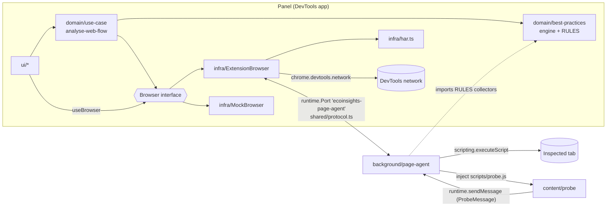

# EcoInsights Profiler: architecture

> Target architecture introduced by the REFACTOR-001 plan ([TECH-REFACTOR-001-plan.md](TECH-REFACTOR-001-plan.md)), following [the architecture review](../review/ARCHITECTURE-REVIEW.md).
> Decisions and their reasons: `ARCH-DECISION-*.md` in this folder.

## 1. Runtime contexts

A WebExtension runs code in four isolated contexts. EcoInsights uses all four, **identically on Chrome and Firefox**.

| Context | Entry point | Built by | Role |
|---|---|---|---|
| DevTools page | `src/devtools.html` → `src/devtools/index.ts` | Vite | Registers the "EcoInsights" panel. |
| Panel (DevTools app) | `src/index.html` → `src/app/index.tsx` | Vite | SolidJS UI, domain logic, `ExtensionBrowser` adapter. Has `chrome.devtools.*` and `runtime.connect` only. |
| Background (Page agent) | `src/background/index.ts` → `scripts/background.js` | esbuild | Executes in the inspected tab on behalf of the panel: `scripting`, `tabs`, `permissions`, `browsingData`. Chrome: service worker. Firefox: event page. |
| Content script (Probe) | `src/content/probe.ts` → `scripts/probe.js` | esbuild | Injected on demand by the Page agent; reports link clicks and form submissions. |



## 2. Layers inside the panel

```
ui/  ──►  domain/  ◄──  infra/
           ▲  models/       (Browser interface, NetworkRequest, BestPractice, NavigationEvent…)
           │  use-case/     (analyse-web-flow, ecoindex, export-csv)
           │  best-practices/ (rule.ts, engine.ts, index.ts, rules/*.rule.ts)
```

- `domain/` never references `chrome`/`browser` and never imports `infra/` or `ui/`. ESLint enforces this.
- `infra/` implements `domain/models/browser.ts`. `browser-factory.ts` picks `ExtensionBrowser` when `chrome.devtools` exists, `MockBrowser` otherwise (`npm run dev`).
- `ui/` gets the `Browser` from a Solid context (`useBrowser()`) and passes it to use cases. Only `src/app/index.tsx` imports the factory.

## 3. Key flows

### 3.1 Request / response

1. `ExtensionBrowser` sends `{type:"request", id, tabId, method, params}` and starts a timeout (5 s, or 30 s for `page.reload`).
2. The Page agent dispatches to `handlers[method]` and replies `{type:"response", id, ok, result | error}`.
3. On timeout or port disconnect, the promise rejects with `AgentError` (`TIMEOUT` / `DISCONNECTED`). If the port dropped (Chrome service-worker restart), `ExtensionBrowser` reconnects on the next call and re-sends `navigation.watch` if listeners are still registered.

### 3.2 Recording a web flow (`analyse-web-flow`)

- **DOM profile:** the use case calls `browser.getPageInfo()` every second; there is no timer in adapters.
- **Requests:** `browser.onNetworkRequest`.
- **Page boundaries:** `browser.onNavigation`.
  - `url-changed` closes the page if the path or query changed.
  - `link-clicked` and `form-submitted` close it only when the matching option is enabled.
- **Best practices:**
  1. The use case calls `browser.collectPageData(ruleIds)` on its own cadence: at start, then when the DOM changes significantly (throttled), and just before a page is closed by a navigation intent.
  2. It then calls `evaluateRules(RULES, { url, requests, pageData })`, which is pure, on every update.

### 3.3 Best-practice rule

`domain/best-practices/rules/<name>.rule.ts` exports a `BestPracticeRule`:

- `collect()` is optional and self-contained. The Page agent executes it in the tab, one `executeScript` per rule, in parallel.
- `evaluate(ctx)` is pure: it receives the collected page data plus the normalised requests.

Registering a rule means adding one line in `domain/best-practices/index.ts`. No protocol, adapter or UI change is needed.

## 4. Build

`npm run build` → `dist/chrome/` and `dist/firefox/` (+ zips). The manifest is generated from `src/manifest/base.json` plus a per-target overlay. Only the `background` key and Firefox's `browser_specific_settings` differ.

## 5. Tests

Vitest (`npm test`) plus jsdom for page-side code. Every module is tested through its interface with injected fakes (fake `chrome` objects, `MockBrowser`), not with module mocking. See [ARCH-DECISION-006](ARCH-DECISION-006-test-strategy.md).
