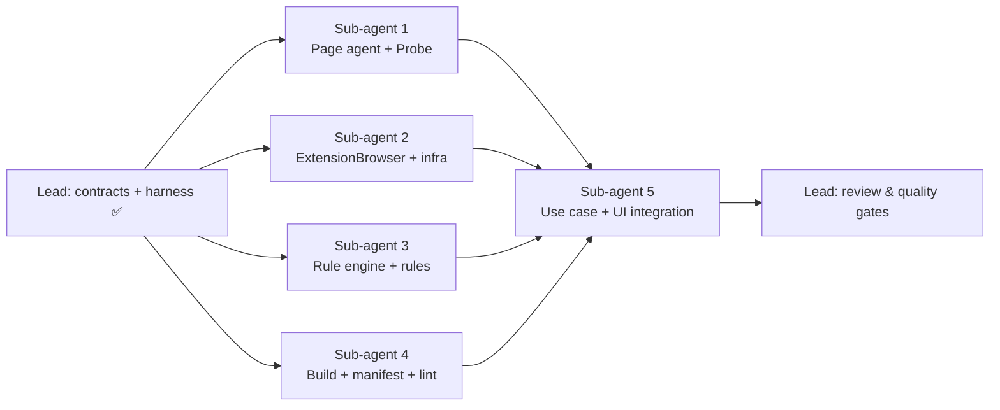

# [TECH-PLAN] REFACTOR-001: Unified browser seam and best-practice rule engine

- **Input:** [docs/review/ARCHITECTURE-REVIEW.md](../review/ARCHITECTURE-REVIEW.md) (§3 defects, §4.1 to §4.4 refactors)
- **Target:** [ARCHITECTURE.md](ARCHITECTURE.md)
- **Decisions:** ARCH-DECISION-001 to 006
- **Branch:** `refactor/architecture` (from `feat/best-practices`)

## 0. Ground rules for every sub-agent

1. **Stay inside your file ownership** (§2). Do not edit any file you don't own, including the contract files in §1. If a contract is wrong or insufficient, **stop and report it** in your final message; don't work around it.
2. **Strict TDD.**
   - Write the test, run it, and keep the failing (red) output for your report.
   - Implement until green.
   - Run your subset with `npx vitest run <your dirs>`. Run `npm test` before finishing.
3. **Type-check your own files:** run `npx tsc --noEmit -p . 2>&1 | grep -E '<your paths>'`. During wave 1, other paths are expected to fail because they are being rewritten in parallel; ignore them.
4. **No `vi.mock` of project modules.** Inject dependencies and use hand-written fakes (ARCH-DECISION-006).
5. **Do not commit, push, or run `npm install`.** If you need a dependency, report it.
6. **Language:** user-facing strings stay in French; code, comments and test names in English. Match the existing code style: 2-space indent, double quotes, `Closeable` for unsubscriptions.
7. **Final report** (your last message): files created, modified and deleted; tests added, with one red-run excerpt per test file; `npx vitest run <your dirs>` output; known limitations; contract issues.

## 1. Contract (shared, owned by the team lead, already written)

| File | Content |
|---|---|
| `src/shared/protocol.ts` | `AgentRequests` method map, request/response/event messages, `AgentError`, `ProbeMessage` + `isProbeMessage`, `AGENT_PORT_NAME`, timeouts |
| `src/app/domain/models/browser.ts` | The new `Browser` interface |
| `src/app/domain/models/navigation-event.ts` | `NavigationEvent` union |
| `src/app/domain/models/network-request.ts` | `NetworkRequest` (+ optional `responseHeaders`) |
| `src/app/domain/models/best-practice.ts` | `BestPractice` (+ `category`, `offenders`, `error`; `compliance` optional) |
| `src/app/domain/best-practices/rule.ts` | `BestPracticeRule`, `RuleContext`, `RuleResult`, `CollectOutcome` |
| `vitest.config.ts`, `package.json` scripts `test`, `typecheck`, `lint` | Test harness |

Contracts introduced by sub-agents, which other agents may import **by these exact names**:

```ts
// Sub-agent 3: src/app/domain/best-practices/index.ts
export const RULES: readonly BestPracticeRule<any>[];
// Sub-agent 3: src/app/domain/best-practices/engine.ts
export function evaluateRules(
  rules: readonly BestPracticeRule<any>[],
  input: { url: string; requests: readonly NetworkRequest[]; pageData: Record<string, CollectOutcome> }
): BestPractice[];
export function collectableRuleIds(rules: readonly BestPracticeRule<any>[]): string[];

// Sub-agent 2: src/app/infra/browser-factory.ts
export function getBrowser(): Promise<Browser>;          // ExtensionBrowser if chrome.devtools exists, else MockBrowser
// Sub-agent 2: src/app/infra/browser-context.tsx
export function BrowserProvider(props: { browser: Browser; children: JSX.Element }): JSX.Element;
export function useBrowser(): Browser;                   // throws if no provider
// Sub-agent 2: src/app/infra/mock-browser.ts
export class MockBrowser implements Browser { /* + test helpers, see §2.2 */ }

// Sub-agent 1: entry points consumed by sub-agent 4's build
//   src/background/index.ts  → dist/<target>/scripts/background.js
//   src/content/probe.ts     → dist/<target>/scripts/probe.js   (the Page agent injects the file "scripts/probe.js")
```

## 2. Scopes

### Delivery waves



Wave 1 runs sub-agents 1 to 4 in parallel; their file sets are disjoint. Wave 2 is sub-agent 5, which integrates and must leave the whole workspace green.

---

### 2.1 Sub-agent 1: Page agent (background) and Probe

**Owns:**

- **Creates:** `src/background/**`, `src/content/**`.
- **Deletes:**
  - `src/scripts/background.ts`, `src/scripts/probe.ts`, `src/scripts/probeChrome.ts`;
  - `src/scripts/shared/get-page-info.ts`, `get-page-description.ts`, `log-in-console.ts`, `onclick-listener.ts`;
  - `src/bridge/connexion.ts`.
- **Must not touch:** `src/scripts/shared/rules/**`, which belongs to sub-agent 3.

**Design.**

- `src/background/chrome-like.ts`: a minimal typed subset of the `chrome` API used by the agent, so tests can pass a fake.
  - `runtime.onConnect`, `runtime.onMessage`;
  - `scripting.executeScript`;
  - `tabs.get`, `tabs.reload`, `tabs.create`, `tabs.onUpdated`;
  - `permissions.contains`;
  - `browsingData.remove`.
- `src/background/page-agent.ts`: `createPageAgent(deps: { chrome: ChromeLike; rules: readonly BestPracticeRule<any>[]; probeFile?: string })` returns `{ dispose(): void }`.
  - Listens to `runtime.onConnect`. It ignores ports whose `name !== AGENT_PORT_NAME`.
  - Keeps **one session per port**: the `tabId` learned from the first request, the watch state, and the listeners it registered. `port.onDisconnect` disposes everything belonging to that session. Several ports may watch different tabs, or the same tab.
  - `handlers` is typed `{ [M in AgentMethod]: (tabId: number, params: AgentParams<M>) => Promise<AgentResult<M>> }`.
  - Replies `{type:"response", id, ok:true, result}`. On a thrown error it replies `ok:false` with code:
    - `NO_PERMISSION` when the `executeScript` error message matches `/cannot access|missing host permission|permission/i`;
    - `UNKNOWN_METHOD` for an unknown method;
    - `INTERNAL` otherwise.
- **Handlers:**
  - `permission.check`: `tabs.get(tabId)`. Pages that aren't `http`/`https` (`about:`, `chrome:`, etc.) return `false`. Otherwise `permissions.contains({ origins: [\`${origin}/*\`] })`.
  - `page.info`: `executeScript({ target:{tabId}, func })` with a self-contained page function returning `{ title, url: location.href, domSize: document.querySelectorAll("*:not(svg *)").length }`.
  - `page.description`: `{ name: document.title, description: <meta name=description> content or "", url: location.origin }`.
  - `page.collect`:
    1. For each requested id that maps to a rule with `collect`, call `executeScript({ target:{tabId}, func: rule.collect })`.
    2. Use `Promise.allSettled`. A rejection, or a missing or `undefined` result, gives `{ ok:false, error }`; otherwise `{ ok:true, data: result }`.
    3. Unknown ids and rules without `collect` are omitted.
  - `page.reload`:
    1. If `purgeCache`, call `browsingData.remove({ since: 0 }, { cache: true, serviceWorkers: true })`. **Do not remove downloads**: the old code did, which was destructive.
    2. Register the `tabs.onUpdated` listener **before** calling `tabs.reload(tabId, { bypassCache: true })`.
    3. Resolve on `status === "complete"` for that tab, then remove the listener.
  - `page.log`: `executeScript` with `args:[message]`, which logs `"EcoInsights : " + msg`.
  - `tab.open`: `tabs.create({ url })`.
  - `navigation.watch`:
    - **`enabled: true`** (idempotent):
      1. Inject `probeFile` (default `"scripts/probe.js"`) into the top frame only.
      2. On `tabs.onUpdated` for the session tab: `changeInfo.url` → push `{type:"event", event:{kind:"url-changed", url}}`; `status === "complete"` → re-inject the Probe.
      3. Forward `runtime.onMessage` messages that pass `isProbeMessage`, come from `sender.tab.id === tabId` and have `sender.frameId === 0` (or undefined), as events.
    - **`enabled: false`:** stop forwarding and remove the listeners.
- `src/background/index.ts`: wiring only, `createPageAgent({ chrome, rules: RULES })`. Import `RULES` from `../app/domain/best-practices`; sub-agent 3 creates it in parallel.
- `src/content/navigation-listener.ts`: port of `onclick-listener.ts`.
  - `listenToNavigationIntents(doc: Document, onIntent: (e: ProbeMessage["event"]) => void): Closeable`.
  - **Every** branch goes through `onIntent`, including the `onclick="window.location.href=…"` branch (review B7).
  - Keeps the rules: same-page links, `target=_blank` and ctrl/meta-click are ignored. A form submission is reported only for a submit button inside a form.
- `src/content/probe.ts`:
  - Idempotent guard via a `window` property, **assigned** this time (review B1).
  - Wires `listenToNavigationIntents(document, e => chrome.runtime.sendMessage({ source:"ecoinsights-probe", event:e }))`.

**Required tests** (`src/background/page-agent.test.ts` with a fake `ChromeLike`, `src/content/navigation-listener.test.ts` in jsdom):

1. A request is answered with the same `id`, and `result` is the `executeScript` result, for `page.info` and `page.description`.
2. Two concurrent requests of the same method get their own answers (the old bug of correlating by type).
3. An `executeScript` rejection "Cannot access contents of url" gives `ok:false` with code `NO_PERMISSION`. An unknown method gives `UNKNOWN_METHOD`.
4. `permission.check`: an `https` tab calls `permissions.contains` with `https://host/*`; `chrome://` returns `false` without calling it.
5. `page.collect`:
   - one call per collectable rule;
   - a rejecting rule gives `ok:false` while the others are `ok:true`;
   - unknown ids and collector-less rules are omitted.
6. `page.reload`:
   - it does not resolve before `onUpdated(status:"complete")` for that tab;
   - it ignores other tabs;
   - with `purgeCache`, `browsingData.remove` is called **without** `downloads`.
7. `navigation.watch`:
   - the Probe is injected;
   - `url-changed` is forwarded;
   - the Probe is re-injected on `complete`;
   - Probe messages are forwarded only for the matching tab and top frame;
   - after `enabled:false`, nothing is forwarded.
8. Port disconnect removes every `onUpdated` and `onMessage` listener the session added. With two ports on two tabs, closing one does not affect the other (review B3).
9. Navigation listener:
   - a link to another path → `link-clicked`;
   - same path with `#anchor` → nothing;
   - `target=_blank` → nothing;
   - ctrl-click → nothing;
   - a submit button in a form → `form-submitted` with `form.action`;
   - a button with `onclick="window.location.href='/next'"` → `link-clicked` through the callback;
   - `close()` removes the listener.

**Done when:** your tests pass, and `src/background` plus `src/content` have no `tsc` errors. Typing errors from importing `RULES` are acceptable if sub-agent 3 hasn't landed `index.ts` yet; say so in your report.

---

### 2.2 Sub-agent 2: `ExtensionBrowser`, HAR normaliser, mock, factory and context

**Owns:**

- **Creates:** `src/app/infra/extension-browser.ts`, `har.ts`, `mock-browser.ts`, `browser-context.tsx`.
- **Rewrites:** `src/app/infra/browser-factory.ts`.
- **Deletes:** `src/app/infra/browser-chrome.ts`, `browser-firefox.ts`, `browser-mock.ts`.

**Design.**

- `har.ts`: `toNetworkRequest(entry: HARFormatEntry): NetworkRequest | null`.
  - Returns `null` for non-`http(s)` URLs (`data:`, `blob:`, `chrome-extension:`, `moz-extension:`…).
  - `type`: the MIME type without parameters, `""` if absent.
  - `responseSize`: `content.size` or `0`.
  - `transferSize`: `_transferSize` if it is a number ≥ 0, else `max(0, bodySize) + max(0, headersSize)`.
  - `responseHeaders`: lower-cased names. When a header repeats, join the values with `", "`.
- `extension-browser.ts`: `new ExtensionBrowser(deps: { runtime: { connect(info:{name:string}): PortLike }, devtools: DevtoolsLike, now?: () => number })`. Define `PortLike` and `DevtoolsLike` as minimal typed subsets.
  - `tabId = deps.devtools.inspectedWindow.tabId` (review D7).
  - The port is connected lazily on first use. On `onDisconnect`:
    1. Reject all pending requests with `AgentError("DISCONNECTED")`.
    2. Drop the port; the next call reconnects.
    3. If navigation listeners are registered, reconnect immediately and re-send `navigation.watch {enabled:true}`.
  - `call<M>(method, params)`: request `id` from `crypto.randomUUID()`. Timeout is `REQUEST_TIMEOUT_MS`, or `RELOAD_TIMEOUT_MS` for `page.reload`; on expiry, reject with `AgentError("TIMEOUT")` and drop the late response. An `ok:false` response rejects with `AgentError(error.code, error.message)`.
  - `getNetworkRequests()` uses `devtools.network.getHAR`. It must support both the callback form (Chrome) and the Promise form (Firefox `browser.*`): call it with a callback and, if the return value is thenable, use that instead. Then map through `toNetworkRequest`, dropping `null`s.
  - `onNetworkRequest(l)` uses `devtools.network.onRequestFinished` mapped through `toNetworkRequest`, skipping `null`s. `close()` removes the listener.
  - `onNavigation(l)`:
    - The first listener sends `navigation.watch {enabled:true}`; closing the last one sends `{enabled:false}`.
    - Events from the port are dispatched to all listeners.
  - The other methods map 1:1 onto protocol methods. `log()` swallows errors.
- `mock-browser.ts`: `MockBrowser implements Browser` for `npm run dev` and for sub-agent 5's tests. It has **no timers of its own**.
  - Constructor `new MockBrowser(initial?: Partial<{ pageInfo; description; requests; permission; pageData }>)`.
  - Test helpers:
    - `setPageInfo(p)`;
    - `emitNetworkRequest(r)`;
    - `emitNavigation(e)`;
    - `setPageData(record)`;
    - `calls` (an array of `{ method, args }`);
    - `reloadInspectedPage` resolves immediately and records the call.
  - For `npm run dev`, `browser-factory` uses `createDemoMockBrowser()`. That is a MockBrowser driven by a small `setInterval` that grows the DOM size and emits a request every second. The demo timer lives in the factory module, not in the class.
- `browser-factory.ts`: `getBrowser()` is memoised. It returns `new ExtensionBrowser({ runtime: chrome.runtime, devtools: chrome.devtools })` when `globalThis.chrome?.devtools?.inspectedWindow` exists, else the demo mock. No other browser sniffing.
- `browser-context.tsx`: `BrowserProvider` and `useBrowser`, built on Solid `createContext`. `useBrowser` throws `Error("useBrowser must be used inside <BrowserProvider>")`.

**Required tests** (`har.test.ts`, `extension-browser.test.ts` with a fake port pair and a fake devtools, `mock-browser.test.ts`):

1. `toNetworkRequest`:
   - a Chrome entry with `_transferSize`;
   - a Firefox-like entry without it (falls back to body + headers, with negatives clamped to 0);
   - `data:` → `null`;
   - MIME parameters stripped;
   - header names lower-cased and duplicates joined.
2. A request carries `tabId` from `inspectedWindow` and a unique `id`; the matching response resolves it.
3. Concurrent calls resolve independently, even in reverse response order.
4. With `vi.useFakeTimers()`: no response → rejects `TIMEOUT` after 5 s; `page.reload` waits 30 s; a late response is ignored.
5. `ok:false` → rejects with an `AgentError` carrying the code.
6. Disconnect → pending calls reject `DISCONNECTED`; the next call opens a new port. With an active navigation listener, the reconnect re-sends `navigation.watch true`.
7. `onNavigation`: the first listener sends `watch true`, the second does not; closing both sends `watch false` once; events reach every listener.
8. `getNetworkRequests` works with both the callback-style and Promise-style `getHAR` and filters `data:` entries.
9. MockBrowser helpers notify listeners, and `close()` unsubscribes.

**Done when:** your tests pass and `src/app/infra` has no `tsc` errors.

---

### 2.3 Sub-agent 3: Best-practice rule engine and rules

**Owns:**

- **Creates:** `src/app/domain/best-practices/engine.ts`, `index.ts`, `rules/**`.
- **Deletes:**
  - `src/app/domain/best-practices/best-practice-manager.ts`, `best-practice-analyzer.ts`, `best-practices-analyzer.ts`;
  - `dont-resize-images-in-browse.analyzer.ts`, `print-style-sheet.analyzer.ts`;
  - `src/scripts/shared/rules/**`.
- **Must not touch:** `rule.ts`, which is a contract.

**Design.**

- `engine.ts`: `evaluateRules` returns one `BestPractice` per rule, in registry order:
  - `id`, `name` and `category` come from the rule.
  - `page` is `pageData[id].data` when `ok`, else `undefined`.
  - When `evaluate` succeeds, copy `compliance`, `detail` and `offenders`.
  - When `evaluate` throws, set `error` to the message, leave `compliance` undefined, and set `detail` to `"Règle non évaluée"`.
  - A rule **with** a collector whose `pageData` entry is missing or `ok:false` still gets `evaluate` called with `page: undefined`. Rules must handle that case, usually by returning a non-penalising result with a detail saying the page could not be inspected.
- `collectableRuleIds(rules)`: the ids of rules that have `collect`.
- `index.ts`: `export const RULES = [printStylesheetRule, dontResizeImagesRule, standardFontsRule] as const`, typed as `readonly BestPracticeRule<any>[]`.
- **Rules** (one file each, in `rules/`; names in French as today):
  1. `print-stylesheet.rule.ts`: id `PrintStyleSheet`, category `css`. Port of the existing rule: A if at least one `link[rel=stylesheet][media~=print], style[media~=print]`, else C.
  2. `dont-resize-images.rule.ts`: id `DontResizeImagesInBrowser`, category `images`. Port of the existing rule with the review B8 fixes:
     - SVG is excluded by **file extension** (`.svg`, with or without a query string) or by a `data:image/svg+xml` src, not by a substring match;
     - an image is flagged when **either** dimension is downscaled by 2 px or more;
     - images with `clientWidth === 0` or `clientHeight === 0` are skipped;
     - offenders read `"<file> : affichée en WxH au lieu de WxH"`.

     A if none, C otherwise. `collect` returns the raw image list; filtering happens in `evaluate`.
  3. `standard-fonts.rule.ts` (**new**): id `UseStandardFonts`, category `fonts`.
     - **`collect`** returns `{ families: string[] }`: the unique families of `document.fonts` entries with `status === "loaded"`.
     - **`evaluate`** counts font requests: MIME type starting with `font/` or `application/font`, or a URL path matching `/\.(woff2?|ttf|otf|eot)$/i`.
       - A: 0 font files.
       - B: 1 or 2 files and a total `transferSize` under 100 kB.
       - C: otherwise.
     - Detail: `"<n> police(s) téléchargée(s) (<kb> ko)"`. When `families` is known, append `" : <families joined by ', '>"`.
     - Offenders: the font URLs.

**Required tests** (`engine.test.ts`, one `<rule>.rule.test.ts` per rule, and `rules-registry.test.ts`):

1. Engine:
   - registry order;
   - `pageData` passed to the right rule;
   - `ok:false` and missing data give `page: undefined`;
   - a throwing `evaluate` gives `error` and `compliance: undefined` without affecting the other rules;
   - no state is kept between two calls (call twice with different inputs).
2. Each rule:
   - `evaluate` is tested table-driven over A, B (where applicable), C and `page: undefined`.
   - `collect` is tested under `// @vitest-environment jsdom` against a hand-built DOM. jsdom has no layout: define `clientWidth` and `naturalWidth` with `Object.defineProperty`, and stub `document.fonts`.
3. Registry:
   - ids are unique;
   - every rule has a non-empty `name` and a valid `category`;
   - **every `collect` is self-contained**: rebuild it with `new Function(\`return (${rule.collect.toString()})\`)()`, run the rebuilt function in jsdom, and expect no throw;
   - every `collect` result survives `JSON.parse(JSON.stringify(x))` unchanged.

**Done when:** your tests pass, `src/app/domain/best-practices` has no `tsc` errors, and nothing under it references `chrome` or imports `infra`/`ui`.

---

### 2.4 Sub-agent 4: Build, manifests and lint tooling

**Owns:**

- **Creates:** `src/manifest/**`, `scripts/**` (repo root, build scripts).
- **Edits:**
  - `package.json`: the `scripts` section only, except `test`, `test:watch`, `typecheck` and `lint`, which already exist;
  - `vite.config.ts`;
  - `.eslintrc.json`;
  - `.gitignore`;
  - `vitest.config.ts`: you may only add `scripts/**/*.test.{ts,mjs}` to `include`.
- **Deletes:** `build-finalizer.js`, `src/public/manifestChrome.json`, `src/public/manifestFirefox.json`. Keep `src/public/icons`.

**Design** (ARCH-DECISION-005):

- `src/manifest/base.json` holds:
  - name, description and version, copied from the existing manifests;
  - `manifest_version: 3`;
  - `devtools_page: "devtools.html"`;
  - `permissions: ["scripting","tabs","browsingData"]`;
  - `host_permissions: ["<all_urls>"]`;
  - the icons.

  There is **no** `content_scripts` key and no `contextMenus` or `activeTab` permission.
- `src/manifest/chrome.json`: `{ "background": { "service_worker": "scripts/background.js" }, "minimum_chrome_version": "102" }`.
- `src/manifest/firefox.json`: `{ "background": { "scripts": ["scripts/background.js"] }, "browser_specific_settings": { "gecko": { "id": "bastienhub@gmail.com", "strict_min_version": "109.0" } } }`.
- `scripts/manifest.mjs`: `mergeManifest(base, overlay)`, a pure deep merge (objects merged recursively, arrays and scalars replaced by the overlay), plus `readManifest(target)`.
- `scripts/build.mjs --target=chrome|firefox`:
  1. Clean `dist/<target>`.
  2. Run the Vite build programmatically (`build()` from `vite`) with `outDir` = `dist/<target>` and `base: "./"`.
  3. Run esbuild (`build()` from `esbuild`, which is already in `node_modules` through Vite) with `bundle`, `minify`, `format: "iife"` and `target: ["chrome102","firefox109"]` for:
     - `src/background/index.ts` → `scripts/background.js`;
     - `src/content/probe.ts` → `scripts/probe.js`.
  4. Write the merged `manifest.json`.
  5. Zip `dist/<target>` into `dist/<target>.zip` using the system `zip -r -q` through `child_process`. If `zip` is missing, warn and skip without failing the build.

  If an entry point is missing, fail with a clear message naming the missing file. During wave 1, sub-agent 1 may not have created it yet.
- `vite.config.ts`: keep the dev server, and make `outDir` overridable, since the script passes it. `src/public` stays `publicDir` for the icons.
- `package.json` scripts:
  - `build` builds both targets;
  - `build:chrome` and `build:firefox`;
  - `lint:firefox`: `npx --yes web-ext lint -s dist/firefox`;
  - remove `build:app` and `build:scripts`.
- `.eslintrc.json`: add `overrides` for `src/app/domain/**`:
  - `no-restricted-globals` for `chrome` and `browser`;
  - `no-restricted-imports` with patterns `**/infra/**` and `**/ui/**`.

  Make sure `npm run lint` works on the current files. Fix lint configuration problems only; report code lint errors in files you don't own instead of fixing them.
- `.gitignore`: `dist`, `node_modules`, `.DS_Store`, `*.zip`.

**Required tests** (`scripts/manifest.test.mjs` or `.test.ts`):

1. `mergeManifest`: nested objects merge, arrays are replaced, and the base is not mutated.
2. The Chrome merged manifest has `background.service_worker` and no `scripts`. The Firefox one has `background.scripts` and `gecko.id`. Neither has `content_scripts`, `contextMenus` or `activeTab`.
3. Both merged manifests reference only files the build produces: `devtools.html`, `scripts/background.js`, and icons that exist in `src/public/icons`.

**Done when:** your tests pass, `npm run lint` runs (code errors elsewhere may remain and are listed in your report), and `node scripts/build.mjs --target=chrome` either succeeds or fails only because sub-agent 1's entry points are missing.

---

### 2.5 Sub-agent 5 (wave 2): use case, UI integration and full green

**Starts after sub-agents 1 to 4 have finished.**

**Owns:**

- `src/app/domain/use-case/**`;
- `src/app/index.tsx`, `src/app/App.tsx`, `src/app/store.tsx`;
- `src/app/ui/**`;
- `src/test/**`.

**Design.**

- `analyse-web-flow.ts`: `analyseWebFlow(browser: Browser, params: WebFlowAnalysisParams, consume: (pages: PageAnalysis[]) => void, options?: { rules?: readonly BestPracticeRule<any>[]; domPollIntervalMs?: number /* 1000 */; collectMinIntervalMs?: number /* 5000 */ })`. It keeps the `WebFlowAnalysis` return type.
  - **Start:**
    1. If `refreshOnStart`, `await browser.reloadInspectedPage({ purgeCache: true })` **before** reading requests.
    2. Then read `getPageInfo()` and `getNetworkRequests()`.
    3. Seed the DOM profile.
  - **DOM polling:** chained `setTimeout` every `domPollIntervalMs` calling `getPageInfo()`. Keep the existing profile logic: dedupe equal sizes, track the max, and refresh the title when the URL matches. Rejections are logged and polling continues.
  - **Best practices**, when `checkBestPractices` is set:
    1. Collect at start through `collectPageData(collectableRuleIds(rules))`.
    2. Collect again on a DOM poll when the size changed by ≥ 10% or ≥ 50 nodes since the last collection, and at least `collectMinIntervalMs` has passed.
    3. Collect once, best effort with no await on failure, before closing a page on `link-clicked` or `form-submitted`.
    4. On every `sendAnalysis`, call `evaluateRules(rules, { url, requests, pageData })`. `pageData` is reset per page.

    When the option is off, nothing is collected and `bestPractices` is `[]`.
  - **Navigation:** `browser.onNavigation`.
    - `url-changed`: close the page if `isNotOnSamePage`, then fetch the new page info. Keep the existing "pending page" logic.
    - `link-clicked` closes the page only if `triggerNewPageOnLinkClicked`.
    - `form-submitted` closes the page only if `triggerNewPageOnFormSubmitted` (review B6).
  - `stopAnalysis()` closes every listener and clears every timer. It is idempotent.
  - Remove the per-tick `browser.log("Page analyzed")` spam: log once at start and once at stop.
- `index.tsx`: `getBrowser()`, then render `<BrowserProvider browser={b}><App/></BrowserProvider>`.
- `ui/`:
  - Replace every `getBrowser()` import with `useBrowser()`.
  - `NewAnalysis` reads `RULES.length`.
  - `PendingAnalysis`:
    - Manages an explicit state `"starting" | "recording" | "error"`. When `analyseWebFlow` rejects (for example `AgentError` `NO_PERMISSION` or `TIMEOUT`), it shows a French error message with a "Réessayer" button, never an empty screen.
    - Starts the analysis in `onMount`, not in `createEffect`.
  - `BestPractices.tsx`:
    - Group by category.
    - List `offenders` in the expanded detail.
    - Show a grey "Non évaluée" badge when `compliance` is undefined.
    - When aggregating across pages, the worst defined grade wins and undefined never wins.
    - Keep the accessible expand/collapse buttons (`aria-expanded`).
- `store.tsx`:
  - `addAnalysis` persists.
  - `save()` catches `QuotaExceededError` and exposes a `saveError` signal or field that the UI shows as a banner.
  - `restore()` migrates legacy `bestPractices` entries without `category` to `"content"`.
- Fix the remaining `tsc` errors in `ui/shared/ConfimDialog.tsx` and `ui/shared/DomProfileChart.tsx` (review B11).

**Required tests** (`src/app/domain/use-case/analyse-web-flow.test.ts` with `MockBrowser` and fake timers, plus `src/app/store.test.ts` for the pure restore/migration logic; extract it to a pure function if needed):

1. `refreshOnStart` → `reloadInspectedPage` is called before `getNetworkRequests`.
2. DOM polling:
   - samples every interval;
   - equal sizes are deduped;
   - the max is tracked;
   - a sample for another URL is ignored;
   - a rejected `getPageInfo` doesn't stop polling.
3. `url-changed` to another path closes the page; an anchor change does not.
4. `link-clicked` closes the page only when its flag is on; same for `form-submitted` (B6 regression test).
5. Best practices:
   - collected at start;
   - not re-collected before `collectMinIntervalMs`;
   - re-collected after a significant DOM change;
   - `evaluateRules` results appear on the page;
   - `pageData` is reset on a new page;
   - nothing is collected when the option is off.
6. `stopAnalysis` → no more `getPageInfo` calls after advancing the timers, and all `Closeable`s are closed.
7. Store restore migrates legacy best practices and rehydrates `Date` and `URL` objects.

**Done when** the whole workspace is green:

- `npm run typecheck` → 0 errors;
- `npm test` → all pass;
- `npm run lint` → 0 errors;
- `npm run build` → `dist/chrome`, `dist/firefox` and both zips.

---

## 3. Review defects mapped to scopes

| Review id | Fixed by |
|---|---|
| D1, D2, D3, D4, D5, D6, D7, D8 | 1 + 2 (by construction) |
| D9 | 2 (`har.ts`) |
| B1, B2, B3, B7 | 1 |
| B4, B5, B8 | 3 |
| B6, B10, B11 | 5 |
| B9 (EcoIndex size) | **Not in scope**: needs confirmation against `ecoindex_reference` (open question to the owner) |
| Housekeeping (§3.3) | 1, 3, 4 |

## 4. Quality gates (team lead, after wave 2)

The audit is documented in `docs/reviews/REVIEW-REFACTOR-001.md` and checks the following gates:

1. **TDD:** each sub-agent report contains red-run evidence per test file.
2. **Isolation:** all panel ↔ page traffic goes through `shared/protocol.ts`. `domain/` has no `chrome` and no `infra`/`ui` imports (lint). There are no `vi.mock` calls of project modules.
3. **Reactive state:** async UI states are explicit: `NewAnalysis` uses the resource states, and `PendingAnalysis` uses `starting | recording | error`.
4. **UI:** the best-practice list is grouped, offenders are visible, "Non évaluée" is shown, and controls are keyboard-accessible.
5. **Full suite:** `typecheck`, `test`, `lint` and `build` all pass.

## 5. Manual smoke test (owner, after merge)

The smoke test is for **Chrome** and for **Firefox**: load `dist/<target>` unpacked (Firefox: `about:debugging` → "Load Temporary Add-on" → `dist/firefox/manifest.json`).

1. Open a site, open DevTools, then the EcoInsights tab. The form is prefilled.
2. Start the analysis with every option on. The page reloads, and requests and DOM size update live.
3. Click an internal link. A new page row appears.
4. Submit a form. A new page row appears.
5. Best practices are listed, including "Utiliser des polices standard".
6. Stop the analysis. It is saved, and the CSV export works.
7. Undock DevTools (Chrome) and repeat step 1.
8. Firefox: revoke the site permission. The "Permission requise" screen appears instead of a spinner.
