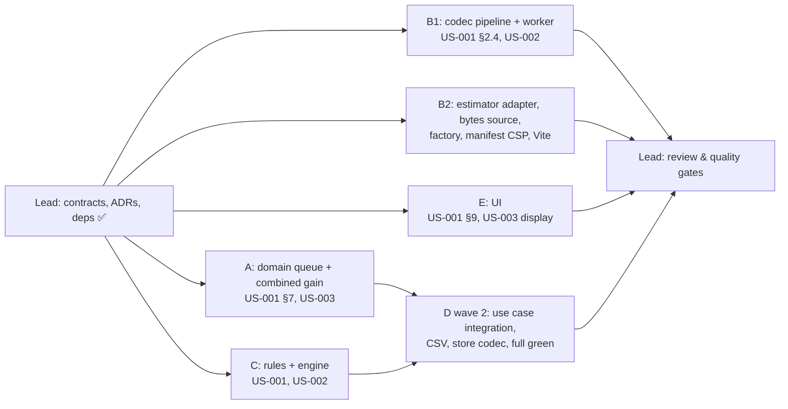

# [TECH-PLAN] US-001 → US-003: Image optimisation (resize gain, optimised formats, combined gain)

- **Input:** [US-001](../stories/US-001.md), [US-002](../stories/US-002.md), [US-003](../stories/US-003.md) (READY FOR TDD)
- **Decisions:** [ARCH-DECISION-007](ARCH-DECISION-007-async-image-estimation.md) (async estimation, amends 004), [008](ARCH-DECISION-008-wasm-image-codecs.md) (WASM codecs), [009](ARCH-DECISION-009-codec-web-worker.md) (Web Worker), [010](ARCH-DECISION-010-image-bytes-and-csp.md) (image bytes, CSP), [011](ARCH-DECISION-011-image-gain-model.md) (gain model)
- **Branch:** `feat/image-optimisation` (from `refactor/architecture`). Nothing is committed.
- **Baseline:** 17 test files, 157 tests green; `tsc` 0 errors; ESLint 0 errors / 1 warning; `dist/chrome` 408 kB (zip 128 kB).

## 0. Ground rules for every sub-agent

1. **Stay inside your file ownership** (§2). Do not edit any file you don't own, including the contract files in §1. If a contract is wrong or insufficient, **stop and report it** in your final message; don't work around it.
2. **Strict TDD.** Write the test, run it, and keep the failing (red) output for your report. Implement until green. Run your subset with `npx vitest run <your dirs>`. Run `npm test` before finishing (failures in other scopes during wave 1 are expected; list them, don't fix them).
3. **Type-check your own files:** `npx tsc --noEmit -p . 2>&1 | grep -E '<your paths>'`. Other paths may fail while they are being rewritten in parallel.
4. **No `vi.mock` of project modules.** Inject dependencies and use hand-written fakes (ARCH-DECISION-006). `vi.useFakeTimers()` is fine.
5. **Do not commit, push, or run `npm install`.** The codecs are already installed (`@jsquash/jpeg@1.6.0`, `png@3.1.1`, `oxipng@2.3.0`, `webp@1.5.0`, `avif@2.1.1`, `resize@2.1.1`). If you need another dependency, report it.
6. **Language:** UI strings in French; code, comments and test names in English. 2-space indent, double quotes, `Closeable` for unsubscriptions. Units: 1 kB = 1 000 bytes ("ko" in French UI), 1 MB = 1 000 000 bytes ("Mo").
7. **Final report** (your last message): files created/modified/deleted; tests added with one red-run excerpt per test file; `npx vitest run <your dirs>` output; known limitations; contract issues.

## 1. Contract (shared, owned by the team lead, already written and tested)

| File | Content |
|---|---|
| `src/app/domain/models/image-estimation.ts` | `ImageFormat`, `EncodingSpec`, `ImageTransform`, `EstimationJob`, `SkipReason`, `FailReason`, `EstimationOutcome`, `EstimateState`, `EstimateLookup`, `estimationKey(job)`, `UNAVAILABLE_ESTIMATES`, `ImageFinding`, `EstimationProgress`, `PageImageGain`, `imageGainStatus(gain)`, `RESIZE_IMAGES_RULE_ID`, `OPTIMISED_FORMATS_RULE_ID` |
| `src/app/domain/models/image-estimator.ts` | Port `ImageEstimator { estimate(job): Promise<EstimationOutcome>; cancel?(): void }` (never rejects) |
| `src/app/domain/image-estimation/policy.ts` | `NOISE_THRESHOLD_BYTES` (10 000), `MAX_IMAGE_PIXELS` (25 M), `MAX_IMAGE_BYTES` (10 M), `MAX_OFFENDER_LINES` (20), grade constants, `RECOMMENDED_ENCODING`, `ALREADY_OPTIMISED_FORMATS`, `OWN_FORMAT_ENCODING`, `CODEC_FORMATS`, `MIME_FORMATS`, `GENERIC_MIME_TYPES` |
| `src/app/domain/image-estimation/image-requests.ts` | `normaliseImageUrl`, `findImageRequest`, `isTransferred`, `originalBytesOf`, `formatFromMime` (ARCH-DECISION-011 §1, §2, §5) |
| `src/app/domain/image-estimation/signature.ts` | `sniffImageFormat(head)`, `detectImageFormat(declaredType, head)` |
| `src/app/domain/best-practices/rule.ts` | Amended: `PlanningContext`, `RuleContext.estimates`, `RuleResult.compliance?`, `progress?`, `images?`, `BestPracticeRule.estimations?` |
| `src/app/domain/models/best-practice.ts` | `BestPractice.progress?`, `BestPractice.images?` |
| `src/app/domain/models/page-analysis.ts` | `PageAnalysis.imageGain?` |
| `src/app/domain/use-case/analyse-web-flow.ts` | **Signatures only:** `WebFlowAnalysisOptions.imageEstimator?`, `stopAnalysis(): PageAnalysis[]` (stub implementation, replaced by sub-agent D) |
| `src/app/infra/image-codec/worker-protocol.ts` | `ImageBytes`, `CodecRequest`, `CodecResponse`, `WorkerLike` |
| `src/app/infra/estimator-context.tsx` | `ImageEstimatorProvider`, `useImageEstimator()` |

Contracts introduced by sub-agents, which other agents may import **by these exact names**:

```ts
// Sub-agent A: src/app/domain/image-estimation/estimation-queue.ts
export interface EstimationQueue {
  /** Enqueues the jobs whose key is unknown (cache by estimationKey); known keys are ignored. Never notifies synchronously. */
  request(jobs: readonly EstimationJob[]): void;
  /** Current state of a job; undefined if never requested. */
  lookup: EstimateLookup;
  /** Called after each state change (one call per settled job, one call for stop()). */
  onChange(listener: () => void): Closeable;
  /** Jobs queued or in flight. */
  pendingCount(): number;
  /** Every pending job becomes skipped("analysis-stopped"); queue dropped; late results ignored; estimator.cancel?.() called. Idempotent. */
  stop(): void;
}
export function createEstimationQueue(estimator: ImageEstimator): EstimationQueue;

// Sub-agent A: src/app/domain/image-estimation/image-gain.ts
export interface ImageGainInput {
  requests: readonly NetworkRequest[];
  bestPractices: readonly BestPractice[];
  estimates: EstimateLookup;
}
/** resize-convert jobs for the images that are offenders of both image rules. */
export function planCombinedEstimations(input: ImageGainInput): EstimationJob[];
/** Undefined when neither image rule is present in bestPractices. */
export function computePageImageGain(input: ImageGainInput): PageImageGain | undefined;

// Sub-agent C: src/app/domain/best-practices/engine.ts
export interface EvaluationInput {
  url: string;
  requests: readonly NetworkRequest[];
  pageData: Record<string, CollectOutcome>;
  /** Default UNAVAILABLE_ESTIMATES. */
  estimates?: EstimateLookup;
}
export function evaluateRules(rules, input: EvaluationInput): BestPractice[];
/** Jobs of every rule, deduplicated by estimationKey; a throwing `estimations` is ignored. */
export function planEstimations(rules, input: Omit<EvaluationInput, "estimates">): EstimationJob[];
// Sub-agent C: src/app/domain/best-practices/index.ts
export const RULES; // [PrintStyleSheet, DontResizeImagesInBrowser, UseOptimizedImageFormats, UseStandardFonts]

// Sub-agent B2: src/app/infra/browser-factory.ts
export function getImageEstimator(): Promise<ImageEstimator>; // memoised; WorkerImageEstimator in the extension, FakeImageEstimator otherwise

// Sub-agent B1: src/app/infra/image-codec/codec.worker.ts (worker entry, imported by B2 as "../image-codec/codec.worker?worker")
```

## 2. Scopes

### Delivery waves



Wave 1 runs A, B1, B2, C and E in parallel; their file sets are disjoint. Wave 2 is D, which integrates the domain and must leave the whole workspace green. The story order US-001 → US-002 → US-003 is respected inside each scope (US-001 tests first).

---

### 2.A Sub-agent A: estimation queue and combined page gain (domain)

**Owns (creates):** `src/app/domain/image-estimation/estimation-queue.ts`, `estimation-queue.test.ts`, `image-gain.ts`, `image-gain.test.ts`. **Must not touch** `policy.ts`, `image-requests.ts`, `signature.ts` (contract).

**Design.**

- `createEstimationQueue(estimator)`:
  - `Map<key, EstimateState>` cache for the queue's lifetime (one analysis). `request(jobs)`: unknown keys are stored as `{ status: "pending" }` and appended to a FIFO; known keys are ignored (including settled ones: one encode per URL and transformation per analysis, US-001 scenario 11).
  - **Concurrency 1:** at most one `estimator.estimate()` in flight. When it settles, store the outcome, notify listeners, start the next one.
  - `estimate()` must never reject per the port contract; still, a rejection is stored as `failed(encode-failed, message)`.
  - Listeners are never called synchronously from `request()` (callers call `request()` while building analyses; re-entrance would loop).
  - `stop()`: idempotent; every pending entry (queued and in flight) becomes `skipped(analysis-stopped)`; listeners notified once; results arriving later are ignored; `estimator.cancel?.()` is called; `request()` after stop is a no-op.
- `image-gain.ts` implements ARCH-DECISION-011 §7 exactly:
  - Find the `BestPractice` with id `RESIZE_IMAGES_RULE_ID` and `OPTIMISED_FORMATS_RULE_ID`; return `undefined` if neither is present.
  - Union of their `images` by `url`. Consider only images with `isTransferred(findImageRequest(requests, url))` (US-003 §"Page gain", scenario 5).
  - Per image, with `r` = resize finding, `f` = format finding:
    - any finding `pending` → `pendingCount++`, contributes 0;
    - `r.offender && f.offender` → combined job `{ url, declaredType: r.declaredType || f.declaredType, transform: { kind: "resize-convert", width: r.target.width, height: r.target.height } }`. Its state: `pending` → `pendingCount++`; `estimated` → `gain = max(0, originalBytes − encodedBytes)` with `originalBytes` = `r.originalBytes`; `failed`/`skipped` → `gain = max(r.gainBytes, f.gainBytes)`, `fallbackCount++` (scenario 10);
    - only one offender → that finding's `gainBytes`;
    - no offender and at least one finding `failed`, or `skipped` with reason `too-large` / `analysis-stopped` → `notEvaluatedCount++`;
    - a gain counts only if `≥ NOISE_THRESHOLD_BYTES`.
  - `planCombinedEstimations` returns the combined jobs of the images flagged by both rules (only when neither finding is pending).

**Required tests.**

| Test | Story scenario |
|---|---|
| Queue: one encode per key across many `request()` calls with the same job; different transforms of one URL are distinct entries | US-001 S11, US-002 §3 |
| Queue: FIFO order and never two `estimate()` in flight (fake estimator with manual deferreds) | US-001 §5 |
| Queue: `lookup` gives `pending` then the outcome; `undefined` for unknown jobs; `onChange` once per settled job; no synchronous notification from `request()` | US-001 S8 |
| Queue: a rejecting estimator gives `failed(encode-failed)` and the next job still runs | US-001 S10 |
| Queue: `stop()` → pending become `skipped(analysis-stopped)`, estimated results kept, late result ignored, `cancel` called, idempotent | US-001 S12 |
| Gain: both offenders + combined 36 kB on a 240 kB image → 204 kB | US-003 S1 |
| Gain: resize-only 30 kB + format-only 20 kB → 50 kB, no combined job planned | US-003 S2 |
| Gain: image with transfer size 0 on the page → not counted | US-003 S5 |
| Gain: 2 estimated (120 kB) + 3 pending → `{ bytes: 120 000, pendingCount: 3 }` | US-003 S6 |
| Gain: failed / too-large images → `notEvaluatedCount`; out-of-scope skips (`unsupported-format`, `animated`, `already-optimised`, `not-an-image`) ignored | US-003 S7 |
| Gain: combined failure → `max(resize, format)` and `fallbackCount` | US-003 S10 |
| Gain: combined gain under 10 kB → 0; no image rule present → `undefined` | US-003 §2, S9 |

**Done when:** your tests pass and `src/app/domain/image-estimation` has no `tsc` or lint errors.

---

### 2.B1 Sub-agent B1: codec pipeline and Web Worker (infra)

**Owns (creates):** everything under `src/app/infra/image-codec/` **except** `worker-protocol.ts`: `pipeline.ts`, `codecs.ts` (the `Codecs` interface), `jsquash-codecs.ts`, `image-inspect.ts` (dimensions + animation), `base64.ts`, `codec.worker.ts`, their tests, and `src/app/infra/image-codec/testing/` (test helpers: Node WASM loader, synthetic images).

**Design** (ARCH-DECISION-008, 009).

- `codecs.ts`: `RawImage = { data: Uint8ClampedArray; width: number; height: number }` (no DOM `ImageData`: it does not exist in Node) and
  ```ts
  export interface Codecs {
    decode(format: "jpeg" | "png" | "webp" | "avif", bytes: Uint8Array): Promise<RawImage>;
    resize(image: RawImage, width: number, height: number): Promise<RawImage>; // Lanczos3, premultiplied, sRGB
    encode(image: RawImage, spec: EncodingSpec): Promise<Uint8Array>;
  }
  ```
- `jsquash-codecs.ts`: `createJsquashCodecs(loadWasm: (name: CodecWasm) => Promise<WebAssembly.Module>): Codecs`, `CodecWasm = "jpeg-dec" | "jpeg-enc" | "png-dec" | "oxipng" | "webp-dec" | "webp-enc" | "avif-dec" | "avif-enc" | "resize"`. **Import the single-thread glue directly** (`@jsquash/jpeg/codec/dec/mozjpeg_dec.js`, `…/enc/mozjpeg_enc.js`, `@jsquash/png/codec/pkg/squoosh_png.js`, `@jsquash/oxipng/codec/pkg/squoosh_oxipng.js`, `@jsquash/webp/codec/dec/webp_dec.js`, `…/enc/webp_enc.js` (non-SIMD), `@jsquash/avif/codec/dec/avif_dec.js`, `…/enc/avif_enc.js`, `@jsquash/resize/lib/resize/pkg/squoosh_resize.js`), never the packages' `index.js`/`encode.js` (they pull multi-thread variants). Emscripten glue is initialised with `factory({ noInitialRun: true, instantiateWasm })` (see `@jsquash/*/utils.js`), wasm-bindgen glue with `init(module)`. Each codec is initialised lazily, once, on first use. Option objects: start from each package's `meta.js` `defaultOptions` and override per `EncodingSpec`: mozjpeg `quality`; oxipng `optimise_raw(data, w, h, level, false, false)`; WebP `{ lossless: 1, method: 4 }` or `{ quality, method: 4 }`; AVIF `{ quality, speed, subsample: 1, bitDepth: 8 }`; resize method index 3 (lanczos3), `premultiply: true`, `linearRGB: false`.
- `image-inspect.ts`: `readDimensions(format, bytes)` (JPEG SOFn, PNG IHDR, WebP VP8/VP8L/VP8X, AVIF `ispe`; undefined if not found), `isAnimated(format, bytes)` (PNG `acTL` before `IDAT`; WebP VP8X animation flag or `ANIM` chunk), `isLosslessWebp(bytes)` (`VP8L` chunk).
- `base64.ts`: `decodeBase64(data: string): Uint8Array` (uses `atob`, available in workers and Node).
- `pipeline.ts`: `createEstimationPipeline(codecs: Codecs): (request: { job: EstimationJob; source: ImageBytes }) => Promise<EstimationOutcome>`, never rejects:
  1. bytes from `source` (base64 decoded here). Invalid base64 → `failed(bytes-unavailable)`. Length > `MAX_IMAGE_BYTES` → `skipped(too-large)`.
  2. `format = detectImageFormat(job.declaredType, bytes.subarray(0, 32))`. If the MIME type was generic and the format is `unknown` → `skipped(not-an-image)`; if the format is not in `CODEC_FORMATS` → `skipped(unsupported-format, sourceFormat)`.
  3. `isAnimated` → `skipped(animated)`.
  4. Target encoding: `convert`/`resize-convert` → `ALREADY_OPTIMISED_FORMATS` gives `skipped(already-optimised)`, else `RECOMMENDED_ENCODING[format]`; `resize` → `OWN_FORMAT_ENCODING` (WebP: `webpLossless` if `isLosslessWebp`, else `webpLossy`).
  5. `readDimensions` → `w × h > MAX_IMAGE_PIXELS` → `skipped(too-large)` **before decoding**.
  6. decode (throw → `failed(decode-failed)`); keep the **last decoded image** keyed by URL + byte length, so the 3 jobs of one URL decode once.
  7. resize when the transform has a size smaller than the natural size (throw → `failed(encode-failed)`).
  8. encode (throw → `failed(encode-failed)`), outcome `estimated` with `sourceBytes = bytes.length`, `encodedBytes`, natural `width`/`height`, `sourceFormat`, `target`.
- `codec.worker.ts`: thin entry. Imports each `.wasm` with Vite's `?url` suffix, `loadWasm = (name) => fetch(url).then(r => r.arrayBuffer()).then(WebAssembly.compile)`, builds the pipeline once, `self.onmessage = (e: { data: CodecRequest })` → `postMessage({ type: "result", id, outcome } satisfies CodecResponse)`. No logic beyond wiring (it is not unit-tested; keep it trivial). Spike reference: Vite 4.5 bundles this as an IIFE worker with separate `.wasm` assets.

**Required tests** (Node environment, **real WASM**: a test helper `loadWasmFromNodeModules(name)` reads `node_modules/@jsquash/.../*.wasm` with `fs` and compiles it; synthetic images are generated in the test (gradient + deterministic noise, e.g. 96×64) and encoded with the same codecs, so no binary fixtures are committed):

| Test | Story scenario |
|---|---|
| jsquash codecs: round-trip decode(encode(x)) for JPEG, PNG (oxipng), WebP lossy/lossless, AVIF keeps the size; resize to 48×32 gives 48×32 | US-001 §2.4 |
| Pipeline (real codecs): JPEG `resize` to half → `estimated`, `target` = mozjpeg q80, `encodedBytes < sourceBytes` | US-001 S1, S3 |
| Pipeline: JPEG `convert` → AVIF q65 speed 6; PNG `convert` → WebP lossless | US-002 S1, S2 |
| Pipeline: `image/webp` or `image/avif` + `convert` → `skipped(already-optimised)`; MIME `image/webp` with JPEG bytes is treated as WebP | US-002 S3, S5 |
| Pipeline: `application/octet-stream` + PNG bytes → PNG → WebP lossless; + HTML bytes → `skipped(not-an-image)` | US-002 S6 |
| Pipeline: GIF / ICO bytes → `skipped(unsupported-format)`; APNG (synthetic `acTL` chunk) and animated WebP (VP8X flag) → `skipped(animated)` | US-001 S7, US-002 S7 |
| Pipeline: PNG header declaring 6000×5000 → `skipped(too-large)` without calling `decode` (fake codecs record calls); > 10 MB → `skipped(too-large)` | US-001 S9 |
| Pipeline (fake codecs): decode throws → `failed(decode-failed)`; encode throws → `failed(encode-failed)`; invalid base64 → `failed(bytes-unavailable)` | US-001 S10, US-002 S9 |
| Pipeline: two jobs on the same URL decode once (fake codecs count calls) | US-001 S11 |
| Determinism: the same input twice gives the same `encodedBytes` | US-002 NFR cross-browser |
| `image-inspect`: dimensions for the 4 formats, animation and lossless flags | — |

Also measure, in a test or a script under `testing/`, the AVIF q65 encode time of a ≈ 2 MP synthetic image and put the figure in your report (the lead measured 0.69 s on a real photo in Node).

**Done when:** your tests pass, `src/app/infra/image-codec` has no `tsc` or lint errors.

---

### 2.B2 Sub-agent B2: estimator adapter, image bytes, factory, manifest and build

**Owns:**
- **Creates:** `src/app/infra/image-estimator/worker-image-estimator.ts`, `image-bytes-source.ts`, `fake-image-estimator.ts` and their tests.
- **Edits:** `src/app/infra/extension-browser.ts` (+ test), `src/app/infra/browser-factory.ts` (+ test), `src/app/index.tsx`, `src/manifest/base.json`, `src/manifest/chrome.json`, `scripts/manifest.test.mjs` (and `scripts/build.mjs` if needed), `vite.config.ts`.

**Design** (ARCH-DECISION-009, 010).

- `image-bytes-source.ts`:
  ```ts
  export type ImageBytesResult = { ok: true; source: ImageBytes } | { ok: false; outcome: EstimationOutcome };
  export type ImageBytesSource = (url: string) => Promise<ImageBytesResult>;
  export function createImageBytesSource(deps: {
    getDevtoolsContent?: (url: string) => Promise<{ content: string; encoding?: string } | null>;
    fetch: (input: string, init?: RequestInit) => Promise<Response>;
  }): ImageBytesSource;
  ```
  1. DevTools content: accepted as `{ kind: "base64", data }` if `encoding === "base64"`, or if `atob` of the first 64 characters succeeds and `sniffImageFormat` of those bytes is not `unknown` (Firefox does not return the encoding). Never decode the whole string on the main thread.
  2. Else `fetch(url, { cache: "force-cache", credentials: "include" })`: non-2xx or network error → `failed(bytes-unavailable)`; `Content-Length` > `MAX_IMAGE_BYTES` → `skipped(too-large)` without reading the body; body > `MAX_IMAGE_BYTES` → `skipped(too-large)`; else `{ kind: "binary", data: arrayBuffer }`.
  3. Never throws.
- `worker-image-estimator.ts`: `class WorkerImageEstimator implements ImageEstimator`, constructor `{ getBytes: ImageBytesSource; createWorker: () => WorkerLike; timeoutMs?: number /* 120_000 */ }`.
  - The worker is created on the first `estimate()` only.
  - `estimate(job)`: `getBytes(job.url)` → on `ok: false` return its outcome; else post a `CodecRequest` (transfer the `ArrayBuffer` of binary sources) and resolve with the matching `CodecResponse.outcome`.
  - Timeout → terminate the worker, resolve `failed(timeout)`, next job recreates a worker. Worker `onerror` → terminate, resolve every in-flight job `failed(encode-failed, message)`.
  - `cancel()` → terminate the worker, resolve in-flight jobs with `skipped(analysis-stopped)`.
  - Never rejects.
- `fake-image-estimator.ts`: `FakeImageEstimator` for `npm run dev` (no worker, no WASM): resolves `estimated` with `sourceBytes = 100_000`, `encodedBytes = 40_000`, `sourceFormat` from `formatFromMime(job.declaredType)` (default `jpeg`) and the policy's target.
- `extension-browser.ts`: remember the last HAR entry exposing `getContent` per `normaliseImageUrl(url)` (from `onRequestFinished` entries **and** `getHAR()` entries), bounded to the 1 000 most recent URLs. New public method (not on `Browser`):
  ```ts
  getResourceContent(url: string): Promise<{ content: string; encoding?: string } | null>;
  ```
  Supports `getContent(callback(content, encoding))` (Chrome) and a returned promise of `[content, mimeType]` (Firefox); resolves `null` when unknown or on error. Note that `onRequestFinished` is only registered while the domain listens (`onNetworkRequest`); that covers every request of a recording.
- `browser-factory.ts`: `getImageEstimator(): Promise<ImageEstimator>`, memoised. In the extension: `new WorkerImageEstimator({ getBytes: createImageBytesSource({ getDevtoolsContent: (u) => extensionBrowser.getResourceContent(u), fetch: globalThis.fetch.bind(globalThis) }), createWorker })`, sharing the **same** `ExtensionBrowser` instance as `getBrowser()`; `createWorker` uses `new CodecWorker()` from `import CodecWorker from "./image-codec/codec.worker?worker"` (B1 creates that file; if the static import breaks the factory test in Node, load it with a dynamic `import()` on first worker creation). Otherwise: `FakeImageEstimator`.
- `index.tsx`: `Promise.all([getBrowser(), getImageEstimator()])`, then `<BrowserProvider><ImageEstimatorProvider estimator={…}><App/></…>`.
- `src/manifest/base.json`: `"content_security_policy": { "extension_pages": "script-src 'self' 'wasm-unsafe-eval'; object-src 'self'" }`. `chrome.json`: `"minimum_chrome_version": "103"`.
- `vite.config.ts`: `worker: { format: "iife" }`; `optimizeDeps: { exclude: [the six @jsquash packages] }` so `npm run dev` does not pre-bundle them.

**Required tests.**

| Test | Story scenario |
|---|---|
| Bytes source: base64 DevTools content is used and `fetch` is not called; Firefox-style content without encoding but with an image signature is accepted | US-001 §2.7, NFR "no measurement bias" |
| Bytes source: no DevTools content → `fetch` with `cache: "force-cache"`; 404 / network error → `failed(bytes-unavailable)` | US-001 S10 |
| Bytes source: `Content-Length` 12 MB → `skipped(too-large)` and the body is not read | US-001 S9 |
| Worker estimator (fake `WorkerLike`): worker created lazily on first job; request/response matched by id; binary buffer transferred | US-001 §5 |
| Worker estimator: timeout (fake timers) → `failed(timeout)`, worker terminated and recreated for the next job; `onerror` → `failed(encode-failed)` | US-001 S10 |
| Worker estimator: `cancel()` terminates and settles in-flight jobs; `getBytes` failure is returned without posting | US-001 S12 |
| ExtensionBrowser: `getResourceContent` with Chrome callback form, Firefox promise form, unknown URL → `null`; entries from `getHAR` are remembered; map bounded | ARCH-DECISION-010 |
| Factory: outside the extension `getImageEstimator()` returns a `FakeImageEstimator`, memoised | US-001 NFR bundle |
| Manifests: both targets have the CSP with `'wasm-unsafe-eval'`; Chrome `minimum_chrome_version` is `"103"` | US-001 §3 |

**Done when:** your tests pass; your files have no `tsc` or lint errors (the `?worker` import may fail type-check until B1 creates `codec.worker.ts`; say so); `node scripts/build.mjs --target=chrome` succeeds once B1's worker exists, and `dist/chrome/manifest.json` carries the CSP.

---

### 2.C Sub-agent C: image rules and engine (domain)

**Owns:** `src/app/domain/best-practices/**` **except** `rule.ts` (contract). Creates `rules/optimised-formats.rule.ts` (+ test), shared rule helpers (e.g. `rules/image-rule-helpers.ts` + test), rewrites `rules/dont-resize-images.rule.ts` (+ test), edits `engine.ts`, `index.ts`, `engine.test.ts`, `rules-registry.test.ts`, and the other rule tests (they need `estimates` in their contexts now).

**Design.**

- **Engine:** `EvaluationInput.estimates?: EstimateLookup` (default `UNAVAILABLE_ESTIMATES`); `evaluateRules` passes it in the context and copies `compliance` (may be undefined), `detail`, `offenders`, `progress`, `images`. `planEstimations(rules, input)` calls each rule's `estimations` with the same `page` resolution as `evaluateRules`, deduplicates by `estimationKey`, ignores a throwing rule.
- **Shared helpers** (pure): `gradeByShare(gainBytes, evaluatedBytes)` with integer comparisons (ARCH-DECISION-011 §3); `formatKo(bytes)` → `"180 ko"` (`Math.round(bytes / 1000)`, `fr-FR` grouping); `fileLabel(url)` → last non-empty path segment, URI-decoded, else the host; `notEvaluatedLabel(reason)`:

  | Reason | Label |
  |---|---|
  | `too-large` | `image trop volumineuse` |
  | `bytes-unavailable` | `contenu de l'image indisponible` |
  | `decode-failed` | `échec du décodage` |
  | `encode-failed` | `échec de l'encodage` |
  | `timeout` | `délai d'estimation dépassé` |
  | `estimator-unavailable` | `estimation indisponible` |
  | `analysis-stopped` | `analyse arrêtée` |

  `offenderLines(lines)` caps at `MAX_OFFENDER_LINES` then appends `"… et N autres images"`.
- **`dont-resize-images.rule.ts`** (US-001), id/name unchanged, `BestPracticeRule<ResizePageData>`:
  - `collect` (self-contained): `{ devicePixelRatio: window.devicePixelRatio || 1, images: [{ src: img.currentSrc || img.src, displayWidth, displayHeight /* getBoundingClientRect */, naturalWidth, naturalHeight }] }` for every `img` (includes `<picture>`/`srcset`, via `currentSrc`).
  - Candidates (pure helper shared by `estimations` and `evaluate`): drop empty and `data:` sources, SVG (matched request MIME `image/svg+xml`, else `data:image/svg+xml` or a `.svg` path), GIF (MIME `image/gif`, else a `.gif` path), `naturalWidth/Height` 0, display width or height ≤ 0, and matched MIME types that are not JPEG/PNG/WebP/AVIF/generic. Group by `normaliseImageUrl`; keep the **largest** display box.
  - `required = ceil(display × dpr)`; `f = max(reqW / natW, reqH / natH)`; oversized iff `f < 1`; `target = max(1, round(natural × f))` per axis.
  - Pre-skip without a job: `natW × natH > MAX_IMAGE_PIXELS` or known original bytes > `MAX_IMAGE_BYTES` → finding `skipped(too-large)`.
  - `estimations`: one `resize` job per remaining oversized candidate, `declaredType` = matched request type or `""`.
  - `evaluate`: one `ImageFinding` per oversized candidate (`target` = target size, `originalBytes` = `originalBytesOf(request, outcome.sourceBytes)`; `gainBytes = max(0, original − encoded)`; `offender = gain ≥ NOISE_THRESHOLD_BYTES`). Findings skipped `unsupported-format`/`animated`/`not-an-image` are kept in `images` but neither listed nor counted.
  - Evaluated weight = original bytes of in-scope **non-oversized** images (`originalBytesOf(request)`, unknown → excluded) + oversized images that are `estimated`.
  - **Pending:** any finding pending → `compliance` undefined, `progress = { done, total }` over oversized findings, detail `"Densité d'écran : 2x\nEstimation en cours… (2/5 images)"`.
  - **Graded:** `gradeByShare(sum of offender gains, evaluated weight)`. No candidate and no image → A, detail `"Densité d'écran : 2x\nAucune image surdimensionnée"`. Evaluated weight 0 and at least one finding failed or skipped `too-large`/`analysis-stopped` → `compliance` undefined, detail `"Densité d'écran : 2x\nNon évaluée : aucune image n'a pu être estimée"` (S10).
  - Detail when graded with offenders: `"Densité d'écran : 2x\n<n> image(s) surdimensionnée(s), gain estimé <X> ko (<P> % du poids des images)"`. The density is printed with up to 2 decimals, no trailing zeros, dot separator: `2x`, `1.5x`, `1.25x` (S13).
  - `offenders`: offenders sorted by gain descending, `"photo.jpg : 1200×800 pour un affichage en 300×200 (×2 → 600×400), gain estimé 180 ko"` (display box rounded, `×` U+00D7, `→` U+2192, required size after the arrow), then not-evaluated lines `"big.jpg : non évaluée (image trop volumineuse)"`; capped by `offenderLines`.
  - `page === undefined` → A, `"La page n'a pas pu être inspectée"` (unchanged behaviour).
- **`optimised-formats.rule.ts`** (US-002): id `UseOptimizedImageFormats` (`OPTIMISED_FORMATS_RULE_ID`), name `"Utiliser des formats d'image optimisés"`, category `images`, **no** `collect`.
  - Image set: the page's requests with a 2xx status, deduplicated by `normaliseImageUrl` (last wins), whose `formatFromMime(type)` is `jpeg`, `png` or `generic` (candidates), or `webp`/`avif` (already compliant). Other types are ignored (S7).
  - Pre-skip `too-large` when `originalBytesOf(request) > MAX_IMAGE_BYTES`. `estimations`: one `convert` job per candidate.
  - `evaluate`: findings with `encoding` = `outcome.target`; `skipped(already-optimised)` counts in the evaluated weight like WebP/AVIF; other skips as in US-001.
  - Evaluated weight = estimated candidates + already-compliant images; grade like US-001 (S8). No candidate → A (S3), detail `"Toutes les images utilisent un format optimisé"`. Pending / Non évaluée as US-001 (without the density line).
  - Offender line: `"photo.jpg : JPEG 240 ko → AVIF ≈ 96 ko, gain estimé 144 ko"`, `"logo.png : PNG 50 ko → WebP sans perte ≈ 35 ko, gain estimé 15 ko"` (source label from `outcome.sourceFormat`: `JPEG`, `PNG`; target from `outcome.target`: `AVIF`, `WebP sans perte`).
  - Detail when graded: `"<n> image(s) à convertir, gain estimé <X> ko (<P> % du poids des images)"`.
- **`index.ts`:** `RULES = [printStylesheetRule, dontResizeImagesRule, optimisedFormatsRule, standardFontsRule]`.

**Required tests.**

| Test | Story scenario |
|---|---|
| Resize, DPR 2, 1200×800 in 300×200, 240 kB transfer, resize estimate 60 kB → offender, `target` 600×400, gain 180 000, offender line exact, detail contains `Densité d'écran : 2x` | US-001 S1 |
| Resize, DPR 2, 600×400 in 300×200 → no job, not listed | US-001 S2 |
| Resize, DPR 1, same image, gain 40 kB → offender | US-001 S3 |
| Grade table: evaluated 1 000 kB, gains 50 / 100 / 300 / 301 kB → A / B / B / C (use `gradeByShare` and a full rule evaluation) | US-001 S4 |
| Gain 8 kB → not listed, not counted | US-001 S5 |
| Natural ≤ required (upscaled, exact) → not listed | US-001 S6 |
| SVG, `data:`, GIF, `naturalWidth` 0, 0×0 → no job, not counted in the evaluated weight | US-001 S7 |
| 5 oversized, 2 estimated → `progress {2,5}`, no compliance, detail `Estimation en cours… (2/5 images)` | US-001 S8 |
| 30 MP image → `non évaluée (image trop volumineuse)`, excluded, others graded | US-001 S9 |
| Failed bytes / encode → `non évaluée (…)`, others graded; all failed → compliance undefined, `Non évaluée` detail | US-001 S10 |
| Same URL twice on a page with different boxes → one job with the largest size | ARCH-DECISION-011 §1 |
| `analysis-stopped` findings → `non évaluée (analyse arrêtée)`, grade on the estimated ones | US-001 S12 |
| Density 1.5 → `Densité d'écran : 1.5x` | US-001 S13 |
| > 20 offenders → 20 lines + `… et N autres images`, sorted by gain | US-001 §2.9 |
| `collect` in jsdom: reads `currentSrc`, `getBoundingClientRect`, `devicePixelRatio` (stub them) | US-001 §2.1–2 |
| Formats: JPEG 240 kB → AVIF 96 kB → line and gain 144 kB | US-002 S1 |
| Formats: PNG 50 kB → WebP lossless 35 kB → `PNG 50 ko → WebP sans perte ≈ 35 ko`, gain 15 kB | US-002 S2 |
| Formats: only WebP/AVIF → A, nothing listed, no job | US-002 S3 |
| Formats: 4 kB PNG → 5 kB → not listed, gain 0 | US-002 S4 |
| Formats: `photo.jpg` served `image/webp` → no job, not listed | US-002 S5 |
| Formats: `img/42` served `application/octet-stream` → `convert` job; estimated PNG → WebP outcome is listed | US-002 S6 |
| Formats: GIF, ICO requests → no job, not counted; generic outcome `skipped(animated)` → not counted | US-002 S7 |
| Formats grade table: 500 kB evaluated, gains 40 / 120 / 200 kB → A / B / C | US-002 S8 |
| Formats: `failed(encode-failed)` → `broken.jpg : non évaluée (échec de l'encodage)`, others graded | US-002 S9 |
| Engine: `planEstimations` dedupes, isolates a throwing `estimations`; `evaluateRules` passes `estimates`, defaults to unavailable, copies `progress`/`images`, keeps an undefined compliance without `error` | ARCH-DECISION-007 |
| Registry: 4 rules in order; every `collect` still self-contained and JSON-serialisable | ARCH-DECISION-004 |

**Done when:** your tests pass; `src/app/domain/best-practices` has no `tsc` or lint errors; nothing under it imports `infra/` or `ui/`.

---

### 2.E Sub-agent E: UI (panel)

**Owns:** `src/app/ui/**` (edits `analysis/BestPractices.tsx`, `analysis/best-practices-view.ts` (+ test), `analysis/AnalysedPage.tsx`, `analysis/AnalysisResult.tsx`, `analysis/SavedAnalysis.tsx`, `analysis/PendingAnalysis.tsx`; creates `analysis/image-gain-view.ts` (+ test)).

**Design.** There are no component tests: put all logic in pure `.ts` helpers.

- `best-practices-view.ts`: `AggregatedBestPractice.progress?: EstimationProgress`, summed over the pages that have one. When any page has a `progress`, the aggregated `compliance` is undefined (no grade while estimating, US-001 S8). `describeProgress({ done, total })` → `"Estimation en cours… (2/5 images)"`.
- `BestPractices.tsx`: when `item.progress` is set, show `<span role="status">Estimation en cours… (2/5 images)</span>` in the header button instead of the badge; keep the grey "Non évaluée" badge for an undefined compliance without progress. Offenders remain inside the existing expand/collapse panel (`aria-expanded`, `aria-controls`). The "N'afficher que les pratiques non suivies" filter must keep in-progress rules visible.
- `image-gain-view.ts` (pure):
  - `formatGainBytes(bytes)`: under 1 000 kB after rounding → `"204 ko"` (`fr-FR`, no decimal); else `"1,2 Mo"` (`fr-FR`, exactly one decimal).
  - `describePageImageGain(gain: PageImageGain | undefined, pageTransferBytes: number): string`:
    - undefined → `"—"`;
    - pending → `"≥ 120 ko (estimation en cours)"`;
    - `notEvaluatedCount > 0` → `"80 ko (2 images non évaluées)"` (`"1 image non évaluée"` in the singular); else `fallbackCount > 0` → `"80 ko (partiel)"`;
    - then, when not pending and `pageTransferBytes > 0`: `", soit 20 % du poids de la page"` (rounded integer percentage of the page's total `transferSize`).
    - Examples: `"204 ko, soit 20 % du poids de la page"`; `"80 ko (2 images non évaluées), soit 8 % du poids de la page"`.
  - `sumAnalysisImageGain(pages)`: `undefined` if no page has `imageGain`, else `{ bytes, pending: boolean, notEvaluatedCount, fallbackCount }` over the pages that have one (legacy pages ignored, US-003 S9).
  - `describeAnalysisImageGain(total)`: `"—"` | `"1,2 Mo"` | `"≥ 1,2 Mo (estimation en cours)"`.
  - `pageTransferBytes(page)`: sum of `requests[].transferSize`.
- `AnalysedPage.tsx`: line `Gain estimé (images) : <describePageImageGain>` below the environmental impact; the element has `role="status"` while pending.
- `AnalysisResult.tsx`: in the bottom "Impact total" bar, next to the EcoIndex indicators, `Gain estimé sur le parcours : <describeAnalysisImageGain>` (`role="status"` while pending). `SavedAnalysis.tsx` hides that bar (`hideTotalImpact`): show the same line in its summary (`additionnalContext`), next to `EnvironnementalImpact`.
- `PendingAnalysis.tsx`: pass `{ imageEstimator: useImageEstimator() }` as the 4th argument of `analyseWebFlow`; "Stopper l'analyse" saves the pages **returned by** `stopAnalysis()` (falls back to `pagesAnalysed()` only if no flow exists).

**Required tests** (`image-gain-view.test.ts`, `best-practices-view.test.ts`):

| Test | Story scenario |
|---|---|
| `describePageImageGain`: 204 kB, page 1 000 kB → `"204 ko, soit 20 % du poids de la page"` | US-003 S1, S3 |
| `sumAnalysisImageGain` + `describeAnalysisImageGain`: 204 + 0 + 1 000 kB → `"1,2 Mo"` | US-003 S4 |
| Pending page: `"≥ 120 ko (estimation en cours)"`; total prefixed with `"≥"` | US-003 S6 |
| Partial: `"80 ko (2 images non évaluées)"`, singular form, fallback → `"(partiel)"` | US-003 S7, S10 |
| Legacy: undefined → `"—"`; total ignores legacy pages; all legacy → `"—"` | US-003 S9 |
| `formatGainBytes` boundaries: 999 400 → `"999 ko"`, 999 600 → `"1,0 Mo"`, French decimal comma | US-003 §2 display |
| Aggregation: one page in progress → aggregated compliance undefined, progress summed; `describeProgress` text | US-001 S8 |

**Done when:** your tests pass and `src/app/ui` has no `tsc` or lint errors (the `stopAnalysis()` return type and `imageEstimator` option are already in the contract).

---

### 2.D Sub-agent D (wave 2): use case integration, CSV and store codec

**Starts after A and C have finished.** **Owns:** `src/app/domain/use-case/**`, `src/app/store-codec.ts`, `src/app/store.test.ts`, `src/app/store.tsx`, `src/test/**`.

**Design.**

- `analyse-web-flow.ts`:
  - When `checkBestPractices` is on, create one `EstimationQueue` per analysis with `options.imageEstimator ?? unavailableEstimator` (an estimator answering `failed(estimator-unavailable)`).
  - Keep the **evaluation input of every page**, closed ones included (requests, `pageData`, URL, plus the frozen non-best-practice fields). Building a page analysis:
    1. `jobs = planEstimations(rules, input)`; `queue.request(jobs)`;
    2. `bestPractices = evaluateRules(rules, { ...input, estimates: queue.lookup })`;
    3. `queue.request(planCombinedEstimations({ requests, bestPractices, estimates: queue.lookup }))`;
    4. `imageGain = computePageImageGain(...)`.
  - `queue.onChange` → `sendAnalysis()`, which now rebuilds the best practices and `imageGain` of **all** pages (closed pages are updated live, US-001 S8). Other fields of closed pages stay frozen.
  - `stopAnalysis()`: stop timers and listeners (as today), `queue.stop()`, then build and **return** the final pages (pending → `analysis-stopped`, US-001 S12), with no further `consume` call. Idempotent (a second call returns the same pages).
  - When `checkBestPractices` is off: no queue, no jobs, `bestPractices: []`, `imageGain` undefined.
- `export-csv.ts`: last column `"Gain images estimé (ko)"`: `(bytes / 1000).toFixed(1)`, suffixed `" (partiel)"` when `pendingCount > 0`; empty cell when `imageGain` is undefined (US-003 S8, S9).
- `store-codec.ts`: legacy analyses (no `imageGain`, `bestPractices` without `images`/`progress`) load unchanged; new fields round-trip. If a stored best practice still has `progress` (should never happen), drop it and leave its compliance as stored.

**Required tests** (`analyse-web-flow.test.ts` with `MockBrowser`, fake timers and a fake `ImageEstimator` with manual deferreds; `export-csv.test.ts`; `store.test.ts`):

| Test | Story scenario |
|---|---|
| With the real `RULES` and page data for the resize rule: the first analysis shows the rule in progress; after the fake estimator resolves, `consume` is called again with the graded rule (no user action) | US-001 S1, S8 |
| An image on 3 pages (same size) → one `estimate()` call; each page lists the same gain | US-001 S11 |
| A page closed by navigation is updated when its estimate settles later | US-001 S8 |
| `stopAnalysis()` with 3 pending → returns pages whose findings are `analysis-stopped`, rule graded on estimated images; `consume` not called afterwards; `cancel` called | US-001 S12 |
| Both rules flag an image → combined job requested only after both estimates; page `imageGain.bytes` = combined gain | US-003 S1 |
| Image cached on page 2 (transfer 0) → page 2 gain 0 | US-003 S5 |
| No estimator injected → image rules "Non évaluée", nothing hangs | ARCH-DECISION-007 |
| `checkBestPractices` off → no `estimate()` call, `imageGain` undefined | — |
| CSV: gains 204 kB and 0 → `"204.0"`, `"0.0"`; pending → `"120.0 (partiel)"`; legacy → empty cell | US-003 S8, S9 |
| Store codec: legacy analysis loads and exports; new fields round-trip | US-001 §3 persistence, US-003 S9 |
| The existing 37 use-case and store tests still pass (adapt `stopAnalysis` expectations only if needed) | regression |

**Done when:** `npm test`, `npm run typecheck` and `npm run lint` pass on the **whole** workspace.

## 3. Deviations from the stories (decided by the team lead)

| # | Story point | Deviation | Reason / alternative |
|---|---|---|---|
| D1 | US-001 §2.4 "JPEG/PNG… sharp equivalents" | AVIF encoded at libavif **speed 6**, not sharp's default effort 4 (≈ speed 5) | Measured 0.69 s vs 6.6 s on a 2 MP photo for a similar output size. ARCH-DECISION-008. |
| D2 | US-001 §2.4 "PNG compression 9" | PNG re-encoded with **oxipng level 2** | The WASM PNG encoder does not compress; oxipng is the closest "maximum deflate". ARCH-DECISION-008. |
| D3 | US-001 §2.4 "WebP and AVIF keep their source quality range" | WebP lossy q80 (lossless if the source is VP8L), **AVIF q65** speed 6 | The source quality cannot be read from the file. WebP q80 is sharp's default. AVIF: **owner decision (2026-10-19): quality 65**, not sharp's default 50, aligned with the US-002 AVIF target. |
| D4 | US-001 scenario 7 lists "animated GIF" | **All GIFs** (and BMP, ICO, TIFF) are excluded from US-001 | There is no GIF encoder in the WASM codec set, so "re-encode in its own format" is impossible. Alternative for a later story: estimate a static GIF resize as PNG. |
| D5 | US-001 §2.4 "originalBytes = transferred size" | Transferred size when downloaded, else body size (cache/304), else bytes obtained | Without it a cached image always shows 0 gain and US-001 S11 fails. ARCH-DECISION-011 §2. |
| D6 | US-001 §3 "re-fetch from the background page agent" | Re-fetch from the **DevTools panel** | Same permissions, no base64 over the JSON port, no wake-up of the service worker, still invisible to the page's measurement. ARCH-DECISION-010. |
| D7 | US-003 §"Page gain" percentage | Not shown while pending | A lower-bound percentage would be misleading next to "≥". |

**Owner review (2026-10-19), final:** D1, D2, D4 and D5 accepted as written. D3 accepted with AVIF at **quality 65** (applied above, in `policy.ts` `OWN_FORMAT_ENCODING.avif` and ARCH-DECISION-008). D6 accepted: the re-fetch of images not captured by DevTools is kept; the README "Vie privée" section states that the extension may re-download images of the analysed site, from the HTTP cache when possible, and sends nothing to any third party. About 5.9 MB of lazily loaded WASM per target is accepted. D7 was not commented on and stays a lead decision.

## 4. Bundle-size and performance checks (lead, at review)

- Size of `dist/chrome` and `dist/firefox` and their zips before/after; list of emitted `.wasm` assets.
- `npm run dev` must not fetch any `.wasm` (fake estimator).
- AVIF encode time on a 2 MP photo (Node, single thread): 0.69 s at speed 6 (lead's spike).

## 5. Manual checks (owner, real browsers)

1. Chrome ≥ 103 and Firefox ≥ 109: load `dist/<target>`, record a page with oversized JPEG/PNG images: the rules show "Estimation en cours…", then grades and gains; the panel stays responsive.
2. The DevTools Network panel of the inspected tab shows **no** extra request when estimation re-fetches (record without `refreshOnStart` to force re-fetches); the request count of the page is unchanged.
3. Firefox: the WASM codecs load in the worker (no CSP error in the panel's console) and the panel re-fetch succeeds cross-origin.
4. Stop an analysis during estimation: it is saved at once with "non évaluée (analyse arrêtée)" lines.
5. Browser zoom at 150% on a 1x screen: "Densité d'écran : 1.5x".
6. CSV export: the "Gain images estimé (ko)" column.
