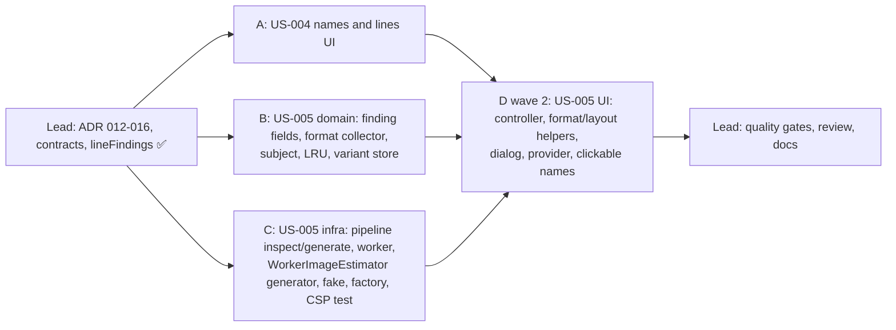

# [TECH-PLAN] US-004 → US-005: Shortened image names, image comparison dialog

- **Input:** [US-004](../stories/US-004.md), [US-005](../stories/US-005.md) (READY FOR TDD, product decisions confirmed by the owner)
- **Decisions:** [ARCH-DECISION-012](ARCH-DECISION-012-on-demand-variant-generation.md) (on-demand variants in the codec worker, amends 009), [013](ARCH-DECISION-013-comparison-subject-from-findings.md) (finding fields, format rule collector, comparison subject, amends 011), [014](ARCH-DECISION-014-session-variant-cache.md) (session cache, LRU 50 MB), [015](ARCH-DECISION-015-image-lines-from-findings.md) (image lines from findings), [016](ARCH-DECISION-016-comparison-dialog-host.md) (app-level dialog, pure controller, object URLs, CSP `blob:`)
- **Branch:** `feat/image-comparison`. Nothing is committed.
- **Baseline:** 35 test files, 416 tests green; `tsc` 0 errors; ESLint 0 errors / 1 known warning; `dist/<target>` 6.2 MB.

## 0. Ground rules for every sub-agent

1. **Stay inside your file ownership** (§2). Do not edit files you don't own, including the contract files in §1. If a contract is wrong or insufficient, **stop and report it**; don't work around it.
2. **Strict TDD.** Write the test, run it, keep the failing (red) output for your report, then implement until green. Run your subset with `npx vitest run <your paths>`, then `npm test` before finishing.
3. **Type-check and lint** your files: `npx tsc --noEmit -p .` and `npx eslint <your paths>`.
4. **No `vi.mock` of project modules.** Inject dependencies and use hand-written fakes (ARCH-DECISION-006). `vi.useFakeTimers()` is fine.
5. **Do not commit, push, or run `npm install`.** No new dependency.
6. **Language:** UI strings in French, **exactly** as written in the stories; code, comments and test names in English. 2-space indent, double quotes. Units: 1 kB = 1 000 bytes ("ko"). Placeholder email `bastienhub@gmail.com`.
7. **No Solid component tests** exist in this project: put every piece of logic (string building, state transitions, layout maths) in a tested `.ts` helper; `.tsx` files are wiring only.
8. **Final report:** files created/modified; tests added with one red-run excerpt per test file; `npx vitest run <your paths>` output; `npm test` tail; limitations; contract issues.

## 1. Contract (owned by the team lead, already written)

| File | Content |
|---|---|
| `src/app/domain/models/image-estimation.ts` | `ImageFinding` gains optional `natural`, `display`, `sourceBytes` (ARCH-DECISION-013) |
| `src/app/domain/models/image-variants.ts` | `ImageVersionId`, `ImageFileInfo`, `ImageFileError`, `ImageFileResult`, port `ImageVariantGenerator`, `ImageVariantStore`, `ComparisonVersion`, `ComparisonSubject` |
| `src/app/domain/image-estimation/policy.ts` | `COMPARISON_CACHE_MAX_BYTES = 50_000_000` |
| `src/app/domain/best-practices/rules/image-rule-helpers.ts` | `lineFindings(findings)`: findings that get a line, in line order (tested; `summariseImageFindings` uses it) |
| `src/app/infra/image-codec/worker-protocol.ts` | `CodecRequest = EstimateRequest \| InspectRequest \| GenerateRequest`, `CodecResponse = EstimateResponse \| FileResponse`, `CodecFileResult` |

`codec.worker.ts` and `worker-image-estimator.ts` were narrowed by the lead to ignore the new message types (marked `TODO(US-005 scope C)`), so the tree type-checks; scope C replaces that.

Contracts introduced by sub-agents, which other agents import **by these exact names**:

```ts
// Scope A: src/app/ui/analysis/image-name.ts
export interface DisplayImageName { short: string; full: string }
export function displayImageName(url: string): DisplayImageName;

// Scope A: src/app/ui/analysis/best-practices-view.ts
export type BestPracticeLine =
  | { kind: "text"; text: string }
  | {
      kind: "image";
      /** Persisted line, used as the dedupe key across pages. */
      text: string;
      ruleId: string;
      url: string;
      name: DisplayImageName;
      /** Text after "<fileLabel> : ", displayed after the name. */
      rest: string;
      finding: ImageFinding;
    };
// AggregatedBestPractice gains `lines: BestPracticeLine[]` (one per offender string, same order and dedupe).

// Scope B: src/app/domain/image-comparison/lru-byte-cache.ts
export interface LruByteCache<V> {
  get(key: string): V | undefined;      // refreshes the position
  set(key: string, value: V): void;     // evicts LRU entries until total ≤ maxBytes; a value > maxBytes is not stored
  delete(key: string): void;
  has(key: string): boolean;
  totalBytes(): number;
}
export function createLruByteCache<V>(maxBytes: number, sizeOf: (value: V) => number): LruByteCache<V>;

// Scope B: src/app/domain/image-comparison/variant-store.ts
export function createImageVariantStore(
  generator: ImageVariantGenerator,
  options?: { maxBytes?: number } // default COMPARISON_CACHE_MAX_BYTES
): ImageVariantStore;

// Scope B: src/app/domain/image-comparison/comparison-subject.ts
export function comparisonSubjectFor(
  bestPractices: readonly BestPractice[],
  ruleId: string,
  url: string
): ComparisonSubject | undefined;
export function hasImageChanged(subject: ComparisonSubject, currentByteLength: number): boolean;
export function referenceOriginalBytes(subject: ComparisonSubject, currentByteLength: number): number;

// Scope C: src/app/infra/image-codec/pipeline.ts
export interface ImagePipeline {
  estimate(request: { job: EstimationJob; source: ImageBytes }): Promise<EstimationOutcome>;
  inspect(request: { declaredType: string; source: ImageBytes }): Promise<FileResult>;
  generate(request: { job: EstimationJob; source: ImageBytes }): Promise<FileResult>;
}
// FileResult = { ok: true; bytes: Uint8Array; info: ImageFileInfo } | { ok: false; reason: SkipReason | FailReason; message?: string }
export function createImagePipeline(codecs: Codecs): ImagePipeline;
export function createEstimationPipeline(codecs: Codecs); // unchanged signature = createImagePipeline(codecs).estimate

// Scope C: src/app/infra/browser-factory.ts
export function getImageEstimator(): Promise<ImageEstimator & ImageVariantGenerator>; // memoised, same instance as today

// Scope D: src/app/ui/analysis/comparison/comparison-context.tsx
export function ImageComparisonProvider(props: { store: ImageVariantStore; children: JSX.Element }): JSX.Element;
export function useImageComparison(): { open(subject: ComparisonSubject, trigger: HTMLElement): void };
```

## 2. Scopes

### Delivery waves



Wave 1 (A, B, C) has disjoint file sets. **US-004 is delivered entirely by A** and does not depend on B or C. Wave 2 (D) needs all three.

---

### 2.A Scope A: US-004 shortened names and image lines (UI)

**Owns:** creates `src/app/ui/analysis/image-name.ts`, `image-name.test.ts`, `src/app/ui/analysis/ImageName.tsx`; edits `src/app/ui/analysis/best-practices-view.ts`, `best-practices-view.test.ts`, `src/app/ui/analysis/BestPractices.tsx`.

**Design** (ARCH-DECISION-015).

- `displayImageName(url): { short, full }` (US-004 §2, pure, O(n)):
  1. `new URL(url)`; on failure, treat the input as a path (strip `?…` and `#…`). File name = last non-empty path segment, `decodeURIComponent` (raw segment if it throws). No segment → `hostname` (no port).
  2. Extension: after the **last** dot, if that dot is not the first character and the part matches `/^[\p{L}\p{N}]{1,5}$/u`. Case kept. Stem = the rest.
  3. Count **characters as user-perceived characters**: split into code points (`Array.from`), then glue to the previous character: combining marks (`\p{M}`), ZWJ (U+200D) and the code point after it, variation selectors (U+FE00–U+FE0F), emoji modifiers (U+1F3FB–U+1F3FF), tag characters (U+E0020–U+E007F); and pair regional indicators (U+1F1E6–U+1F1FF) two by two. Do **not** use `Intl.Segmenter` (missing in Firefox < 125). For names without such sequences this is exactly a code-point count (see deviation L1).
  4. Stem ≤ 24 characters → `short = full`. Else `short = first 12 + "..." + last 12 + ("." + ext if any)`.
  5. `full` = the decoded file name (or host).
- `best-practices-view.ts`: `AggregatedBestPractice.lines: BestPracticeLine[]`, built in `aggregateBestPractices` next to `offenders` (same order, same dedupe by persisted string). For a `BestPractice` with `images`: zip `bp.offenders[i]` with `lineFindings(bp.images)[i]`; keep an `image` line only if the string starts with `` `${fileLabel(finding.url)} : ` `` (`fileLabel` from `image-rule-helpers.ts`); `rest` = the string after that prefix. Everything else (no `images`, mismatch, the "… et N autres images" line, other rules) → `{ kind: "text", text }`.
- `ImageName.tsx`: `<span class="whitespace-nowrap" title={full}><span aria-hidden="true">{short}</span><span class="sr-only">{full}</span></span>`. Must be easy to render as a `<button type="button">` later with the same inner content and no layout change (US-005).
- `BestPractices.tsx`: render `item.lines` instead of `item.offenders`: text lines exactly as today; image lines as `<ImageName/>` + `" : "` + `rest`. Keep `break-all` for the rest only; the name never wraps.

**Required tests.**

| Test | Story scenario |
|---|---|
| Every row of the US-004 §2 table (8 rows) gives the expected `short`; `full` is the decoded name | US-004 S1, S2, S4, S5, S7 |
| `https://cdn.example.org/img/962c01_upload-1-c02rkcjxsn76-frame-1-22.jpeg` → short `962c01_uploa...6-frame-1-22.jpeg`, full `962c01_upload-1-c02rkcjxsn76-frame-1-22.jpeg` | S1 |
| `https://example.org/photo.jpg?v=3` → short = full = `photo.jpg` (query dropped) | S2 |
| Stem of 24 + `.png` kept; stem of 25 → 12 + `...` + 12 + `.png` | S3 |
| `bad%E0%A4%A.jpg` → raw segment, no throw | S6 |
| `https://cdn.example.org/?id=3` and `https://cdn.example.org:8443/` → `cdn.example.org` | S7 |
| Emoji: a flag (2 regional indicators) and a ZWJ family at characters 12–13, and an accented `e` + U+0301: never split (assert the short name contains the whole sequence or none of its code points) | S8 |
| Extension rules: `.htaccess` (leading dot) and `file.toolongext` have no extension; `IMG.JPG` keeps its case | §2 |
| `aggregateBestPractices` builds image lines from findings (name, rest) for both image rules; a rule without `images` and the "… et N autres images" line stay text lines; a prefix mismatch falls back to text; lines are deduped across pages like `offenders` | S9, §2 "Where it applies" |
| A 300-line rule builds its lines quickly (sanity, e.g. under 50 ms) | NFR performance |

**Done when:** your tests pass, `tsc` and ESLint are clean for your files, `npm test` is green.

---

### 2.B Scope B: US-005 domain (finding fields, format rule collector, comparison subject, cache, store)

**Owns:** edits `src/app/domain/best-practices/rules/image-rule-helpers.ts` (only `findingFromState`; do not change `lineFindings` or the line wording), `dont-resize-images.rule.ts`, `optimised-formats.rule.ts`, their tests, `src/app/domain/best-practices/rules-registry.test.ts`, `src/app/domain/best-practices/testing/image-fixtures.ts`; creates `src/app/domain/image-comparison/` (`lru-byte-cache.ts`, `variant-store.ts`, `comparison-subject.ts` and tests, plus a `testing/fake-variant-generator.ts` if useful). May adjust `src/app/domain/use-case/*.test.ts` **only** if the new format collector breaks an expectation there (report it).

**Design** (ARCH-DECISION-013, 014).

- `findingFromState`: when `estimated`, also set `sourceBytes = outcome.sourceBytes` and `natural = { width: outcome.width, height: outcome.height }` unless `base` already has `natural`.
- Resize rule: findings carry `natural` (candidate natural size) and `display` (candidate box, rounded to integers? **No:** keep the CSS values as collected) for every oversized finding, whatever its state.
- Format rule: add a self-contained `collect()` returning `{ images: Array<{ src: string; displayWidth: number; displayHeight: number }> }` (every ``, `currentSrc || src`, `getBoundingClientRect()`). In `evaluate`, `display` = the largest box (by area) among the collected images whose `normaliseImageUrl(src)` equals the finding URL, `{ width: 0, height: 0 }` when none; `display` absent when `page` is undefined. Scope, grade, lines and estimations are unchanged. `estimations` must not depend on `page`.
- `comparison-subject.ts` (ARCH-DECISION-013):
  - finds the `RESIZE_IMAGES_RULE_ID` and `OPTIMISED_FORMATS_RULE_ID` findings of `url` (compare with `normaliseImageUrl`); returns `undefined` unless the finding of `ruleId` exists and `classifyFinding(f) === "offender"`;
  - versions: `original` ("Originale"); resize offender → `resized` ("Redimensionnée", job `{ url, declaredType: r.declaredType, transform: { kind: "resize", ...r.target } }`, `estimatedBytes: r.estimatedBytes`); format offender → `converted` (label `encodingLabel(f.encoding)`, job `convert`, `estimatedBytes: f.estimatedBytes`); both offenders (resize with a `target`) → `both` ("Les deux", job identical to `planCombinedEstimations`: `resize-convert` at `r.target`, `declaredType: r.declaredType || f.declaredType`). A rule's version appears only when that rule's finding is an offender;
  - `recordedBytes` / `recordedSourceBytes` / `declaredType` from the clicked rule's finding; `natural` = first defined of resize, format; `display` = resize's if defined, else format's.
  - `hasImageChanged`, `referenceOriginalBytes`: exactly as in ARCH-DECISION-013 §"Image changed".
- `lru-byte-cache.ts`: `Map` insertion order as recency; `sizeOf` per value; see the contract.
- `variant-store.ts`: see ARCH-DECISION-014. Cache keys: `original:<url>` and `variant:<estimationKey(job)>` in one LRU (sizes = `bytes.byteLength` of loaded results). In-flight maps for both kinds; a variant waits for `original(job.url, job.declaredType)`; original `error` → `{ status: "error", error: "original-unavailable" }` without calling `generate`. Never cache errors. `generate` / `loadOriginal` rejecting (contract violation) → treated as `generation-failed` / `original-unavailable`.

**Required tests.**

| Test | Story scenario |
|---|---|
| Resize rule findings carry `natural` 1200×800 and `display` 300×200 for an image shown at 300×200 on a 2x screen; estimated findings carry `sourceBytes` | US-005 S1, §3 hints |
| Format rule: `collect` is self-contained (registry test), `display` is the largest box of the URL, `{0,0}` for an image not in any ``, absent when `page` is undefined; grade/lines unchanged (existing tests stay green) | S6 |
| Registry test updated: the format rule now has a collector | — |
| Subject from the resize list: versions Originale / Redimensionnée with the resize job | S1 |
| Subject from the format list (JPEG): Originale / AVIF; PNG: Originale / WebP sans perte | S2 |
| Double offender, opened from either list: Originale / Redimensionnée / AVIF / Les deux; `estimationKey(both.job)` equals the key of `planCombinedEstimations` for the same page | S3, S4 |
| Non-offender (pending, failed, under the noise threshold, skipped) → `undefined` | S12 |
| `hasImageChanged`: 240 000 recorded / 180 000 now → true; same `sourceBytes` → false; legacy without `sourceBytes`: 240 300 recorded vs 240 000 → false, vs 180 000 → true; `referenceOriginalBytes` accordingly | S11 |
| LRU: eviction order, `get` refreshes, oversize value not stored, `totalBytes`, overwrite of a key | §3 cache, NFR sobriety |
| Store: second `variant(job)` is served from the cache without calling `generate` again | S8 |
| Store: two concurrent calls share one `generate`; a call whose caller "went away" still fills the cache | S14, S15 |
| Store: original failure → every variant `original-unavailable`, `generate` not called; original fetched once for several variants | S9, S7 |
| Store: `generate` error not cached, the next call retries and succeeds | S10 |
| Store: with a small `maxBytes`, the LRU evicts and an evicted original is reloaded on the next variant | NFR sobriety |
| `peekOriginal` / `peekVariant` return loaded entries only | S8 |

**Done when:** your tests pass, `tsc`/ESLint clean, `npm test` green.

---

### 2.C Scope C: US-005 infra (pipeline, worker, generator adapter, fake, factory, CSP test)

**Owns:** edits `src/app/infra/image-codec/pipeline.ts`, `pipeline.test.ts`, `codec.worker.ts`, `src/app/infra/image-estimator/worker-image-estimator.ts`, `worker-image-estimator.test.ts`, `fake-image-estimator.ts`, `fake-image-estimator.test.ts`, `src/app/infra/browser-factory.ts`, `browser-factory.test.ts`, `scripts/manifest.test.mjs`. May add helpers under `src/app/infra/image-codec/testing/`. Must not change `worker-protocol.ts` (contract) nor the estimation behaviour.

**Design** (ARCH-DECISION-012).

- `pipeline.ts`: refactor into `createImagePipeline(codecs)` with a shared private core used by `estimate` and `generate`, so both run **the same** detection, caps, encoding choice, decode cache, resize and encode. `estimate` returns exactly today's outcomes (all existing tests unchanged). `generate` returns `{ ok: true, bytes: encoded, info }` with `info = { format: target.format, lossless: target.format === "webp" ? target.lossless : undefined, width/height: the encoded pixel size (after resize), byteLength: encoded.length, mimeType }`, or `{ ok: false, reason }` for any non-`estimated` outcome. `inspect` decodes the source (base64 or binary), detects the format like `estimate` (`detectImageFormat(declaredType, head)`), reads dimensions (`readDimensions`, else decode through the shared decode cache for codec formats), `lossless` for WebP (`isLosslessWebp`), and returns the original bytes with `info`; unknown/non-image → `{ ok: false, reason: "not-an-image" | "unsupported-format" }`; too large → `too-large`; never rejects. MIME map: jpeg `image/jpeg`, png `image/png`, webp `image/webp`, avif `image/avif` (others: `image/<format>`, svg `image/svg+xml`).
- `codec.worker.ts`: route by `type`; `inspect`/`generate` answer `{ type: "file", id, result }` and **transfer** the result buffer (slice it first if `bytes.byteOffset !== 0 || bytes.byteLength !== bytes.buffer.byteLength`). Remove the lead's TODO narrowing.
- `WorkerImageEstimator` implements `ImageVariantGenerator` too:
  - `loadOriginal(url, declaredType)`: `getBytes(url)`; `ok: false` → `{ status: "error", error: "original-unavailable", message }` without posting; else post `inspect` (transfer binary sources) → `ok` → `{ status: "loaded", bytes: new Uint8Array(result.bytes), info }`, else `original-unavailable`.
  - `generate(job, original)`: post `generate` with `{ kind: "binary", data: original.slice().buffer }` (a copy, transferred); `ok` → `loaded`, else `generation-failed`.
  - Same worker, lazy creation, id sequence, timeout (120 s → error), `onerror` recycling, and `cancel()` (in-flight dialog requests settle as errors: `original-unavailable` for inspect, `generation-failed` for generate). Route `"file"` responses to their entries; `"result"` responses as today. Never rejects.
- `FakeImageEstimator` implements `ImageVariantGenerator` for `npm run dev`: returns small synthetic images (an SVG with the requested size is fine: `format: "svg"`, `mimeType: "image/svg+xml"`), `loadOriginal` 1000×1000 / 100 000 bytes info, `generate` the job's target size (`resize` / `resize-convert`) or 1000×1000, 40 000 bytes info. No worker, no WASM, no network.
- `browser-factory.ts`: `getImageEstimator()` returns `Promise<ImageEstimator & ImageVariantGenerator>` (same memoised instance).
- `scripts/manifest.test.mjs`: assert, for both targets, that `content_security_policy.extension_pages` contains no `img-src` and no `default-src` directive (blob: images allowed, ARCH-DECISION-016).

**Required tests.**

| Test | Story scenario |
|---|---|
| Pipeline (real WASM, synthetic images): for JPEG `resize`, JPEG `convert` (AVIF), PNG `convert` (WebP lossless) and JPEG `resize-convert`, `generate(...).info.byteLength === estimate(...).encodedBytes` for the same source | S4, S1, S2, S3 |
| Pipeline: `generate` info: format/lossless/size of the output (resize → target size; convert → natural size); the bytes start with the right signature (`sniffImageFormat`) | S1, S2 |
| Pipeline: `inspect` of a base64 and of a binary JPEG/PNG → bytes equal to the input, format, width/height, mimeType; lossless WebP flagged; HTML bytes with a generic type → `not-an-image`; > `MAX_IMAGE_BYTES` → `too-large` | S1, S7 |
| Pipeline (fake codecs): `generate` with an encode failure → `{ ok: false, reason: "encode-failed" }`; `estimate` and `generate` of the same URL decode once | S10 |
| Existing pipeline and codec tests unchanged and green | regression |
| Worker estimator (fake `WorkerLike`): `loadOriginal` with `getBytes` failure → `original-unavailable`, nothing posted | S9 |
| Worker estimator: `loadOriginal` posts `inspect` (binary source transferred), a `file` response resolves `loaded` with the bytes and info | S7 |
| Worker estimator: `generate` posts a **copy** (the caller's `Uint8Array` keeps its bytes and is not the posted buffer), resolves `loaded`; `ok: false` → `generation-failed` | S10, S8 |
| Worker estimator: an estimation and a generation in flight on the same worker are answered independently (out-of-order responses) | NFR "never delays the queue" |
| Worker estimator: generation timeout → `generation-failed` and worker recycled; `cancel()` settles dialog requests with errors | S10 |
| Fake estimator: implements both ports, deterministic sizes | dev |
| Factory: outside the extension, `getImageEstimator()` resolves an object with `estimate`, `loadOriginal`, `generate` | — |
| Manifests: no `img-src` / `default-src` in the extension pages CSP of both targets | ARCH-DECISION-016 |

**Done when:** your tests pass; `tsc`/ESLint clean; `npm test` green; `npm run build` succeeds and the worker chunk in `dist/chrome/assets/` is still an IIFE without `import.meta`.

---

### 2.D Scope D (wave 2): US-005 UI (controller, helpers, dialog, provider, clickable names)

**Owns:** creates `src/app/ui/analysis/comparison/` (`comparison-format.ts`, `comparison-layout.ts`, `comparison-controller.ts` and their tests, `ComparisonDialog.tsx`, `comparison-context.tsx`); edits `src/app/ui/analysis/best-practices-view.ts` (+ test), `ImageName.tsx`, `BestPractices.tsx`, `src/app/index.tsx`, `src/app/index.css` (only if a style is needed).

**Design** (ARCH-DECISION-016).

- `best-practices-view.ts`: image lines gain `comparison?: ComparisonSubject`, set with `comparisonSubjectFor(page.bestPractices, bp.id, finding.url)` for the page the line comes from (undefined for non-offenders).
- `ImageName.tsx`: when the line has a `comparison`, render the same content in a `<button type="button" aria-haspopup="dialog" data-comparison-key={ruleId + "|" + url}>` (no layout change: reset button styles, `whitespace-nowrap`, underline on hover/focus), which calls `useImageComparison().open(subject, event.currentTarget)`. Otherwise the US-004 `<span>` (S12).
- `comparison-format.ts` (pure): `formatResolution(w, h)` → `"1200 × 800 px"` (no thousands separator); size → `formatKo` (`"240 ko"`); `formatFileFormat(info)` → `JPEG`, `PNG`, `WebP`, `WebP sans perte`, `AVIF` (other formats: upper case); `formatGain(referenceBytes, variantBytes)` → `"−144 ko (−60 %)"` with U+2212, percent rounded on the reference; a negative gain shows `"+3 ko (+2 %)"`, zero `"0 ko (0 %)"`; `versionAlt(version, info, fullName)` → `"Version AVIF de photo.jpg, 1200 × 800 px, 96 ko"` (labels: `originale`, `redimensionnée`, the format label for `converted`, `redimensionnée et convertie en <format>` for `both`); messages: loading `"Chargement de l'image originale…"` (original) / `"Génération de la version optimisée…"` (variants); errors `original-unavailable` → `"Image originale indisponible."`, `generation-failed` → `"La version optimisée n'a pas pu être générée."`, `display-failed` → `"Votre navigateur ne peut pas afficher ce format."`; notice `"L'image a changé depuis l'analyse : les tailles affichées peuvent différer de l'estimation."`; `"Réessayer"`, `"Fermer"`, `"Même taille que sur la page"`, `"Taille réelle"`, `"Image non affichée sur la page"`.
- `comparison-layout.ts` (pure): `isDisplayed(subject)` (display defined and both sides > 0); `initialMode(subject)` → `"page"` or `"native"`; `pageBox(display, maxWidth)` → the display box, scaled proportionally when wider than `maxWidth`; `nativeCssSize({ width, height }, devicePixelRatio)` → natural ÷ dpr (dpr ≤ 0 → 1).
- `comparison-controller.ts` (pure, no DOM): 
  ```ts
  type VersionState =
    | { status: "idle" } | { status: "loading" }
    | { status: "loaded"; objectUrl: string; info: ImageFileInfo }
    | { status: "error"; error: ImageFileError | "display-failed"; message?: string };
  interface ComparisonState {
    open: boolean; subject?: ComparisonSubject; selected: ImageVersionId;
    mode: "page" | "native"; versions: Partial<Record<ImageVersionId, VersionState>>;
    /** Set once the original is loaded. */
    changed: boolean; referenceBytes?: number;
  }
  createComparisonController(deps: { store: ImageVariantStore; objectUrls: { create(bytes: Uint8Array, mimeType: string): string; revoke(url: string): void } }):
    { state(): ComparisonState; subscribe(listener: (s: ComparisonState) => void): () => void;
      open(subject): void; select(id): void; retry(id): void; setNativeSize(on: boolean): void;
      displayFailed(id): void; close(): void }
  ```
  - `open`: ignored while open (S15); selects `original`, mode `initialMode`, loads the original (peek first: cached → `loaded` synchronously, S8).
  - `select(id)`: sets `selected`; an `idle` version starts loading (peek first); a `loading`/`loaded`/`error` version is left as is (the toggle stays usable while loading).
  - Original loaded → `changed = hasImageChanged`, `referenceBytes = referenceOriginalBytes` (S11). Original error → only the original's state (variants get `original-unavailable` from the store when selected, S9).
  - `retry(id)`: only that version, `error` → `loading` → store again (S10). For `display-failed`, re-create the object URL from the store (peek, else reload).
  - `setNativeSize(false)` is ignored when the image is not displayed (S6).
  - Results arriving after `close()` or for an earlier opening are ignored and create no object URL (S14). `close()` revokes every object URL created during the opening and resets the state.
- `comparison-context.tsx` + `ComparisonDialog.tsx` (wiring only): one native `<dialog>` for the app (`showModal()`, `aria-labelledby` on the title `<h2>` = short name with `title` = full name, then the full URL as selectable, wrapping text, never truncated); close button "Fermer", Escape (`cancel` event), backdrop click (click whose target is the `<dialog>` itself) → `controller.close()`, then focus back to the trigger (or `[data-comparison-key="…"]` if the trigger was detached). Toggle: `<fieldset role="radiogroup">` of native radio inputs (arrow keys) with the version labels. "Taille réelle": checkbox with visible label; checked and disabled with the hint when not displayed. Image area: `overflow: auto`, `max-height` ~60vh; page mode draws every version in the same `pageBox` (`width`/`height` style); native mode draws at `nativeCssSize(info, window.devicePixelRatio)`; keep `scrollLeft`/`scrollTop` across toggles (store them before switching and restore on the new image's `load`). Loading: `<p role="status">`; error: `<div role="alert">` + "Réessayer". `` → `controller.displayFailed`. Info block for the selected loaded version: resolution, size (original: `referenceBytes`; variants: `info.byteLength`), format, and for variants the gain against `referenceBytes`. Notice when `changed`.
- `src/app/index.tsx`: `const store = createImageVariantStore(estimator)`; wrap `<App/>` in `<ImageComparisonProvider store={store}>` inside the existing providers.

**Required tests** (all on the pure helpers and the controller, with a fake `ImageVariantStore` built on deferreds and a fake `objectUrls` counting create/revoke).

| Test | Story scenario |
|---|---|
| `best-practices-view`: offender image lines carry a `comparison` subject; non-offender lines and text lines don't | S12 |
| Format helpers: `"1200 × 800 px"`, `"240 ko"`, `"JPEG"`, `"WebP sans perte"`, `"AVIF"`, gain `"−144 ko (−60 %)"` (240 000 → 96 000), negative and zero gains, alt `"Version AVIF de photo.jpg, 1200 × 800 px, 96 ko"`, all messages verbatim | S1, S2, §5 a11y |
| Layout: display 300×200 → box 300×200; display 900×600 with `maxWidth` 450 → 450×300; native 1200×800 at dpr 2 → 600×400, 600×400 → 300×200; dpr 0 → 1; 0×0 or undefined display → mode `native` | S1, S5, S6 |
| Controller: open → original selected and loading, then loaded with info; select "resized" → loading then loaded; the toggle is usable while loading (select original again shows its state) | S1, S2 |
| Controller: double `open` → one opening (one original request) | S15 |
| Controller: cached variant (peek) → loaded synchronously, no store call | S8 |
| Controller: original error → original `original-unavailable`; selecting a variant shows the error returned by the store | S9 |
| Controller: variant `generation-failed` → retry only that version → loaded; original unaffected | S10 |
| Controller: `changed` and `referenceBytes` from the loaded original (180 kB vs 240 kB recorded) | S11 |
| Controller: `displayFailed` → `display-failed`; retry re-creates an object URL | §2 errors |
| Controller: close during a generation → no error, no object URL created by the late result, every created URL revoked once; reopen → cached version | S13, S14, NFR |
| Controller: not-displayed subject opens in `native`, `setNativeSize(false)` ignored | S6 |

**Done when:** your tests pass; `tsc`/ESLint clean; `npm test` green; `npm run build` succeeds.

## 3. Decisions and deviations (lead)

| Id | Topic | Decision |
|---|---|---|
| L1 | US-004 "characters are code points" vs scenario 8 (an emoji made of 2 code points at positions 12–13 must not be split) | **Deviation.** Characters are counted as user-perceived characters: code points, with combining marks, ZWJ sequences, variation selectors, skin-tone modifiers, tags and regional-indicator pairs glued to their base. For any name without such sequences this is exactly the code-point count of the story. `Intl.Segmenter` is not used (Firefox < 125). |
| L2 | Display box for the format rule | The format rule gets a page collector (ARCH-DECISION-013). One more `executeScript` per collection. |
| L3 | Findings without display box (saved before US-005, or page not inspected) | Treated as "not displayed": the dialog opens in "Taille réelle" with the hint "Image non affichée sur la page". |
| L4 | Original size and gains shown in the dialog | Against the weight recorded in the analysis while the image is unchanged (same figures as the best-practice line), against the current bytes when it changed (S11). |
| L5 | "Image changed" for findings without `sourceBytes` | Tolerance `max(2 000 bytes, 2 %)` against the recorded weight, which may include headers. |
| L6 | Analysis stopped while a dialog generation runs (only possible after closing the modal) | The worker is terminated as before; that generation fails and is not cached. Reopening regenerates. |
| L7 | Alt texts for versions other than the story's AVIF example | `Version originale de …`, `Version redimensionnée de …`, `Version <format> de …`, `Version redimensionnée et convertie en <format> de …`. |
| L8 | `Les deux` estimated size | Not persisted per image (US-003 persists only the page sum); the dialog shows the generated size and its gain. Equality with the combined estimate is guaranteed by construction (same job key, same pipeline, tested). |
| L9 | Negative gain (variant larger) | Shown as `+X ko (+Y %)`; cannot happen for the clicked rule's variant (offender ⇒ gain ≥ 10 kB). |

## 4. Manual checks (owner, real browsers)

1. Chrome ≥ 103 and Firefox ≥ 109: long names are shortened with the full name on hover and read by a screen reader.
2. Click an offender of each rule and a double offender: toggle, info, gain; "Taille réelle" on a 2x screen; scroll kept when toggling; Escape, backdrop, close button, focus return.
3. AVIF and WebP display from `blob:` URLs, no CSP error in the panel console, in both browsers.
4. Saved analysis in a new DevTools session: the original is re-downloaded and the variants generated; a 404 image shows the error with "Réessayer".
5. Reopen: instant. Close during "Les deux" generation, reopen after a few seconds: instant.
6. Panel stays responsive while generating (worker), and a recording in progress keeps estimating.
