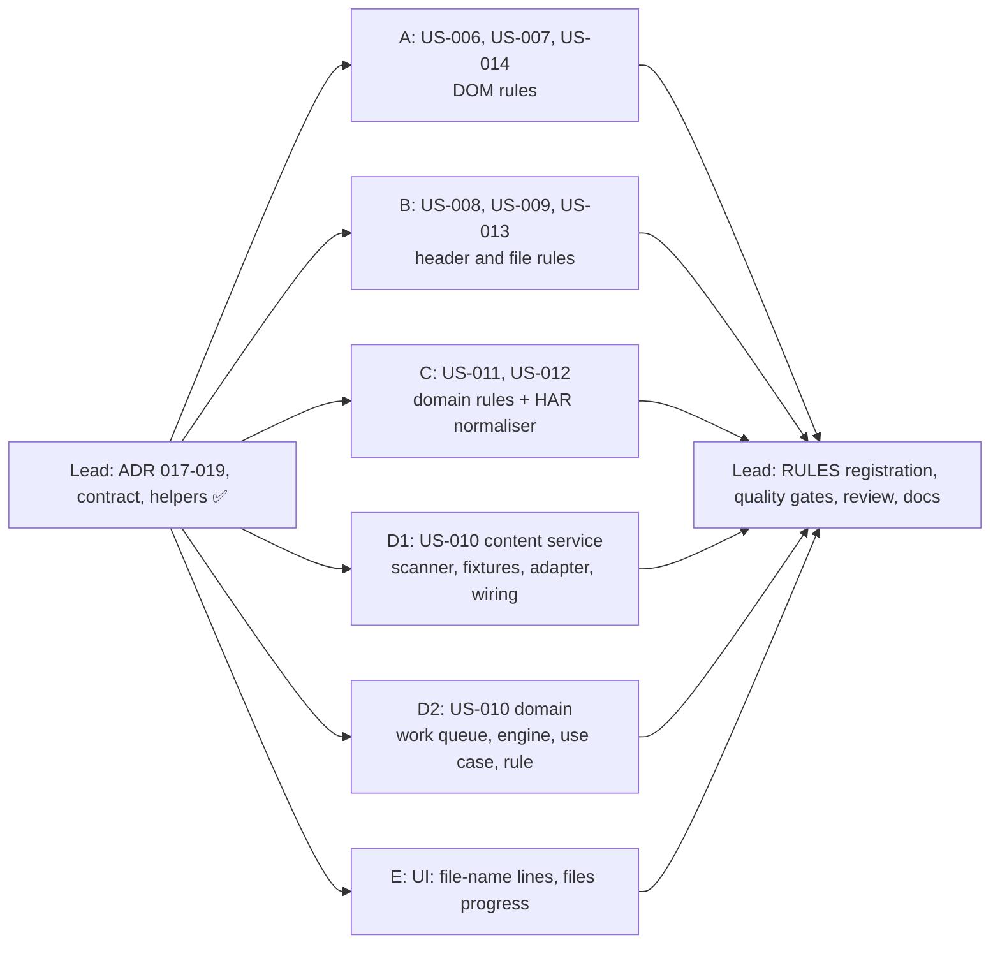

# [TECH-PLAN] US-006 → US-014: Epic BP2, nine new best practices

- **Input:** [EPIC-BP2-conventions](../stories/EPIC-BP2-conventions.md), [US-006](../stories/US-006.md) … [US-014](../stories/US-014.md) (READY FOR TDD).
- **Decisions:**
  - [ARCH-DECISION-017](ARCH-DECISION-017-line-refs-for-file-names.md): `lineRefs`, display names for non-image rules; amends 015.
  - [018](ARCH-DECISION-018-text-content-analysis.md): text content analysis, generic queue, `ContentAnalyser` port; amends 004 and 007.
  - [019](ARCH-DECISION-019-request-model-protocol-and-start-time.md): `httpVersion` and `startedAt` on `NetworkRequest`.
- **Branch:** `feat/best-practices-bp2`, from `feat/image-comparison` (7b4e35a). Nothing is committed.
- **Baseline:** 42 test files, 594 tests green; `tsc` 0 errors; ESLint 0 errors / 1 known warning (`browser-context.tsx`).
  - After the lead contract wave: 44 files, 647 tests green.

## 0. Ground rules for every sub-agent

1. **Stay inside your file ownership** (§3). Do not edit files you don't own, including the contract files of §1 and `best-practices/index.ts` / `rules-registry.test.ts` (the lead registers the rules at integration). If a contract is wrong or insufficient, **stop and report it**; don't work around it.
2. **Strict TDD.** Write the test, run it, keep the failing (red) output for your report, then implement until green. Run your subset with `npx vitest run <your paths>`.
   - Other agents work in the same tree at the same time. A failure of `npm test` in a file you don't own is reported, not fixed.
3. **Type-check and lint:** `npx tsc --noEmit` and `npx eslint <your paths>`. `src/app/domain` must not import `infra/` or `ui/`, nor use `chrome`/`browser`.
4. **No `vi.mock` of project modules.** Inject dependencies and use hand-written fakes (ARCH-DECISION-006). `vi.useFakeTimers()` is fine.
5. **Do not commit, push, stash, checkout or run `npm install`.** No new dependency. No git command that changes state.
6. **Language and wording:**
   - UI strings in French, **exactly** as written in the stories and in §2.
   - Code, comments and test names in English. 2-space indent, double quotes.
   - 1 kB = 1 000 bytes: use `formatKo` (`image-rule-helpers.ts`) for "250 ko" and `formatCount` (`rule-lines.ts`) for "1 500 px". Both use `toLocaleString("fr-FR")`, whose grouping separator is U+202F. Tests compare against the helper or `"1 500"`.
   - The space before "%" is a regular space ("6 %"), as in the stories.
   - Placeholder email `bastienhub@gmail.com`.
7. **No Solid component tests** exist in this project. Put every piece of logic in a tested `.ts` helper; `.tsx` files are wiring only.
8. **Rules** (CLAUDE.md "Adding a best practice"): one file per rule in `src/app/domain/best-practices/rules/`, and a `*.rule.test.ts` covering **every Gherkin scenario of the story** (name the test after the scenario number), the grade boundaries and the line order.
   - A rule with `collect()` also tests, in its own test file, that the collector is self-contained: `new Function("return (" + rule.collect.toString() + ")")()` runs without throwing in jsdom, and its result survives `JSON.parse(JSON.stringify(…))`.
   - The lead adds the line to `RULES` and to the registry test.
9. **Final report:**
   - files created and modified;
   - tests added, with one red-run excerpt per test file;
   - the `npx vitest run <your paths>` output, and the `npm test` tail;
   - the decisions you had to take, the limitations, and any contract issue.

## 1. Contract (owned by the team lead, already written and tested)

| File | Content |
|---|---|
| `domain/models/network-request.ts` | `HttpVersion`; `NetworkRequest.httpVersion?`, `startedAt?` (epoch ms) (019) |
| `domain/models/best-practice.ts` | `LineRef { url; prefix? }`; `BestPractice.lineRefs?: (LineRef \| null)[]` (017) |
| `domain/models/image-estimation.ts` | `EstimationProgress.unit?: "images" \| "files"` (018) |
| `domain/models/text-content.ts` | `TextFileType` (`"HTML" \| "CSS" \| "JS" \| "SVG"`), `ContentJob`, `ContentOutcome`, `ContentState`, `ContentLookup`, `contentKey`, `UNAVAILABLE_CONTENTS`, `removableShare` (018) |
| `domain/models/content-analyser.ts` | port `ContentAnalyser { analyse(job); cancel?() }` (018) |
| `domain/text-content/policy.ts` | `MIN_TEXT_FILE_BYTES` 1 000, `MAX_CONTENT_BYTES` 5 000 000, `MINIFIED_MAX_REMOVABLE_SHARE` 0.05 |
| `domain/best-practices/rule.ts` | `RuleResult.lineRefs?`; `RuleContext.contents?`; `BestPracticeRule.contentAnalyses?(ctx): ContentJob[]` |
| `domain/best-practices/engine.ts` | copies `lineRefs`; passes `contents` (default `UNAVAILABLE_CONTENTS`). **`planContentAnalyses` is scope D2's.** |
| `domain/best-practices/rules/rule-lines.ts` | `RuleLine`, `fileLine(url, rest, prefix?)`, `capLines(lines)` → `{ offenders, lineRefs? }` (20 + "… et N autres"), `plural(n, sing, plur)` (singular for 0 and 1), `formatCount(n)` |
| `domain/best-practices/rules/request-helpers.ts` | `isSuccess2xx`, `isGenericMime`, `pathExtension(url)`, `JAVASCRIPT_MIME_TYPES`, `textFileType(request)` (US-008 §2), `hostOf(url)` (US-011), `contentTypeCharset(request)`, `lastRequestPerUrl(requests, keep)` |
| `domain/use-case/analyse-web-flow.ts` | `WebFlowAnalysisOptions.contentAnalyser?: ContentAnalyser`, declared only; scope D2 wires it |

Reused as is: `fileLabel`, `formatKo` (`image-rule-helpers.ts`), `normaliseImageUrl` (`image-requests.ts`), `GENERIC_MIME_TYPES`, `MAX_OFFENDER_LINES` (`policy.ts`), `displayImageName` and `ImageName`.

## 2. Product decisions taken by the lead (confirmed by the owner on 2026-10-20)

1. **Wording.** Counts use real French agreement, never "(s)": singular for 0 and 1 (`plural`). B/C details not given by the stories:

   | Rule | Detail |
   |---|---|
   | US-006 C | `"<n> contenu(s) multimédia(s) sans alternative textuelle"`, then `", <m> alternative(s) vide(s) à vérifier"` if m > 0. Example: "2 contenus multimédias sans alternative textuelle, 1 alternative vide à vérifier" |
   | US-006 B | "1 alternative vide à vérifier" / "3 alternatives vides à vérifier" |
   | US-007 B/C | "1 image ou iframe hors de l'écran initial chargée immédiatement" / "3 images ou iframes hors de l'écran initial chargées immédiatement" |
   | US-008 B/C | "2 fichiers textuels non compressés, 1 en compression faible (deflate)"; B only: "1 fichier textuel en compression faible (deflate)"; C without deflate: "1 fichier textuel non compressé" |
   | US-009 B/C | "2 fichiers statiques sur 5 ne peuvent pas être mis en cache" / "1 fichier statique sur 5 ne peut pas être mis en cache" |
   | US-010 A | "Tous les fichiers CSS, JavaScript, HTML et SVG sont minifiés"; none in scope: "Aucun fichier CSS, JavaScript, HTML ou SVG à vérifier" |
   | US-010 B/C | "2 fichiers sur 5 non minifiés" (5 = evaluated files) |
   | US-010 suffix | " (2 fichiers non évalués)" / " (1 fichier non évalué)" appended to any graded detail when some files were not evaluated |
   | US-014 B/C | "1 vidéo ou son lancé ou préchargé automatiquement" / "3 vidéos ou sons lancés ou préchargés automatiquement" |

2. **Aggregated view:** per-page lines are kept and deduplicated by text (existing behaviour). In a saved analysis, a domain of US-011/012 may appear once per page with different counts. A follow-up story will be raised.
3. **Line order when there is no size** (DOM rules): by URL (`localeCompare`), then document order. US-006 puts missing before empty; US-007 sorts by distance from the top.
4. **One file per URL:** request rules deduplicate by URL without fragment, keeping the last qualifying request (`lastRequestPerUrl`).
5. **Tracking pixel** (US-006, US-007): an `` that is `complete` with `0 < naturalWidth ≤ 1` and `naturalHeight ≤ 1`, **or** whose `width` and `height` attributes are both present and ≤ 1. An image not loaded yet (`naturalWidth` 0) is **not** a tracking pixel.
6. **US-009:**
   - `Cache-Control` present with no decisive directive (e.g. `private` alone) and no usable `Expires` → reason "Cache-Control sans durée de cache".
   - `Expires` is valid only as an HTTP-date (IMF-fixdate, RFC 850 or asctime). `0`, numbers and other strings are "Expires invalide".
   - Reference time: the `Date` header, else `startedAt`, else (legacy only) compliant.
7. **US-012:** a share of 0 < p < 0.5 % is shown as "< 1 %". Ties on a domain's most frequent version go to "1.1".
8. **US-013:** the size shown is the transferred size, or the decoded size when the GIF came from the cache (transfer size 0), so the same GIF shows the same weight on every page (as US-001).
9. **US-010:**
   - Files not evaluated are listed after the offenders as `<name> (<type>, <size>) : non évalué (<raison>)`, as the image rules do. Reasons: "contenu non disponible", "fichier trop volumineux", "analyse arrêtée", "échec de l'analyse", "analyse indisponible".
   - When none could be evaluated: "Non évaluée", detail "Contenu des fichiers non disponible".
10. **US-008:** an unknown `content-encoding` counts as compressed, and the detail gets the suffix ` (encodage non reconnu considéré comme compressé : <valeurs distinctes, séparées par ", ">)`.
11. **US-011:** a page without any request is A with the detail "Aucune ressource chargée par la page". Every request counts, whatever its status.

## 3. Scopes

### Delivery waves

Every scope has a disjoint file set and depends only on §1, so all six run in parallel.

---

### 3.A Scope A: DOM rules (US-006, US-007, US-014)

**Owns** (creates), in `src/app/domain/best-practices/rules/`:
- `provide-text-alternatives.rule.ts` and its test;
- `use-lazy-loading.rule.ts` and its test;
- `avoid-media-autoplay.rule.ts` and its test.

**Metadata:**
- `ProvideTextAlternatives`, "Fournir une alternative textuelle aux contenus multimédias", `content`.
- `UseLazyLoading`, "Utiliser le chargement paresseux", `images`.
- `AvoidMediaAutoplay`, "Éviter la lecture et le chargement automatique des vidéos et des sons", `content`.

**Design.**
- Each `collect()` extracts **facts** and returns them as JSON (top frame only). Each `evaluate()` classifies, grades and builds the lines, so that classification is tested with plain fixtures.
  - `collect()` is self-contained: no imports, no module helpers, no closures. Duplicate small helpers inside each collector if needed.
  - Resolve URLs with the element properties (`img.currentSrc || img.src`, `source.src`, `iframe.src`), so they are absolute.
- **No `getComputedStyle`** (too slow for 2 000 elements). "Not rendered" means a `getBoundingClientRect()` of 0 × 0, which covers `display:none`. Call `getBoundingClientRect` at most once per element.
- Tracking pixel: §2.5. jsdom has no layout or image loading: stub `getBoundingClientRect`, `naturalWidth`/`naturalHeight`, `complete`, `innerHeight` and `scrollY` with `Object.defineProperty`.
- **US-006** (`PageData = { elements: Array<{ kind: "img" | "input" | "area" | "video"; url: string; decorative; trackingPixel; alt: string | null; ariaLabel: string | null; labelledByText: string | null; title: string | null; hasCaptions: boolean }> }`, or equivalent):
  - The elements are `img`, `input[type=image]` (case-insensitive), `area[href]` and `video`.
  - `labelledByText` is the trimmed text content of the elements named by `aria-labelledby`, whose ids are separated by spaces. Missing ids contribute nothing.
  - `hasCaptions`: a child `<track>` whose `kind` is `captions` or `subtitles`. A missing or empty `kind` means `subtitles` (HTML default); an invalid value means `metadata`.
  - `decorative`: `role` of `presentation` or `none` (case-insensitive, first token), or `aria-hidden="true"`.
  - Classification order, as in the story: decorative → ignored; tracking pixel (images only) → ignored; non-empty trimmed `aria-label` or `labelledByText` → compliant; for images, `alt` non-empty after trimming → compliant, `alt` present but blank → empty (B), `alt` absent → missing (C); for videos, `hasCaptions` or non-empty `title` → compliant, else missing.
  - Lines:
    - `fileLine(url, " : alternative absente")`;
    - `fileLine(url, " : alternative vide (à vérifier si l'image n'est pas décorative)")`;
    - videos: `fileLine(url, " : ni sous-titres ni libellé", "Vidéo ")`.
    - The video URL is `currentSrc`, else `src`, else the first `<source src>`. Without any URL, the line is plain text: `"Vidéo (sans source) : ni sous-titres ni libellé"` (also for an `` without `src`: `"(sans source) : alternative absente"`).
  - Missing first, then empty; then §2.3 inside each group. Use `capLines`.
- **US-007** (`PageData = { viewportHeight: number; elements: Array<{ kind: "img" | "iframe"; url: string; top: number; rendered: boolean; loading: string | null; scriptLazy: boolean; dataUri: boolean; trackingPixel: boolean }> }`, or equivalent):
  - `top = Math.round(rect.top + scrollY)`. Above the fold ⇔ `top < viewportHeight` (scenario 9: 790 < 800). Above-the-fold elements are excluded.
  - Also excluded: not rendered, `data:` src, tracking pixels, and iframes without an `http(s)` src (nothing downloaded).
  - Lazy: `loading` trimmed and lower-cased is `lazy`; or `scriptLazy` (img only: `data-src` or `data-srcset` present, **and** `src` attribute empty/absent, a `data:` placeholder, or `complete && naturalWidth === 0`).
  - Lines: `fileLine(url, " : chargée immédiatement (située à " + formatCount(top) + " px du haut de page)")`, with the prefix `"Iframe "` for iframes. Sorted by `top`, then URL.
  - Grades: 0 offenders → A, 1 → B, more → C.
- **US-014** (`PageData = { media: Array<{ kind: "video" | "audio"; url: string | null; autoplay: boolean; preload: string | null }> }`, or equivalent):
  - `autoplay`: `hasAttribute("autoplay")`. Offender on preload: `preload` attribute present, and trimmed lower-case value `""` or `"auto"`.
  - Line: prefix `"Vidéo "` or `"Son "`, then reasons joined with `" et "`: `"lecture automatique"`, `"préchargement complet (preload=\"auto\")"`.
  - Name source: `currentSrc`, else `src`, else the first `<source src>`, else plain text `"(sans source)"`.
  - Grades: 0 offenders → A, 1 → B, more → C.

**Tests.**
- Every Gherkin scenario, in jsdom for `collect` and as plain fixtures for `evaluate`.
- `evaluate` with `page === undefined` (collector failed) → no grade, detail "La page n'a pas pu être inspectée".
- Self-contained collector test (§0.8).
- Performance: 2 000 elements (500 media for US-014), collected and evaluated, under the story budget in jsdom (50 ms; 20 ms for US-014). Warm up once before measuring. If jsdom's own overhead exceeds the budget, report the measured value instead of silently relaxing it.

---

### 3.B Scope B: header and file rules (US-008, US-009, US-013)

**Owns** (creates), in `src/app/domain/best-practices/rules/`:
- `compress-text-files.rule.ts` and its test;
- `add-cache-headers.rule.ts` and its test;
- `limit-gifs.rule.ts` and its test.

**Metadata:**
- `CompressTextFiles`, "Compresser les fichiers textuels", `network`.
- `AddCacheHeaders`, "Ajouter des entêtes Expires ou Cache-Control", `network`.
- `LimitGifs`, "Limiter l'utilisation des GIFs animés", `images`.

No collector for any of the three.

**Design.**
- **US-008:**
  - In scope: `lastRequestPerUrl(requests, isSuccess2xx)`, then `textFileType(r) !== undefined`, then `responseSize ≥ MIN_TEXT_FILE_BYTES`, then response headers present with at least one key.
  - Effective encoding: the last comma-separated token of `content-encoding`, trimmed and lower-cased. Classification table of the story; unknown values: §2.10.
  - Lines:
    - `fileLine(url, " (" + type + ", " + formatKo(responseSize) + ") : non compressé")`;
    - `fileLine(url, " (…) : compression faible (deflate)")`.
    - Uncompressed first, then deflate; each by size descending, then URL.
- **US-009:**
  - In scope: `lastRequestPerUrl(requests, r => isSuccess2xx(r) || r.code === 304)`, then static file.
  - Static file: the story's extension list on `pathExtension`, **or** no extension and the story's MIME list (`JAVASCRIPT_MIME_TYPES` for "a JavaScript type"; prefixes `image/`, `font/`, `audio/`, `video/`, `application/font-`, `application/x-font-`).
  - Write a pure, exported `cacheVerdict(headers, startedAt)` returning `{ compliant: true } | { compliant: false; reason }`. It is tested on its own and must never throw.
  - Directives are comma-separated, case-insensitive. `max-age` accepts a quoted value; a non-integer is ignored, like an absent directive.
  - Reason priority: `no-store` → "Cache-Control: no-store"; `no-cache` → "Cache-Control: no-cache"; `max-age=0` → "max-age=0". Then `max-age>0` or `immutable` → compliant. Otherwise `Expires`: valid and later than the reference → compliant; earlier or equal → "Expires dans le passé"; invalid → "Expires invalide". Otherwise "Cache-Control sans durée de cache" if `Cache-Control` is present, else "aucune entête de cache".
  - HTTP-date: §2.6. Reference: `date` header, else `startedAt`, else compliant.
  - Lines `fileLine(url, " : " + reason)`, by `responseSize` descending, then URL.
  - Grades: no static file → A; none compliant → C; some → B; all → A.
- **US-013:**
  - GIF: `type === "image/gif"`, or `isGenericMime(type) && pathExtension === "gif"`. Only 2xx, deduplicated with `lastRequestPerUrl`.
  - Size: §2.8. Lines `fileLine(url, " : " + formatKo(size))`, by size descending, then URL.
  - Detail B/C: `"<n> fichier(s) GIF : à remplacer par une vidéo WebM ou MP4 pour les animations, ou un format d'image moderne"`, with real agreement ("1 fichier GIF", "2 fichiers GIF").

**Tests.**
- Every Gherkin scenario.
- `cacheVerdict` table: every reason, quoted `max-age`, malformed values, `Expires: 0`, past and future dates, missing `Date` with `startedAt`, and neither.
- Cap at 20 lines. `lineRefs` aligned with `offenders`.
- Performance: `evaluate` on 2 000 requests under 10 ms after a warm-up run.

---

### 3.C Scope C: domain rules and HAR normaliser (US-011, US-012)

**Owns:**
- creates `src/app/domain/best-practices/rules/limit-domains.rule.ts`, `prefer-http2.rule.ts` and their tests;
- edits `src/app/infra/har.ts`, `src/app/infra/har.test.ts`, `src/app/store.test.ts` (legacy-load case only).

**Metadata:**
- `LimitDomains`, "Limiter le nombre de domaines servant les ressources", `network`.
- `PreferHttp2`, "Privilégier HTTP/2 à HTTP/1", `network`.

**Design.**
- **HAR** (019):
  - Export `normaliseHttpVersion(raw: unknown): HttpVersion | undefined` from `har.ts`, implementing the US-012 table.
  - `toNetworkRequest` sets `httpVersion` from `response.httpVersion`, and `startedAt` from `Date.parse(entry.startedDateTime)` when finite. Both are omitted otherwise: no `undefined`-valued keys, so persisted JSON stays minimal.
  - Add tests on a Chrome-like entry (`http/2.0`, `h3`, `_transferSize`, lower-case headers) and a Firefox-like one (`HTTP/2`, `HTTP/1.1`, mixed-case `Content-Encoding`, no `_transferSize`). The Firefox one must show that `content-encoding` comes out lower-cased: this answers the US-008 question about Firefox HAR entries.
- **Store:** a stored analysis whose requests have neither field loads and keeps its best practices unchanged (US-012 scenario 8). `store-codec.ts` needs no change; if it does, stop and report.
- **US-011:**
  - Group all requests by `hostOf(url)`, counting requests and summing `transferSize`.
  - Detail: `"<n> domaines servent les ressources de la page"` / `"1 domaine sert les ressources de la page"`; for no request, §2.11.
  - Grades: `n < 5` → A, `= 5` → B, `> 5` → C.
  - Lines: `"<domain> : <k> requête(s), <formatKo>"` with agreement, sorted by count descending, then bytes descending, then domain. No `lineRefs`. `capLines`.
- **US-012:**
  - Counted requests: `httpVersion !== undefined`, excluding 2xx with `transferSize === 0`.
  - `k` = HTTP/1.0 and 1.1 requests. Use integer comparisons: C ⇔ `k * 10 >= n`; B ⇔ `k > 0`.
  - Detail: `"
 % des requêtes en HTTP/1 (<k> sur <n>)"`, with `p = Math.round(100 * k / n)` and §2.7. A: "Toutes les requêtes utilisent HTTP/2 ou HTTP/3". Nothing counted: no grade, detail "Version HTTP inconnue pour toutes les requêtes".
  - Lines per domain with HTTP/1.x requests: `"<domain> : <k> requête(s) en HTTP/<most frequent version>"`, sorted by count descending, then domain. `capLines`.

**Tests.**
- Every Gherkin scenario, including scenario 5 (normalisation) in `har.test.ts`, and scenario 8 in `store.test.ts`.
- The boundaries: 4/5/6 domains; 10 % exactly.
- Performance: 2 000 requests under 10 ms.

---

### 3.D1 Scope D1: US-010 content service (heuristic, fixtures, adapter, wiring)

**Owns:**
- creates `src/app/domain/text-content/minification.ts` and its test, and `src/app/domain/text-content/testing/fixtures/*` (text files plus a `README.md` with sources and licences);
- creates, in `src/app/infra/content-analyser/`: `devtools-content-analyser.ts` and its test, `fake-content-analyser.ts` and its test;
- creates `src/app/infra/content-analyser-context.tsx`;
- edits `src/app/infra/browser-factory.ts`, `browser-factory.test.ts`, `src/app/index.tsx`, `src/app/ui/analysis/PendingAnalysis.tsx`.

**Design.**
- **Scanner** (`minification.ts`, pure, domain):
  - `createMinificationScanner(type: TextFileType): { feed(chunk: string): void; result(): { characters: number; removableCharacters: number } }`, plus `measureMinification(text, type)`, a single feed.
  - **The result must not depend on the chunking.** Property test: random split points over every fixture.
  - Removable characters:
    - Comments: `/* … */` in CSS and JS, `// …` up to the line break in JS, `<!-- … -->` in HTML and SVG.
    - Kept comments: `/*!…`, comments containing `@license` or `@preserve`, and `/*# sourceMappingURL=…*/`, `//# sourceMappingURL=…`, `//@ sourceMappingURL=…`. Detection must work across chunk boundaries.
    - Whitespace (space, tab, CR, LF, FF) outside comments: a run of length L counts L − 1, or L if it contains a line break (story: "length minus 1, plus every line break", capped at L).
  - In JS and CSS, skip the inside of `'…'`, `"…"` and (JS) `` `…` `` literals, with backslash escapes. `'` and `"` strings end at a line break. Do not count anything inside them. This is required: minified JS often holds `"http://…"` in strings, and a naive `//` would mark the rest of the one-line file as a comment. Do not try to parse regex literals; the 5 % tolerance absorbs them.
  - Speed: the 5 MB synthetic text scanned in well under 500 ms in Node. Measure and report.
- **Reference fixtures** (story §2, all must classify correctly with `removableShare < MINIFIED_MAX_REMOVABLE_SHARE`). Vendor them as text files, keeping their licence headers:
  - `node_modules/@kurkle/color/dist/color.min.js` (minified) and `color.esm.js` (not minified), MIT;
  - `node_modules/tailwindcss/src/css/preflight.css` (not minified), and its one-off minified build `npx esbuild --minify --loader=css < preflight.css` (minified), MIT;
  - minified JS with a `/*! lib v1.0 | MIT */` header and a `//# sourceMappingURL=app.js.map` footer (derived from `color.min.js`);
  - a hand-written server-rendered HTML page with indentation (≥ 3 kB);
  - a hand-written design-tool SVG with indentation and comments (≥ 2 kB).
  - Read them in tests with `readFileSync(new URL("./testing/fixtures/…", import.meta.url))`. They are never imported by app code.
- **Adapter** (`createDevtoolsContentAnalyser(deps): ContentAnalyser`):
  - Deps: `{ getDevtoolsContent(url): Promise<{ content: string; encoding?: string } | null>; yieldToEventLoop?: () => Promise<void>; sliceCharacters?: number }`, default slice 256 Ki characters. There is no `fetch` dependency, by construction.
  - Null or empty content → `content-unavailable`. Content longer than `MAX_CONTENT_BYTES` characters (or decoded bytes) → `too-large`, without scanning.
  - Base64 when `encoding === "base64"`, or when there is no encoding and the whole content matches `^[A-Za-z0-9+/]+={0,2}$` with a length that is a multiple of 4 (Firefox). Decode slice by slice (multiples of 4 characters) through `atob` and `TextDecoder(charset ?? "utf-8", { fatal: false })` with `{ stream: true }`. An unknown charset falls back to UTF-8.
  - Feed the scanner slice by slice, `await yieldToEventLoop()` between slices. The default yield is `new Promise(r => setTimeout(r, 0))`; this is the panel's cooperative yield, not domain scheduling.
  - Any throw → `analysis-failed` with a message. `cancel()`: the analysis in progress resolves `analysis-stopped` at its next yield.
  - Never rejects. Keeps no reference to the content after settling.
- **Fake** (`FakeContentAnalyser`, for `npm run dev`): deterministic and synchronous-ish (a resolved promise). For example, a URL containing `.min.` is analysed with 1 % removable, any other with 20 %.
- **Wiring:**
  - `getContentAnalyser(): Promise<ContentAnalyser>`, memoised in `browser-factory.ts`. With an `ExtensionBrowser` (the same instance as `getBrowser()`), it returns the DevTools adapter on `browser.getResourceContent`; otherwise the fake.
  - `ContentAnalyserProvider` / `useContentAnalyser()` in `content-analyser-context.tsx`, on the model of `estimator-context.tsx`.
  - `index.tsx` adds it to the `Promise.all` and the provider tree. `PendingAnalysis.tsx` passes `{ imageEstimator, contentAnalyser }` to `analyseWebFlow`.

**Tests.**
- Scanner: rules, kept comments, strings, whitespace counting, chunking invariance, fixtures (US-010 scenarios 4 and 5), and timing.
- Adapter, with a fake `getDevtoolsContent` and a counting fake yield:
  - text, base64, and Firefox-style base64 without encoding;
  - charset `iso-8859-1`;
  - null content (scenario 11: no other dependency is called);
  - too large (scenario 8);
  - a scanner error;
  - `cancel` (scenario 10);
  - number of yields for a 1 MB content.
- Factory: fake in dev, memoised.

---

### 3.D2 Scope D2: US-010 domain (work queue, engine planning, use case, rule)

**Owns:**
- creates `src/app/domain/work-queue/work-queue.ts` and its test;
- edits `src/app/domain/image-estimation/estimation-queue.ts` (reimplemented on the generic queue; **its existing test file must pass unchanged**);
- creates `src/app/domain/text-content/content-queue.ts` and its test;
- edits `src/app/domain/best-practices/engine.ts` (adds `planContentAnalyses` only) and `engine.test.ts`;
- edits `src/app/domain/use-case/analyse-web-flow.ts`;
- creates `src/app/domain/use-case/analyse-web-flow.contents.test.ts` and `src/app/domain/use-case/testing/fake-content-analyser.ts` (`DeferredContentAnalyser`, on the model of `DeferredImageEstimator`);
- creates `src/app/domain/best-practices/rules/minify-text-files.rule.ts` and its test.

**Metadata:** `MinifyTextFiles`, "Minifier les fichiers CSS, JavaScript, HTML et SVG", `network`.

**Design.**
- `createWorkQueue<J, O>(options: { keyOf(job: J): string; run(job: J): Promise<O>; onRunError(error: unknown): O; stoppedOutcome: O; cancel?(): void })` returns `WorkQueue<J, { status: "pending" } | O>`, with the exact semantics of today's `EstimationQueue`:
  - `request(jobs)` ignores known keys and never notifies synchronously;
  - `lookup(job)`, `onChange(listener)`, `pendingCount()`;
  - `stop()` is idempotent: it settles pending jobs with `stoppedOutcome`, calls `cancel`, notifies once, and ignores late results.
  - FIFO, concurrency 1.
- `createEstimationQueue(estimator)` keeps its exported interface and file. `createContentQueue(analyser)`: `keyOf: contentKey`, `stoppedOutcome: not-evaluated(analysis-stopped)`, `onRunError: not-evaluated(analysis-failed)`.
- `planContentAnalyses(rules, input)`: like `planEstimations`, deduplicated by `contentKey`, and a throwing rule is ignored.
- **Use case:**
  - With `checkBestPractices`, a content queue on `options.contentAnalyser ?? unavailable` (resolves `analyser-unavailable`).
  - `evaluatePage` requests `planContentAnalyses` and passes `contents: contentQueue.lookup`. The content queue's `onChange` bumps the same `queueVersion` and calls `sendAnalysis`.
  - `stopAnalysis` stops both queues before building the final pages. Remove the `TODO(US-010 scope D2)` of §1.
- **Rule:**
  - In scope: `lastRequestPerUrl(requests, isSuccess2xx)`, `textFileType`, and `responseSize ≥ MIN_TEXT_FILE_BYTES`.
  - `responseSize > MAX_CONTENT_BYTES` → not evaluated (`too-large`), with no job. Otherwise job `{ url, type, charset: contentTypeCharset(r) }`.
  - Any job pending (or `undefined`) → `progress: { done, total, unit: "files" }`, no compliance, detail `"Analyse en cours… (<done>/<total> fichiers)"`. `total` counts every in-scope file; files not evaluated from the start count as done.
  - `minified ⇔ removableShare(outcome) < MINIFIED_MAX_REMOVABLE_SHARE`.
  - Grades: no file in scope → A, §2.1. Files in scope but none evaluated → no grade, no progress, "Contenu des fichiers non disponible". None of the evaluated minified → C; some → B; all → A. Add the §2.1 suffix for non-evaluated files.
  - Lines: offenders `fileLine(url, " (" + type + ", " + formatKo(responseSize) + ") : non minifié (~" + Math.round(100 * share) + " % d'octets superflus)")`, sorted by superfluous bytes (`share × responseSize`) descending, then URL. Then not-evaluated files (§2.9), by URL. `capLines`.
  - The rule never touches the content, only outcomes.

**Tests.**
- Work queue: port the existing estimation-queue cases to the generic queue.
- Content queue: stop outcome, error outcome, dedupe by URL.
- Engine: `planContentAnalyses`.
- Rule: scenarios 1 to 3 and 6 to 10, with a fake `ContentLookup`.
- Use case, with `MockBrowser` + `DeferredContentAnalyser` + fake timers:
  - progress then grade without user action (scenario 9);
  - each URL analysed once across two pages;
  - stop → `analysis-stopped` in the returned pages (scenario 10);
  - a closed page is rebuilt when a content settles;
  - without an analyser, "Non évaluée".
- `analyse-web-flow.test.ts` and `analyse-web-flow.images.test.ts` stay green.

---

### 3.E Scope E: UI (file-name lines, files progress)

**Owns:** edits `src/app/ui/analysis/best-practices-view.ts`, `best-practices-view.test.ts`, `src/app/ui/analysis/BestPractices.tsx`.

**Design** (017).
- `BestPracticeLine` gains `{ kind: "file"; text: string; prefix: string; name: DisplayImageName; rest: string }`.
- In `buildLines`, a practice **with** `images` keeps the 015 path unchanged. Otherwise, line `i` with `lineRefs?.[i]` non-null whose text starts with `(prefix ?? "") + fileLabel(url)` becomes a file line: `rest` is the text after that start, `name` is `displayImageName(url)`. Anything else → text. Deduplication by text is unchanged.
- `describeProgress(progress)`: `unit === "files"` → `"Analyse en cours… (<done>/<total> fichiers)"`; otherwise unchanged ("Estimation en cours… (d/t images)").
  - Aggregation sums progress per rule as today, and keeps the first defined `unit`.
- `BestPractices.tsx` renders a file line as `<li class="ml-4">{prefix}<ImageName name={…} />{rest}</li>`. `ImageName` without `comparison` is a non-interactive span with `title`, and `sr-only` full name.

**Tests** (`best-practices-view.test.ts`):
- a prefixed file line (video);
- a suffix-style line (`vendor.js (JS, 250 ko) : …`);
- a mismatched ref → text;
- `null` refs and the "… et N autres" line → text;
- a legacy practice without `lineRefs` → text;
- image rules unaffected;
- dedupe across pages;
- the `files` progress wording and the default `images` wording.

## 4. Integration (lead)

1. Register the nine rules in `RULES` after the existing four, in story order (006 … 014), and update `rules-registry.test.ts`: order, and which rules have collectors (`ProvideTextAlternatives`, `UseLazyLoading`, `AvoidMediaAutoplay`). The self-contained and JSON checks then run automatically.
2. Check that the background bundle still builds: the rules are imported by `page-agent.ts`, and `rule-lines.ts` / `request-helpers.ts` must stay free of DOM and `chrome` references.
3. Quality gates (skill §5), review in `docs/reviews/REVIEW-US-006-014.md`, then README "Bonnes pratiques" and CHANGELOG.
4. Manual checks in Chrome and Firefox (cannot be automated):
   - US-006, US-007 and US-014 on a real page;
   - `content-encoding` and `httpVersion` values in both browsers' HAR;
   - US-010 progress then grade on a site with large bundles;
   - no extra request in the Network panel during US-010.
