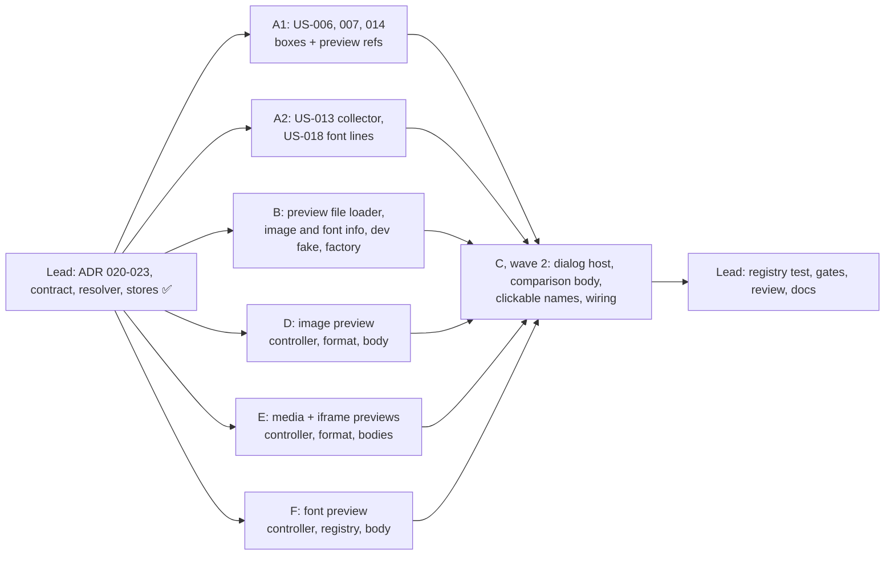

# [TECH-PLAN] US-015 → US-018: Epic PV, preview the elements flagged by the best practices

- **Input:** [EPIC-PV-conventions](../stories/EPIC-PV-conventions.md), [US-015](../stories/US-015.md), [US-016](../stories/US-016.md), [US-017](../stories/US-017.md), [US-018](../stories/US-018.md) (READY FOR TDD).
- **Decisions:**
  - [ARCH-DECISION-020](ARCH-DECISION-020-preview-subjects-from-line-refs.md): `LineRef.preview`, display boxes, preview subjects; amends 013 and 017.
  - [021](ARCH-DECISION-021-app-dialog-host.md): one app-level dialog host, one body and one pure controller per content; amends 016.
  - [022](ARCH-DECISION-022-preview-file-bytes.md): panel-side loader for any format, header parsing, browser decoding, shared session cache.
  - [023](ARCH-DECISION-023-media-and-font-previews-csp.md): streamed media, `FontFace` in the panel, iframes never loaded, CSP unchanged.
- **Branch:** `feat/best-practices-bp2`, on top of the uncommitted US-006 to US-014 work. Nothing is committed.
- **Baseline:** 59 test files, 977 tests green; `tsc` 0 errors; ESLint 0 errors / 1 known warning (`browser-context.tsx`).
  - After the lead contract wave: 62 files, 1013 tests green.

## 0. Ground rules for every sub-agent

1. **Stay inside your file ownership** (§3). Do not edit files you don't own, including the contract files of §1.
   - If a contract is wrong or insufficient, **stop and report it**; don't work around it.
   - The lead updates `rules-registry.test.ts` and `index.tsx` at integration, unless your scope says otherwise.
2. **Strict TDD.**
   - Write the test, run it, and keep the failing (red) output for your report. Then implement until green.
   - Run your subset with `npx vitest run <your paths>`.
   - Other agents work in the same tree at the same time. A failure of `npm test`, `tsc` or ESLint in a file you don't own is reported, not fixed.
3. **Type-check and lint:** `npx tsc --noEmit` and `npx eslint <your paths>`. `src/app/domain` must not import `infra/` or `ui/`, nor use `chrome`/`browser`.
4. **No `vi.mock` of project modules.** Inject dependencies and use hand-written fakes (ARCH-DECISION-006). `vi.useFakeTimers()` and `vi.fn()` on injected fakes are fine.
5. **Do not commit, push, stash, checkout or run `npm install`.** No new dependency. No git command that changes state.
6. **Language and wording:**
   - UI strings in French, **exactly** as written in the stories and in this plan. Put every user-visible string in an exported constant or a pure function of your `*-format.ts` file, and test it there.
   - Code, comments and test names in English. 2-space indent, double quotes.
   - 1 kB = 1 000 bytes: use `formatKo` (`domain/best-practices/rules/image-rule-helpers.ts`) for weights ("240 ko") and `formatCount` (`rule-lines.ts`) for "2 100 px". Both use `toLocaleString("fr-FR")`, whose grouping separator is U+202F. Tests compare against the helper's output, or a literal built with it.
   - Resolutions use `formatResolution(w, h)` (`ui/analysis/comparison/comparison-format.ts`): `1200 × 800 px`, with U+00D7.
   - Placeholder email `bastienhub@gmail.com`.
7. **No Solid component tests** exist in this project.
   - Put every piece of logic in a tested `.ts` helper (controller, format, layout). `.tsx` files are wiring only.
   - Agents writing `.tsx` must first invoke the local **`solidjs` skill** (Skill tool, skill `solidjs`) and follow it. Use `createSignal`, `createMemo`, `Show`, `Switch`/`Match`, `For`, `onMount`, `onCleanup` and refs, and do not destructure props. ESLint's `solid/*` rules must pass.
   - The visual style follows `ui/analysis/comparison/ComparisonDialog.tsx`: Tailwind classes such as `text-sm text-onsurface`, `btn-secondary`, and `bg-background rounded p-1` for the display area.
8. **Final report:**
   - files created and modified;
   - tests added, with one red-run excerpt per test file;
   - the `npx vitest run <your paths>` output, and the `npm test` tail;
   - the decisions you had to take, the limitations, and any contract issue.

## 1. Contract (owned by the team lead, already written and tested)

| File | Content |
|---|---|
| `domain/models/best-practice.ts` | `PreviewBox { width; height }`; `LinePreview` (image / video / audio / iframe / font); `LineRef.preview?` (020) |
| `domain/models/file-preview.ts` | subjects `ImagePreviewSubject`, `MediaPreviewSubject` (`mimeType?`, `downloadedBytes?`, `recordedStatus?`, `display?`), `IframePreviewSubject` (`host`, `mimeType?`, `transferredBytes?`, `top?`), `FontPreviewSubject`, union `PreviewSubject`; `PreviewImageFormat`, `PreviewImageInfo` (`format`, `animated`, `vector`, `width?`, `height?`, `byteLength`, `mimeType`); `FontFormat`, `PreviewFontInfo`; `PreviewFileError` (`unavailable` / `too-large`), `PreviewFileResult<I>`; ports `PreviewFileLoader` and `PreviewFileStore` (022) |
| `domain/file-preview/policy.ts` | `MAX_PREVIEW_BYTES = 25_000_000` |
| `domain/file-preview/preview-subject.ts` | `isPreviewableUrl`, `legacyLinePreview(ruleId, prefix)`, `createPreviewSubjectResolver(requests)` → `(ruleId, ref) => PreviewSubject \| undefined` (020) |
| `domain/file-preview/preview-store.ts` | `createPreviewFileStore(loader, { cache? })`: shared in-flight loads, cache by `preview-image:` / `preview-font:` key, errors never cached, a rejecting loader becomes `unavailable` |
| `domain/file-preview/testing/fake-preview-file-loader.ts` | `FakePreviewFileLoader` (deferred per call: `images[i]`, `fonts[i]`), `loadedImage(n, info?)`, `loadedFont(n, info?)`, `deferred`, `flush` |
| `domain/image-comparison/session-file-cache.ts` | `createSessionFileCache(maxBytes = 50 MB)`: the one LRU of the session |
| `domain/image-comparison/variant-store.ts` | new option `cache?: SessionFileCache` (behaviour unchanged) |
| `domain/best-practices/rules/rule-lines.ts` | `fileLine(url, rest, prefix = "", preview?)` puts `preview` in the ref |
| `ui/analysis/preview/info-rows.ts` | `InfoRow { label; value }`, `PREVIEW_LOADING = "Chargement…"` |
| `ui/analysis/preview/PreviewInfoList.tsx` | `<PreviewInfoList rows={…}/>`: the `<dl>` of epic §4 |
| `scripts/manifest.test.mjs` | asserts no `media-src`, `font-src`, `connect-src` (and still no `img-src`, `default-src`) in both manifests (023) |

Reused as is, read-only:

- from `comparison-format.ts`: `formatResolution`, `formatSize`, `RETRY_LABEL` ("Réessayer"), `CLOSE_LABEL` ("Fermer"), `MODE_PAGE_LABEL` ("Même taille que sur la page"), `MODE_NATIVE_LABEL` ("Taille réelle"), `NOT_DISPLAYED_HINT` ("Image non affichée sur la page");
- from `comparison-layout.ts`: `pageBox(display, maxWidth)`, `nativeCssSize(natural, dpr)`, `Size`, `DisplayMode`;
- `ObjectUrls` from `comparison-controller.ts`;
- `displayImageName` from `ui/analysis/image-name.ts`; `fileLabel`, `formatKo` from `image-rule-helpers.ts`; `formatCount`, `capLines`, `plural` from `rule-lines.ts`;
- `sniffImageFormat` from `domain/image-estimation/signature.ts`; `MIME_FORMATS` and `GENERIC_MIME_TYPES` from `policy.ts`; `normaliseImageUrl` from `image-requests.ts`;
- `readDimensions` from `infra/image-codec/image-inspect.ts`; `decodeBase64` from `infra/image-codec/base64.ts`;
- `lastRequestPerUrl`, `pathExtension`, `isGenericMime` from `rules/request-helpers.ts`.

## 2. Product decisions taken by the lead

These are not in the stories. They are recorded here and in the review for the owner.

1. **Legacy refs** (epic §6): a `LineRef` without `preview` is previewable when its rule and prefix say what it is (`legacyLinePreview`). Unprefixed US-006 legacy lines stay plain text: they cannot be told from `<area>` lines.
2. **Media weight:** the sum, over every recorded request of the URL, of the transfer size, or the body size when the transfer size is 0 (cache). This is the US-013 and US-018 convention.
3. **Iframe weight:** the transfer size of the last recorded request of the URL; "0 ko" for a document served from the cache.
4. **Iframe position** is persisted as `LinePreview.top`, not parsed from the text. Older analyses show "inconnue".
5. **Media errors** (023): `canPlayType` pre-check; `MediaError` 3 is `unsupported`; 4 is `unsupported` only when the page's own request succeeded, else `unavailable`.
6. **Formats of the duration** (US-016 §2 gives "1 min 32 s", "45 s", "2 h 03 min"):
   - `< 60 s`: `"<s> s"`;
   - `< 1 h`: `"<m> min <ss> s"`, with seconds on 2 digits (65 s gives "1 min 05 s");
   - `≥ 1 h`: `"<h> h <mm> min"`, with minutes on 2 digits and seconds dropped.
   - The value is rounded to the nearest second first. `NaN`, `Infinity` or negative gives "inconnue".
7. **Unknown values:** "inconnue" for Résolution, Durée and Position; "inconnu" for Format and Type; "non mesuré" for the iframe weight; "non téléchargé par la page" for the media weight.
8. **Alt text of the image** (US-015 NFR): `"Aperçu de <full name>, <W> × <H> px, <weight>"`. The resolution part is omitted when the resolution is unknown or undefined (vector).
9. **US-018 lines:** one line per distinct URL without fragment (the last request), with the same font filter as today. The detail keeps counting requests, unchanged.
10. **"Not an image"** (US-015 "Image indisponible."): bytes with no known image signature, whose MIME type is not `image/*`.

## 3. Scopes

### Delivery waves

- **Wave 1:** A1, A2, B, D, E and F run in parallel. Their file sets are disjoint, and each depends only on §1.
- **Wave 2:** C integrates the bodies into the host and wires `index.tsx`, so it runs after wave 1.

---

### 3.A1 Scope A1: display boxes and preview refs in the DOM rules (US-006, US-007, US-014)

**Owns** (edits), in `src/app/domain/best-practices/rules/`:
- `provide-text-alternatives.rule.ts` and its test;
- `use-lazy-loading.rule.ts` and its test;
- `avoid-media-autoplay.rule.ts` and its test.

**Design** (ARCH-DECISION-020).
- Collectors stay self-contained: no imports, no module helpers, no closures. Box = `{ width: Math.round(rect.width), height: Math.round(rect.height) }` from **one** `getBoundingClientRect()` per element.
- **US-006:**
  - `AlternativeElement` gains `box?: PreviewBox`. It is set for `img`, `input` and `video`, never for `area`. It is optional so that older fixtures stay valid.
  - Lines:
    - `img` / `input` → `fileLine(url, rest, "", { kind: "image", display: box })`;
    - `video` → `fileLine(url, MISSING_VIDEO, "Vidéo ", { kind: "video", display: box })`;
    - `area` → `fileLine(url, rest)` with **no** preview.
    - Omit `display` when `box` is undefined.
- **US-007:**
  - `LazyElement` gains `width` and `height` (rounded, from the rect already read), optional in the type.
  - Lines:
    - `img` → preview `{ kind: "image", display: { width, height } }`, or `{ kind: "image" }` when unknown;
    - `iframe` → `{ kind: "iframe", top }`.
- **US-014:**
  - `AutoplayMedia` gains `box?: PreviewBox` for `video` only.
  - Lines: `video` → `{ kind: "video", display: box }`; `audio` → `{ kind: "audio" }`.
  - "(sans source)" lines are unchanged.
- The text of every line is **unchanged**. Only the refs gain `preview`.

**Tests.**
- For each rule:
  - jsdom collector tests showing the box (stub `getBoundingClientRect`);
  - `lineRefs[i].preview` for each kind;
  - `area` without preview;
  - a fixture without `box` gives a preview without `display`.
- Spy on `getBoundingClientRect` to show it is called **once** per element.
- The existing performance tests keep their budgets: US-006 2 000 elements < 50 ms; US-007 2 000 < 50 ms; US-014 500 < 20 ms.
- The existing scenarios stay green.

---

### 3.A2 Scope A2: US-013 collector, US-018 font lines

**Owns** (edits), in `src/app/domain/best-practices/rules/`:
- `limit-gifs.rule.ts` and its test;
- `standard-fonts.rule.ts` and its test.

**Design.**
- **US-013** (`LimitGifsPage = { images: Array<{ url: string; width: number; height: number }> }`):
  - `collect()`:
    - for every ``, `url = currentSrc || src`, skipping empty URLs and `data:` URLs;
    - the box comes from one `getBoundingClientRect`, rounded;
    - deduplicate by URL in the collector, keeping the largest area. A `0 × 0` box is kept only if no other box exists for that URL.
  - `evaluate`:
    - unchanged grade, detail, order and text;
    - each GIF line gets `preview: { kind: "image", display }`. `display` is the box of the collected entry whose `normaliseImageUrl(url)` equals the GIF's normalised URL;
    - `{ width: 0, height: 0 }` when the page was collected but no `` shows the GIF (CSS background, script);
    - no `display` at all when `page` is undefined (collector failed).
  - The rule now has a collector. `rules-registry.test.ts` will fail on its collector list; **the lead updates it**. Report it, don't edit it.
- **US-018** (`UseStandardFonts`):
  - The font filter, the `compliance` and the `detail` (including the request count and total) are **unchanged**.
  - Lines:
    - one per URL without fragment (`lastRequestPerUrl(fonts…)`, keeping the same filter);
    - size = `transferSize > 0 ? transferSize : responseSize`;
    - sorted by size descending, then URL (`localeCompare`);
    - `fileLine(url, " : " + formatKo(size), "", { kind: "font" })`, then `capLines` (20 lines + "… et N autres").
  - The collector (`families`) is unchanged.

**Tests.**
- **US-013:**
  - scenario 3 data (box present);
  - scenario 4 (`0 × 0`: GIF used only as a background);
  - collector failed (no `display`);
  - fragment matching;
  - largest box wins;
  - jsdom collector test (dedupe, `data:` skipped, one `getBoundingClientRect` per element).
  - Every existing test stays green. Performance: 2 000 requests and 2 000 collected images evaluated in < 10 ms after a warm-up.
- **US-018:**
  - scenario 4 (`b.woff2 : 98 ko` then `a.woff2 : 20 ko`, with grade and detail unchanged);
  - a cached font (transfer 0) shows its body size;
  - duplicates are collapsed;
  - 21 fonts give 20 lines + "… et 1 autre";
  - `lineRefs` are aligned, with `{ kind: "font" }`;
  - the existing grade and detail tests are kept. Update the tests that asserted URL lines.

---

### 3.B Scope B: preview file loader, image and font info, dev fake, factory

**Owns:**
- creates, in `src/app/infra/file-preview/`:
  - `preview-file-loader.ts` and its test;
  - `preview-image-info.ts` and its test;
  - `font-format.ts` and its test;
  - `fake-preview-file-loader.ts` and its test;
- edits `src/app/infra/browser-factory.ts` and `browser-factory.test.ts` (adds `getPreviewFileLoader` only).

**Design** (ARCH-DECISION-022).
- `describePreviewImage(bytes: Uint8Array, mimeType: string): PreviewImageInfo | undefined` (pure). Undefined means "not an image": no known signature, and a MIME type that is not `image/*`.
  - **Format:**
    - `sniffImageFormat(bytes.subarray(0, 64))`;
    - if `unknown`, the MIME type through `MIME_FORMATS`; `tiff` maps to `unknown`.
    - `PreviewImageFormat` has no `tiff`: TIFF is "unknown" and still displayed if the browser can.
  - **Animated:** GIF only. Walk the blocks: header, logical screen descriptor, optional global colour table, then extensions (`0x21`: skip sub-blocks), image descriptors (`0x2C`: skip the local colour table, the LZW minimum code size and the sub-blocks), up to the trailer `0x3B`. Animated means more than one image descriptor. A truncated file gives the count found so far.
  - **Size:**
    - `readDimensions(format, bytes)` for JPEG, PNG, WebP and AVIF;
    - GIF: logical screen width and height (u16 little-endian at offsets 6 and 8);
    - BMP: `BITMAPINFOHEADER` width (i32 LE at 18) and `abs(height)` (i32 LE at 22), or `BITMAPCOREHEADER` (header size 12: u16 at 18 and 20);
    - ICO: the entry of largest area among the directory entries (count u16 LE at 4, 16-byte entries from 6; width and height bytes, where 0 means 256);
    - SVG: decode the first 4 096 bytes as UTF-8. Find the root `<svg` start tag (skip the XML declaration, comments and the doctype), then read `width` and `height`. Both must be plain positive numbers, optionally with `px`, to give a size; anything else (`%`, `em`, missing) gives `vector: true` with no size. `vector` is true for every SVG.
    - Invalid or zero values give undefined.
  - **`mimeType`:**
    - jpeg → `image/jpeg`, png → `image/png`, webp → `image/webp`, avif → `image/avif`, gif → `image/gif`, svg → `image/svg+xml`, bmp → `image/bmp`, ico → `image/x-icon`;
    - unknown → the given MIME type, else `application/octet-stream`.
- `detectFontFormat(head: Uint8Array, mimeType: string, url: string): FontFormat` (pure).
  - **Signature:** `wOF2` → woff2; `wOFF` → woff; `OTTO` → otf; `00 01 00 00` or `true` → ttf; EOT when bytes 34–35 are `0x4C 0x50`. The EOT check needs ≥ 36 bytes.
  - **Else the MIME type:**
    - `font/woff2`, `application/font-woff2` → woff2;
    - `font/woff`, `application/font-woff`, `application/x-font-woff` → woff;
    - `font/ttf`, `application/x-font-ttf`, `application/x-font-truetype`, `font/sfnt`, `application/font-sfnt` → ttf;
    - `font/otf`, `application/x-font-opentype`, `application/font-otf` → otf;
    - `application/vnd.ms-fontobject` → eot.
  - **Else the URL extension** (`woff2|woff|ttf|otf|eot`), else `unknown`.
- `createPreviewFileLoader(deps: { getDevtoolsContent?: (url) => Promise<{ content: string; encoding?: string } | null>; fetch: (input: string, init?: RequestInit) => Promise<Response>; maxBytes?: number }): PreviewFileLoader`. `maxBytes` defaults to `MAX_PREVIEW_BYTES`.
  - **Never rejects;** every throw becomes `unavailable` with a message.
  - **DevTools content first:**
    - `encoding === "base64"`: the decoded length is `floor(len × 3 / 4) − padding`. Over `maxBytes` → `too-large`, without decoding. Otherwise `decodeBase64`; on a decode error, fall through to fetch.
    - No encoding: if the whole content matches `^[A-Za-z0-9+/]+={0,2}$` with a length that is a multiple of 4, and the decoded first 48 characters have a known signature (image: `sniffImageFormat !== "unknown"`; font: `detectFontFormat(head, "", "") !== "unknown"`), decode it.
    - Else, for an image only, if the text sniffs as SVG (`sniffImageFormat(new TextEncoder().encode(content.slice(0, 64)))` is `svg`), use the UTF-8 bytes: Chrome reports SVG content as text. The `too-large` check applies to the encoded length.
    - Else fall through to fetch.
  - **Fetch:** `fetch(url, { cache: "force-cache", credentials: "include" })`.
    - `!ok` → `unavailable` with the message `HTTP <status>`.
    - A `content-length` over `maxBytes` → `too-large`, then `response.body?.cancel()` (ignore its errors).
    - Read `response.body` with a reader, accumulating chunks. Past `maxBytes` → `reader.cancel()` and `too-large`. Without `body`, use `arrayBuffer()` and check the length.
    - A network error → `unavailable`.
  - **MIME type:** the response `content-type` without parameters, lower-cased, else `declaredType`. DevTools content uses `declaredType`.
  - **Image:** `describePreviewImage(bytes, mime)`; undefined → `unavailable` ("not an image"). **Font:** `info = { format: detectFontFormat(bytes.subarray(0, 64), mime, url), byteLength, mimeType: mime }`. Any byte sequence is accepted; the browser decides whether it can use it (US-018: "Ce format… n'est pas pris en charge").
- `FakePreviewFileLoader` (dev, `npm run dev`; not the domain testing fake of §1):
  - `loadImage` resolves a small synthetic SVG (`width`/`height` 600 × 400, labelled with the file name) with matching info;
  - `loadFont` resolves `unavailable` ("aperçu des polices indisponible en mode démo").
- `getPreviewFileLoader(): Promise<PreviewFileLoader>`, memoised in `browser-factory.ts`. With an `ExtensionBrowser` (the same instance as `getBrowser()`), it returns `createPreviewFileLoader({ getDevtoolsContent: (url) => browser.getResourceContent(url), fetch: globalThis.fetch.bind(globalThis) })`; otherwise the dev fake.

**Tests.**
- Image info on **synthetic** byte arrays built in the tests (no binary fixtures):
  - GIF static and animated (2 frames, extensions in between, local colour table), and a truncated GIF;
  - BMP (positive and negative height, core header);
  - ICO (3 entries, a 0 = 256 entry);
  - SVG with `width="100" height="50"`, `width="100px"`, `%`, missing, an XML declaration and comment before the root, and attributes in single quotes;
  - JPEG and PNG through `readDimensions`;
  - unknown signature with `image/x-foo` (format unknown, still an image) and with `text/html` (undefined).
- Font format: each signature, each MIME type, each extension, unknown.
- Loader, with a fake `getDevtoolsContent` and a fake `fetch` built on `new Response(...)` (Node 18+ has `Response` and `ReadableStream`):
  - base64 image and font;
  - Firefox base64 without encoding;
  - SVG text content;
  - text content for a font → fetch;
  - base64 over the cap → `too-large`, with no decode and no fetch;
  - fetch 200, 404 and a network error;
  - `content-length` over the cap → `too-large`, body not read;
  - a streamed body over the cap without `content-length` → `too-large`, reader cancelled;
  - `content-type` with parameters;
  - not an image → `unavailable`;
  - the loader never rejects when `getDevtoolsContent` throws.
- Factory: dev fake, memoised.

---

### 3.D Scope D: image preview (US-015)

**Owns** (creates), in `src/app/ui/analysis/preview/`:
- `image-preview-format.ts` and its test;
- `image-preview-layout.ts` and its test;
- `image-preview-controller.ts` and its test;
- `ImagePreviewBody.tsx`.

**Design.**
- **Format** (`image-preview-format.ts`):
  - `imageFormatLabel(info)`: `JPEG`, `PNG`, `WebP`, `AVIF`, `GIF`, `GIF animé` (gif + animated), `SVG`, `BMP`, `ICO`, `inconnu`.
  - `imageResolution(info, decoded?)`:
    - info `width`/`height` → `formatResolution`;
    - else, for a vector, "non définie (image vectorielle)";
    - else the `decoded` natural size (raster only), if positive;
    - else "inconnue".
  - `imageInfoRows(info, decoded?)`: `[Résolution, Format, Poids]`, where Poids = `formatKo(info.byteLength)`.
  - `imagePreviewAlt(fullName, info, decoded?)`: §2.8, e.g. "Aperçu de hero.jpg, 1200 × 800 px, 180 ko".
  - `imageErrorMessage(error)`:
    - `unavailable` → "Image indisponible.";
    - `too-large` → "Image trop volumineuse pour l'aperçu.";
    - `display-failed` → "Ce format d'image ne peut pas être affiché.".
  - The loading text is `PREVIEW_LOADING`.
- **Layout** (`image-preview-layout.ts`):
  - `isDisplayedBox(box?)`: `box` defined and both sides > 0.
  - `initialImageMode(subject)`: `page` if displayed, else `native`.
  - `imagePreviewSize({ mode, display, info, decoded, areaWidth, devicePixelRatio })` returns a `Size`, or undefined for the browser's own size:
    - `page` with a displayed box → `pageBox(display, areaWidth)`;
    - `native`:
      - the natural size (info, else decoded, raster only) → `nativeCssSize(natural, dpr)`;
      - a vector without size → the display box if displayed, else undefined;
      - otherwise undefined.
- **Controller** (`createImagePreviewController({ store: PreviewFileStore; objectUrls: ObjectUrls })`), on the model of `comparison-controller.ts`. Every behaviour is tested with `FakePreviewFileLoader` + `createPreviewFileStore` and a counting fake `ObjectUrls`.
  - State: `{ open; subject?: ImagePreviewSubject; mode: DisplayMode; content: { status: "idle" } | { status: "loading" } | { status: "loaded"; objectUrl; info; decoded?: Size } | { status: "error"; error: PreviewFileError | "display-failed" } }`. Expose `state()` and `subscribe(listener)`.
  - **`open(subject)`:** ignored while open.
    - The mode is `initialImageMode`.
    - `store.peekImage(url)` loaded → `loaded` at once, never passing through `loading` (scenario 10).
    - Else `loading`, then `store.image(url, declaredType)`.
    - Results of an older opening, or after `close()`, are ignored and create **no** object URL (scenario 12).
  - **`retry()`:** only in `error` (including `display-failed`). It reloads.
  - **`setNativeSize(on)`:** turning it off is ignored when the box is not displayed (the checkbox is disabled).
  - **`decoded(width, height)`:** called on `` load. It stores the natural size only when the info has none and the image is not a vector.
  - **`displayFailed()`:** in `loaded`, it revokes the URL and sets the error `display-failed`.
  - **`close()`:** revokes every URL of the opening; idempotent.
- **Body** (`ImagePreviewBody(props: { subject: ImagePreviewSubject; store: PreviewFileStore })`):
  - It creates the controller with `URL.createObjectURL(new Blob([bytes], { type: info.mimeType }))` and `URL.revokeObjectURL`, calls `open(props.subject)` on mount and `close()` in `onCleanup`.
  - **Checkbox "Taille réelle"** (visible label): checked in `native`, and disabled when not displayed.
    - Not displayed: show `NOT_DISPLAYED_HINT`.
    - Displayed and in `page` mode: show `MODE_PAGE_LABEL`, as in the comparison.
  - **Area:** `overflow: auto; max-height: 60vh`, measured with `clientWidth` on mount and on `resize`.
    - `loading` → `
Chargement…
`;
    - `error` → `
` with the message and a "Réessayer" `btn-secondary` button;
    - `loaded` → `` with the computed size (`max-width: none` when a size is given, `max-width: 100%` otherwise), `onLoad` → `decoded(naturalWidth, naturalHeight)`, and `onError` → `displayFailed()`.
  - Under the area, `<PreviewInfoList rows={imageInfoRows(...)}/>` when loaded.
  - No header and no "Fermer": the host renders them (scope C).

**Tests:**
- every format label and the GIF animé case;
- the resolution fallbacks (vector, decoded, unknown);
- alt with and without resolution;
- the three error messages;
- layout cases (page, page scaled down, native at DPR 2 = scenario 2, vector, not displayed);
- controller: scenarios 1, 4, 8 (error, then retry loads), 9 (`too-large`), 10 (cached: no loading), 12 (late result, no URL); double open; display failed then retry; close revokes; `decoded` ignored for a vector.

---

### 3.E Scope E: media and iframe previews (US-016, US-017)

**Owns** (creates), in `src/app/ui/analysis/preview/`:
- `media-format.ts` and its test;
- `media-preview-controller.ts` and its test;
- `media-element.ts` and its test;
- `iframe-format.ts` and its test;
- `MediaPreviewBody.tsx`;
- `IframePreviewBody.tsx`.

**Design** (ARCH-DECISION-023).
- **Media format** (`media-format.ts`):
  - `formatDuration(seconds)`: §2.6.
  - `mediaTypeFromExtension(url)`:
    - `mp4`/`m4v` → `video/mp4`; `webm` → `video/webm`;
    - `ogv` → `video/ogg`; `ogg`/`oga`/`opus` → `audio/ogg`;
    - `mp3` → `audio/mpeg`; `m4a` → `audio/mp4`;
    - `wav` → `audio/wav`; `aac` → `audio/aac`; `flac` → `audio/flac`;
    - otherwise undefined.
  - `effectiveMediaType(subject)`: the recorded `mimeType` if it is neither generic nor empty, else `mediaTypeFromExtension(url)`.
  - `mediaFormatLabel(mimeType?, url)`. From the MIME type, without parameters and lower-cased:
    - `video/mp4` → MP4; `video/webm`, `audio/webm` → WebM;
    - `video/ogg`, `audio/ogg`, `application/ogg` → Ogg;
    - `audio/mpeg`, `audio/mp3` → MP3; `audio/mp4`, `audio/x-m4a`, `audio/m4a` → M4A;
    - `audio/wav`, `audio/x-wav`, `audio/wave`, `audio/vnd.wave` → WAV;
    - `audio/aac`, `audio/aacp`, `audio/x-aac` → AAC; `audio/flac`, `audio/x-flac` → FLAC.
    - Else, for a missing or generic MIME type, the extension: `mp4`/`m4v` → MP4, `webm` → WebM, `ogg`/`ogv`/`oga`/`opus` → Ogg, `mp3` → MP3, `m4a` → M4A, `wav` → WAV, `aac` → AAC, `flac` → FLAC.
    - Else "inconnu".
  - `mediaInfoRows(subject, metadata?)`:
    - video: `[Résolution, Durée, Format, Poids téléchargé par la page]`; audio: the same without Résolution;
    - Résolution: `formatResolution(width, height)` when both are > 0, else "inconnue";
    - Poids: `formatKo(downloadedBytes)`, else "non téléchargé par la page".
  - `mediaAccessibleName(fullName)` → "Aperçu de <full name>".
  - `VIDEO_NOT_DISPLAYED_HINT = "Vidéo non affichée sur la page"`.
  - `mediaErrorMessage`: `unavailable` → "Média indisponible."; `unsupported` → "Ce format n'est pas lu par ce navigateur.".
  - `mediaErrorKind({ code, recordedStatus })`: ARCH-DECISION-023 (3 → unsupported; 4 → unsupported if `recordedStatus` is 2xx or 304, else unavailable; else unavailable).
- **Controller** (`createMediaPreviewController({ canPlayType: (type: string) => string })`):
  - State: `{ open; subject?: MediaPreviewSubject; mode: DisplayMode; content: idle | loading | { status: "loaded"; metadata: { duration: number; width?: number; height?: number } } | { status: "error"; error: "unavailable" | "unsupported" }; reloads: number }`.
  - **`open(subject)`:** ignored while open.
    - The mode is `page` for a video with a displayed box, else `native`; audio is always `native` and has no checkbox.
    - When the effective type is known and `canPlayType` returns "", the content is `error: unsupported` at once; the body then renders no source (scenario 6).
    - Else `loading`.
  - **`metadataLoaded(metadata)`:** `loading` → `loaded`; ignored when closed.
  - **`failed(code?: number)`:** `mediaErrorKind`; ignored when closed or idle.
  - **`retry()`:** in `error`, back to `loading` with `reloads + 1`, even after a canPlayType error, so the body renders the source and calls `load()`.
  - **`setNativeSize(on)`:** as in D; video only.
  - **`close()`:** idempotent.
- **Release** (`media-element.ts`):
  - `releaseMedia(el: MediaElementLike)`: `pause()`, `removeAttribute("src")`, `load()`, each in its own `try`;
  - `MediaElementLike = { pause(): void; removeAttribute(name: string): void; load(): void }`;
  - `mediaDisplaySize({ mode, display, metadata, areaWidth, devicePixelRatio })`: as D's layout, with the natural size `videoWidth × videoHeight`, or undefined before the metadata.
- **`MediaPreviewBody(props: { subject: MediaPreviewSubject })`:**
  - It creates the controller with `canPlayType: (t) => document.createElement(kind).canPlayType(t)`, opens it on mount and closes it in `onCleanup`. `onCleanup` also calls `releaseMedia(element)`, which stops playback and the download (scenario 5).
  - **Element:**
    - `<video controls preload="metadata">` or `<audio controls preload="metadata">`, with **no `autoplay`**, `src={subject.url}` and `aria-label={mediaAccessibleName(full)}`;
    - `onLoadedMetadata` → `metadataLoaded({ duration, width: videoWidth, height: videoHeight })`; `onError` → `failed(el.error?.code)`;
    - in the canPlayType error state the element is not rendered;
    - an effect on `reloads` calls `el.load()`;
    - while `loading`, the element is in the DOM but visually hidden (`visibility: hidden`), so the metadata loads.
  - `
Chargement…
` while loading; an alert with "Réessayer" on error.
  - **Video:** the "Taille réelle" checkbox and the hint, as in D, with `VIDEO_NOT_DISPLAYED_HINT`. Width and height come from `mediaDisplaySize`.
  - `<PreviewInfoList rows={mediaInfoRows(subject, metadata)}/>` is always shown, with "inconnue" before the metadata.
- **Iframe** (`iframe-format.ts`, `IframePreviewBody(props: { subject: IframePreviewSubject })`):
  - `iframeInfoRows(subject)`:
    - `Hôte` (`host`);
    - `Type` (`mimeType ?? "inconnu"`);
    - `Poids transféré` (`formatKo` or "non mesuré");
    - `Position` (`"à " + formatCount(top) + " px du haut de page"`, or "inconnue").
  - The body renders only `<PreviewInfoList>`: **no `<iframe>`, no request**, no loading state.

**Tests:**
- every duration example, including 59.6 s and `Infinity`;
- every MIME type and extension label;
- `effectiveMediaType`;
- the info rows for video, audio, unknown and not downloaded (US-016 S1, S3, S4);
- `mediaErrorKind`'s table;
- controller: S1 (loaded metadata); S2 (state is never "playing": the controller never asks to play); S6 (canPlayType ""); S7 (code 4 with `recordedStatus` 404 → unavailable; no record → unavailable); retry; close ignores late events; S9 (0 × 0 box → native); audio has no mode;
- `releaseMedia` order with a fake element, and its robustness to throwing methods;
- `mediaDisplaySize`;
- `iframeInfoRows` for US-017 S1 and S2, using `formatKo(48_000)` and `formatCount(2100)`.

---

### 3.F Scope F: font preview (US-018)

**Owns** (creates), in `src/app/ui/analysis/preview/`:
- `font-preview-format.ts` and its test;
- `font-registry.ts` and its test;
- `font-preview-controller.ts` and its test;
- `FontPreviewBody.tsx`.

**Design** (ARCH-DECISION-023).
- **Format** (`font-preview-format.ts`):
  - `FONT_SAMPLE_TEXT = "Tâcher de se vaincre plutôt que la fortune, et changer ses désirs plutôt que l’ordre du monde"`, with U+2019 in "l’ordre";
  - `FONT_SAMPLE_AUTHOR = "— Voltaire"`, with an em dash (U+2014) and a space;
  - `FONT_SAMPLE_SIZE_PX = 32`;
  - `FONT_GROUP_LABEL = "Police"`;
  - `FONT_LOADING = "Chargement de la police…"`.
  - `FONT_CHOICES`: `[{ id: "downloaded", label: "Police téléchargée" }, { id: "sans", label: "Sans-serif", stack }, { id: "serif", label: "Serif", stack }, { id: "mono", label: "Mono", stack }]`. The stacks are **copied character for character** from US-018 §2:
    - Sans-serif: `-apple-system, BlinkMacSystemFont, avenir next, avenir, segoe ui, helvetica neue, Adwaita Sans, Cantarell, Ubuntu, roboto, noto, helvetica, arial, sans-serif`;
    - Serif: `Iowan Old Style, Apple Garamond, Baskerville, Times New Roman, Droid Serif, Times, Source Serif Pro, serif, Apple Color Emoji, Segoe UI Emoji, Segoe UI Symbol`;
    - Mono: `Menlo, Consolas, Monaco, Adwaita Mono, Liberation Mono, Lucida Console, monospace`.
  - `sampleFontFamily(choice, family?)`: the stack for a system choice; `"<family>"` (double-quoted) for `downloaded`.
  - `fontFormatLabel(format)`: WOFF2, WOFF, TTF, OTF, EOT, "inconnu". `fontInfoRows(info)`: `[Format, Poids]`.
  - `fontErrorMessage`: `unavailable` → "Police indisponible."; `unsupported` → "Ce format de police n'est pas pris en charge par ce navigateur.". `too-large` from the store also shows "Police indisponible.".
- **Registry** (`font-registry.ts`):
  - `FontRegistry { register(bytes: Uint8Array): Promise<{ ok: true; family: string; release(): void } | { ok: false; message?: string }> }`. It never rejects.
  - `createDocumentFontRegistry({ fonts: FontSetLike; createFace: (family: string, data: ArrayBuffer, descriptors: { weight: string; style: string }) => FontFaceLike })`:
    - `FontSetLike = { add(face): void; delete(face): boolean }` and `FontFaceLike = { load(): Promise<unknown> }`;
    - the family is `ecoinsights-preview-<n>`, with `n` incremented per registration;
    - the data is a copy (`bytes.slice().buffer`), so the cache keeps its bytes;
    - the descriptors are `{ weight: "normal", style: "normal" }`;
    - `await face.load()` → `fonts.add(face)`. `release()` is `fonts.delete(face)` and is idempotent;
    - a throw in `createFace` or a rejected `load()` gives `{ ok: false }`.
  - The body passes `fonts: document.fonts` and `createFace: (f, d, desc) => new FontFace(f, d, desc)`. This is the **panel** document: nothing reaches the inspected page.
- **Controller** (`createFontPreviewController({ store: PreviewFileStore; fonts: FontRegistry })`):
  - State: `{ open; subject?: FontPreviewSubject; choice: "downloaded" | "sans" | "serif" | "mono"; font: idle | loading | { status: "loaded"; family; info } | { status: "error"; error: "unavailable" | "unsupported" } }`.
  - **`open(subject)`:** ignored while open. The choice is `downloaded`.
    - It uses `peekFont`, else `font: loading` and `store.font(url, declaredType)`.
    - A loaded file → `fonts.register(bytes)` (still `loading`). `ok` → `loaded`; `!ok` → `error: unsupported`. A store error → `error: unavailable`.
  - **`select(choice)`:** changes only the choice. It never reloads (scenario 2) and works in every font state (scenario 5).
  - **`retry()`:** in `error`, it reloads.
  - **`close()`:** releases the registered font; idempotent. A `register` result arriving after `close` (or for an older opening) is **released immediately** and changes nothing (scenario 9). A store result arriving after `close` registers nothing.
- **`FontPreviewBody(props: { subject: FontPreviewSubject; store: PreviewFileStore })`:**
  - It creates the registry and the controller, opens on mount and closes in `onCleanup`.
  - **Group:** `<fieldset>` with a visible `<legend>Police</legend>` and four native `<input type="radio" name="font-preview-choice">` with labels (arrow keys are native).
  - **Sample:** `<blockquote>`, or a `<figure>` with `
{FONT_SAMPLE_TEXT}
` and `
{FONT_SAMPLE_AUTHOR}
`, styled `font-size: 32px; overflow-wrap: anywhere` with `font-family: sampleFontFamily(...)`.
    - For `downloaded`: the sample is shown only when `loaded`. In `loading`, show `
Chargement de la police…
` and **no sample**. In `error`, show `
` with the message and "Réessayer".
    - The system choices always show the sample.
  - `<PreviewInfoList rows={fontInfoRows(info)}/>` once the file is loaded.

**Tests:**
- the exact strings: sample (assert that `"l’ordre"` is included and the code point is U+2019), author, the three stacks, compared with the story text verbatim;
- `sampleFontFamily`; labels; error messages;
- registry with fakes: family names unique, copy of the bytes, descriptors, `add` after `load`, `release` deletes once, `load` rejection gives `ok: false`;
- controller: S1 (loaded, choice downloaded), S2 (select serif, then downloaded: one load, one register), S3, S5 (store error → unavailable; system choices still selectable), S6 (register `!ok` → unsupported), S7 (close releases), S9 (close while loading: the late register is released, the state is untouched), retry, cached reopen (`peekFont`: no store call, still registers).

---

### 3.C Scope C (wave 2): dialog host, comparison body, clickable names, wiring

**Owns:**
- creates `src/app/ui/analysis/dialog/dialog-host.ts` and its test, and `DialogHost.tsx`;
- renames `ui/analysis/comparison/ComparisonDialog.tsx` → `ComparisonBody.tsx`, and deletes `comparison-context.tsx`;
- edits `ui/analysis/ImageName.tsx`, `ui/analysis/BestPractices.tsx`, `ui/analysis/best-practices-view.ts` and `best-practices-view.test.ts`, and `src/app/index.tsx`.

**Design** (ARCH-DECISION-021).
- **`dialog-host.ts`** (pure):
  - `DialogRequest = { kind: "comparison"; subject: ComparisonSubject } | { kind: "preview"; subject: PreviewSubject }`.
  - `createDialogHost()` exposes `state()`, `subscribe`, `open(request, key?) → boolean` and `close()`, with the state `{ open; request?; key?; opening: number }`.
  - `dialogKey(ruleId, url)` returns `"ruleId|url"`. `dialogTitle(request)` returns `displayImageName(request.subject.url)`.
- **`DialogHost.tsx`:** `AppDialogProvider(props: { variantStore: ImageVariantStore; previewStore: PreviewFileStore; children })` and `useAppDialog(): { openComparison(subject, trigger: HTMLElement); openPreview(subject, trigger: HTMLElement) }`.
  - **One `<dialog aria-labelledby="app-dialog-title">`**, with `showModal()` on open and `close()` on close, on the model of today's `ComparisonDialog`. Escape (`onCancel`, `preventDefault`), a backdrop click and "Fermer" close it. Focus returns to the trigger, else to `[data-dialog-key="<key>"]` (`CSS.escape`).
  - **Header** (epic §3): `<h2 id="app-dialog-title" title={full}>` containing `{short}{full}`, then `
{url}
`.
  - **Body:** `<Switch>` on the request, re-mounted per `opening`:
    - comparison → `<ComparisonBody controller={…}/>`. The comparison controller is created once with `variantStore`; the provider calls `open(subject)` when it opens a comparison and `close()` on close, as today;
    - image → `<ImagePreviewBody subject store={previewStore}/>`;
    - media → `<MediaPreviewBody subject/>`;
    - iframe → `<IframePreviewBody subject/>`;
    - font → `<FontPreviewBody subject store={previewStore}/>`.
  - **"Fermer"** (`CLOSE_LABEL`) at the bottom.
- **`ComparisonBody.tsx`:** today's `ComparisonDialog` content without the `<dialog>`, the header and the "Fermer" button. The version toggle, the mode, the "changed" notice, the area, the info and the scroll restore are kept. The controller and its tests are **unchanged**.
- **`ImageName.tsx`:** props `{ name; comparison?; preview?; ruleId?; url? }`.
  - With `comparison` → `openComparison`; else with `preview` → `openPreview`.
  - The button keeps today's classes and `aria-haspopup="dialog"`. `data-comparison-key` becomes `data-dialog-key={dialogKey(ruleId, url)}`.
  - Without either, it renders today's span.
- **`best-practices-view.ts`:**
  - The `file` line gains `ruleId: string`, `url: string` (`ref.url`) and `preview?: PreviewSubject`.
  - In `aggregateBestPractices`, build **one** `createPreviewSubjectResolver(page.requests)` per page, lazily: only file lines call it, and its index is lazy. Pass it to `buildLines`.
  - `preview = resolve(bp.id, ref)` is set only when defined.
  - Image lines (015 path) are unchanged.
- **`BestPractices.tsx`:** passes `preview`, `ruleId` and `url` to `ImageName` for file lines.
- **`index.tsx`:**
  - `Promise.all([... , getPreviewFileLoader()])`;
  - `const cache = createSessionFileCache()`;
  - `createImageVariantStore(estimator, { cache })` and `createPreviewFileStore(loader, { cache })`;
  - `<AppDialogProvider variantStore previewStore>` in place of `ImageComparisonProvider`.
- Search the tree for `useImageComparison`, `ImageComparisonProvider`, `ComparisonDialog` and `data-comparison-key`, and leave no reference.

**Tests:**
- `dialog-host.test.ts`: open, a second open refused (double click), close is idempotent, `opening` increments, key kept, `dialogKey`, `dialogTitle`.
- `best-practices-view.test.ts`:
  - each preview kind from `lineRefs` with `preview`: US-006 image and video; US-007 image and iframe; US-013; US-014 audio; US-018;
  - an `<area>` ref without preview → no `preview`;
  - `blob:` and `data:` → no `preview` (US-015 S7, US-016 S8);
  - a legacy ref without `preview` for `LimitGifs` → image (US-015 S11);
  - legacy URL-only font lines → text (US-018 S8);
  - the resolver is built once per page (the requests are read once per page, measured with a `Proxy` as in the contract test);
  - image lines and comparison subjects unchanged.

## 4. Integration (lead)

1. Update `rules-registry.test.ts`: `LimitGifs` now has a collector, which must be self-contained and JSON-serialisable.
2. Check that the background bundle still builds (`npm run build`): the rule files import `normaliseImageUrl` outside `collect` only.
3. Run the quality gates (skill §5) and write the review in `docs/reviews/REVIEW-US-015-018.md`.
4. Update the README ("Bonnes pratiques": clickable names and previews; "Vie privée": media, font and image re-downloads from the panel), the CHANGELOG, `ARCHITECTURE.md` (§3.7 previews), `CLAUDE.md` and the story statuses.
5. **Manual checks in Chrome and Firefox** (cannot be automated):
   - previews from each rule;
   - an animated GIF plays; an SVG with a `<script>` does not run;
   - BMP and ICO display;
   - a video streams and stops on close (Network panel of the DevTools-on-DevTools);
   - `FontFace` from bytes works, and `document.fonts` of the panel is empty after close;
   - no request from the iframe modal;
   - focus returns to the button after Escape.
