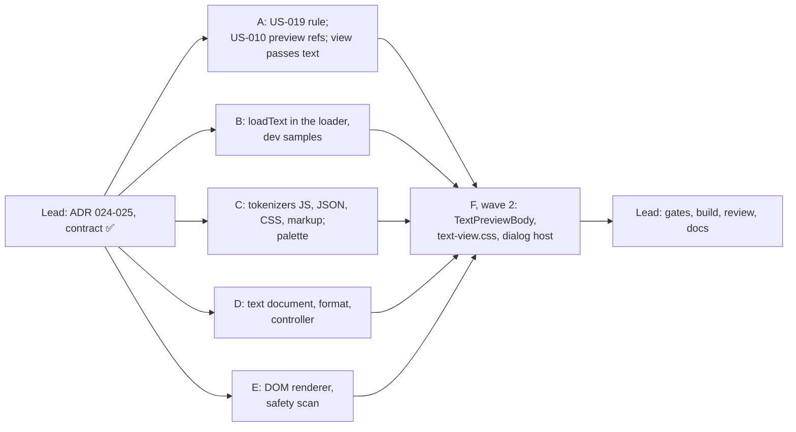

# [TECH-PLAN] US-019 and US-020: small GIFs ignored; preview of a non-minified text file

- **Input:** [US-019](../stories/US-019.md) (epic BP2), [US-020](../stories/US-020.md) (epic PV, [conventions](../stories/EPIC-PV-conventions.md)). Both READY FOR TDD.
- **Decisions:**
  - [ARCH-DECISION-024](ARCH-DECISION-024-text-preview-subjects-and-bytes.md): `text` line previews and subjects, legacy lines recognised from their text, `loadText` / `text` on the existing loader and store, raw bytes cached and decoded in the UI. It amends 020 and 022.
  - [025](ARCH-DECISION-025-text-viewer-in-house-tokenizer.md): an in-house line-based tokenizer loaded lazily, and an imperative renderer from text nodes, in time slices.
  - US-019 needs no ADR: it is a policy constant and a filter in one rule.
- **Branch:** `feat/best-practices-bp2`, on top of the uncommitted US-006 to US-018 work. Nothing is committed.
- **Baseline:** 77 test files, 1334 tests green; `tsc` 0 errors; ESLint 0 errors and 1 known warning (`browser-context.tsx`).
  - After the lead contract wave: 77 files, 1345 tests green.

## 0. Ground rules for every sub-agent

1. **Stay inside your file ownership** (§3). Do not edit files you don't own, including the contract files of §1.
   - If a contract is wrong or insufficient, **stop and report it**; don't work around it.
2. **Strict TDD.**
   - Write the test, run it, and keep the failing (red) output for your report. Then implement until green.
   - Run your subset with `npx vitest run <your paths>`.
   - Other agents work in the same tree at the same time. A failure of `npm test`, `tsc` or ESLint in a file you don't own is reported, not fixed.
3. **Type-check and lint:** `npx tsc --noEmit` and `npx eslint <your paths>`. `src/app/domain` must not import `infra/` or `ui/`, nor use `chrome`/`browser`.
4. **No `vi.mock` of project modules.** Inject dependencies and use hand-written fakes (ARCH-DECISION-006). `vi.useFakeTimers()` and `vi.fn()` on injected fakes are fine.
5. **Do not commit, push, stash, checkout or run `npm install`.** No new dependency. No git command that changes state.
6. **Language and wording:**
   - UI strings in French, **exactly** as written in the stories and in this plan. Put every user-visible string in an exported constant or a pure function, and test it there.
   - Code, comments and test names in English. 2-space indent, double quotes.
   - 1 kB = 1 000 bytes: use `formatKo` (`domain/best-practices/rules/image-rule-helpers.ts`, "48 ko") and `formatCount` (`rule-lines.ts`, "1 234"). Both use `toLocaleString("fr-FR")`, whose grouping separator is U+202F. Tests compare against the helper's output, or a literal built with it.
   - The ellipsis is U+2026 ("…").
   - Placeholder email `bastienhub@gmail.com`.
7. **No Solid component tests** exist in this project.
   - Put every piece of logic in a tested `.ts` helper. `.tsx` files are wiring only.
   - Agents writing `.tsx` must first invoke the local **`solidjs` skill** (Skill tool, skill `solidjs`) and follow it. ESLint's `solid/*` rules must pass.
8. **Safety (US-020):** file content is **never** given to `innerHTML`, `outerHTML`, `insertAdjacentHTML`, `DOMParser`, `createContextualFragment`, `document.write`, `eval` or `new Function`. Use `document.createTextNode` / `textContent` only.
9. **Final report:**
   - files created and modified;
   - tests added, with one red-run excerpt per test file;
   - the `npx vitest run <your paths>` output, and the `npm test` tail;
   - the decisions you had to take, the limitations, and any contract issue.

## 1. Contract (owned by the team lead, already written and tested)

| File | Content |
|---|---|
| `domain/models/best-practice.ts` | `TextPreviewType = TextFileType \| "JSON"`; `LinePreview` gains `{ kind: "text"; type: TextPreviewType }` (024) |
| `domain/models/file-preview.ts` | `TextPreviewSubject { kind: "text"; url; ruleId; fileType; declaredType; charset? }` in `PreviewSubject`; `PreviewTextInfo { byteLength; mimeType; charset }`; `PreviewFileLoader.loadText(url, declaredType, charset?)`; `PreviewFileStore.text(url, declaredType, charset?)` and `peekText(url)` |
| `domain/file-preview/policy.ts` | `MAX_PREVIEW_TEXT_CHARS = 500_000` |
| `domain/file-preview/preview-store.ts` | `text` / `peekText`, keys `preview-text:` |
| `domain/file-preview/preview-subject.ts` | `legacyLinePreview(ruleId, prefix, text?)` (MinifyTextFiles offender lines from their text); resolver `(ruleId, ref, text?)`; `text` subjects with `contentTypeCharset` of the last recorded request |
| `domain/file-preview/testing/fake-preview-file-loader.ts` | `texts[i]` deferreds (with `charset`), `loadedText(text, info?)` (UTF-8 bytes, charset "utf-8", MIME "text/css") |
| `infra/file-preview/preview-file-loader.ts`, `fake-preview-file-loader.ts` | **temporary** `loadText` stubs returning `unavailable`: scope B replaces them |
| `ui/analysis/preview/syntax/syntax-types.ts` | `TextLanguage`, `TokenKind`, `LineToken { text; kind? }`, `LineHighlighter { line(text): LineToken[] }`, `CreateLineHighlighter`, `textLanguage(type)`, `tokenClass(kind)` (`syntax-<kind>`), `tokenColourVariable(kind)` (`--syntax-<kind>`) |

Reused as is, read-only:

- `formatKo`, `fileLabel` (`image-rule-helpers.ts`); `formatCount`, `plural`, `fileLine`, `capLines` (`rule-lines.ts`); `contentTypeCharset`, `textFileType`, `lastRequestPerUrl` (`request-helpers.ts`);
- `RETRY_LABEL` ("Réessayer"), from `ui/analysis/comparison/comparison-format.ts`;
- `InfoRow`, `PreviewInfoList` (`ui/analysis/preview/`);
- `decodeBase64` (`infra/image-codec/base64.ts`).

## 2. Product decisions taken by the lead

These are not in the stories. They are recorded here and in the review for the owner.

1. **US-019 policy location:** `MIN_COUNTED_GIF_BYTES = 5_000` lives in `domain/image-estimation/policy.ts`, the image policy file, next to the other image thresholds.
2. **US-020 "Lignes":** a line break is `\r\n`, `\n` or `\r`. The count is the number of breaks plus one, minus one when the text ends with a break. An empty content has 0 lines. Examples: `"a"` → 1, `"a\nb\n"` → 2, `"\n"` → 1. The displayed rows follow the same rule, so a file shows exactly "Lignes" rows when it is not truncated.
3. **US-020 display cap:** the first 500 000 UTF-16 code units, minus one if the cut would split a surrogate pair. The last displayed line may be partial. The notice is `Affichage limité aux 500 premiers ko (fichier de <formatKo(byteLength)>).`: the file size is the "Poids" value.
4. **US-020 "Poids" of DevTools text content:** the UTF-8 length of the decoded text that DevTools gives (ARCH-DECISION-024). It is the exact byte length for base64 content and re-downloads.
5. **US-020 type label:** `CSS`, `JavaScript` (for `JS`), `HTML`, `SVG`, `JSON`.
6. **US-020 themes:** the panel has a single, dark theme (`tailwind.config.js`: `background #282828`, `surface #3C3C3C`). The palette is defined and contrast-tested for it. A light palette would be added with a light theme.
7. **US-020 empty content:** the information list is shown ("Poids : 0 ko", "Lignes : 0"), then "Fichier vide." in place of the block.

## 3. Scopes

### Delivery waves



- **Wave 1:** A, B, C, D and E run in parallel. Their file sets are disjoint, and each depends only on §1.
- **Wave 2:** F wires the body into the dialog host.

---

### 3.A Scope A: US-019, and the US-010 preview refs

**Owns** (edits):
- `src/app/domain/best-practices/rules/limit-gifs.rule.ts` and its test;
- `src/app/domain/image-estimation/policy.ts` (adds one constant only);
- `src/app/domain/best-practices/rules/minify-text-files.rule.ts` and its test;
- `src/app/ui/analysis/best-practices-view.ts` and `best-practices-view.test.ts`.

**Design.**
- **US-019** (`LimitGifs`):
  - Add `export const MIN_COUNTED_GIF_BYTES = 5_000;` to `image-estimation/policy.ts`, with a doc comment (US-019: under 5 000 bytes ignored; exactly 5 000 counted; 0 means unknown, ignored).
  - In `evaluate`, after the existing detection (2xx, MIME or extension, `lastRequestPerUrl`), split the GIFs by `gifSize(r) >= MIN_COUNTED_GIF_BYTES` into **counted** and **ignored**.
  - The grade uses counted GIFs only: 0 → A, 1 → B, more → C.
  - Detail, with `n` ignored and `suffix = n === 0 ? "" : \` (${n} GIF de moins de 5 ko ${plural(n, "ignoré", "ignorés")})\``:
    - 0 counted, 0 ignored: `Aucun fichier GIF` (unchanged);
    - 0 counted: `Aucun fichier GIF de 5 ko ou plus` + suffix;
    - otherwise the existing detail + suffix.
  - Lines: counted GIFs only; text, order, preview box and 20-line cap unchanged. With 0 counted there is no `offenders` and no `lineRefs`.
  - The collector is unchanged.
- **US-020 refs** (`MinifyTextFiles`): offender lines become `fileLine(url, rest, "", { kind: "text", type: file.job.type })`. "Non évalué" lines keep `fileLine(url, rest)` with **no** preview. Text, order, grade and detail are unchanged.
- **View:** in `fileOrTextLine`, call `resolve(bp.id, ref, text)`; `lazyResolver` forwards the third argument. Nothing else changes.

**Tests.**
- **US-019:** scenarios 1 to 8 as written, with their exact sizes and details. Scenario 9 (saved analyses) is covered by the view: stored `offenders` and `compliance` are displayed as stored; add one assertion in `best-practices-view.test.ts` that a stored `LimitGifs` practice with a `pixel.gif : 0 ko` line and grade C is rendered unchanged.
  - Adapt the existing tests that use GIFs under 5 000 bytes (`pixel.gif` 43 bytes in "scenario 3"; the 1 000- and 2 000-byte GIFs of the cap, extension and tie tests): raise the sizes to ≥ 5 000, or assert the new behaviour. Keep their intent.
  - Keep the performance test (2 000 requests < 10 ms) and the collector tests.
  - Singular and plural: `1 GIF de moins de 5 ko ignoré`, `3 GIF de moins de 5 ko ignorés`.
- **US-020 refs:** an offender line has `lineRefs[i].preview` `{ kind: "text", type: "CSS" }` (one per type: CSS, JS, HTML, SVG); a "non évalué" line has a ref without `preview`; the existing tests stay green.
- **View** (`best-practices-view.test.ts`):
  - a `MinifyTextFiles` offender with `preview` gives a `text` subject with `fileType`, `declaredType` and `charset` from the page's requests;
  - a legacy offender (ref without `preview`) is previewable (US-020 S12), and a legacy "non évalué" line is not (S4);
  - a `data:` URL is not previewable.

---

### 3.B Scope B: `loadText` in the preview loader, dev samples

**Owns:**
- `src/app/infra/file-preview/preview-file-loader.ts` and its test;
- `src/app/infra/file-preview/fake-preview-file-loader.ts` and its test.

**Design** (ARCH-DECISION-024). Replace the lead's stubs.
- `loadText(url, declaredType, charset?)` never rejects.
- **DevTools content first** (`getDevtoolsContent`):
  - `encoding === "base64"`, **or** `encoding` is `undefined`/`null` and the content is entirely base64 (`length % 4 === 0` and `/^[A-Za-z0-9+/]+={0,2}$/`, as in `devtools-content-analyser.ts`): decoded length over `maxBytes` → `too-large` without decoding; else `decodeBase64`. Charset = `charset ?? "utf-8"`. A decode error falls through to fetch.
  - Otherwise the content is decoded text: `bytes = new TextEncoder().encode(content)`, charset `"utf-8"`. Over `maxBytes` → `too-large`.
  - A missing or empty content falls through to fetch (an empty file is then read from the re-download).
- **Fetch** (existing path): non-2xx → `unavailable` (`HTTP <status>`); `content-length` over the cap → `too-large`, body cancelled; streamed read capped; network error → `unavailable`.
  - Keep the full `content-type` header of the response: the MIME type is its value without parameters, lower case; the charset is its `charset` parameter (lower case, unquoted), else `charset`, else `"utf-8"`.
- `mimeType`: the response MIME type, else `declaredType` without parameters, lower case (DevTools content uses `declaredType`).
- `info = { byteLength: bytes.length, mimeType, charset }`. Any bytes are accepted, including 0 bytes.
- Keep `loadImage` and `loadFont` behaviour unchanged. Refactor the shared `obtain` path if needed, but their tests must stay green unchanged.
- **Dev fake** (`npm run dev`): `loadText(url)` returns a synthetic, **non-minified** sample chosen by the URL extension: `.css` (comments, selectors, `@media`), `.js`/`.mjs` (comments, strings, a template literal, numbers, keywords), `.html`/`.htm` (doctype, comment, attributes, an inline `<script>` and `<style>`), `.svg` (XML declaration, attributes), `.json`; anything else → the CSS sample. UTF-8 bytes, charset `"utf-8"`, a matching MIME type. Include a few non-ASCII characters (é, …).

**Tests:**
- base64 with `encoding: "base64"` and the charset of the subject (bytes `[0xE9]` with `iso-8859-1` → info charset `iso-8859-1`);
- Firefox: content entirely base64 without encoding → decoded;
- Chrome text content (`"a { color: red }\n"`) → UTF-8 bytes, charset `utf-8`, `byteLength` = UTF-8 length (with an "é", 2 bytes);
- text over the cap → `too-large`; base64 over the cap → `too-large` without decoding and without fetch;
- no DevTools content → fetch; fetch 200 with `text/css; charset=ISO-8859-1` → MIME `text/css`, charset `iso-8859-1`; fetch without charset → the subject's, else `utf-8`; 404 → `unavailable` (US-020 S6); network error → `unavailable`; `content-length` over the cap → `too-large`, body unread; a streamed body over the cap → `too-large`;
- an empty body → `loaded` with 0 bytes (S14);
- `getDevtoolsContent` throws → fetch; nothing ever rejects;
- the existing image and font tests stay green;
- dev fake: each extension gives its sample with a matching MIME type, decodable as UTF-8, with at least one comment.

---

### 3.C Scope C: tokenizers and palette

**Owns** (creates), in `src/app/ui/analysis/preview/syntax/`:
- `javascript.ts`, `json.ts`, `css.ts`, `markup.ts`, each with its test;
- `index.ts` (`createLineHighlighter`) and its test;
- `syntax-palette.ts` and its test.

**Design** (ARCH-DECISION-025). Pure TypeScript, no DOM, no dependency.
- Each language exports a factory returning a `LineHighlighter` (`syntax-types.ts`): `createJavaScriptHighlighter()`, `createJsonHighlighter()`, `createCssHighlighter()`, `createMarkupHighlighter()`.
  - `line(text)` returns the tokens of one line (no line break inside) and keeps the state for the next call.
  - **Invariant:** joined token texts equal the input, and no token is empty. Adjacent tokens of the same kind may be merged.
  - **Never throws**, on any string (random, binary-looking, unbalanced). **Linear** time: hand-written character scanning; no regex with nested quantifiers on unbounded input.
- **JavaScript:** `//` and `/* */` comments (multi-line); `'…'`, `"…"` with escapes (an unterminated string ends at the end of the line); template literals `` `…` `` across lines, `${ … }` approximated (track brace depth; the inside may be tokenized as code or left plain); numbers (decimal, `.5`, exponents, hex/octal/binary, `_` separators, `n` suffix); keywords (`break case catch class const continue debugger default delete do else export extends finally for function if import in instanceof let new of return static super switch this throw try typeof var void while with yield async await get set`); literals `true false null undefined NaN Infinity`; regex literals when the previous significant token is not an identifier, number, literal, `)` or `]` (keywords like `return` allow a regex), as `string`; HTML-like comments are not needed. Identifiers are plain, including identifiers that contain a keyword (`classList`).
- **JSON:** strings followed (after optional spaces) by `:` are `key`, other strings `string`; numbers; `true false null` → `literal`. Lenient on invalid JSON (tokenize what can be).
- **CSS:** comments (multi-line); at-rules (`@media`, `@import`, `@font-face`, `@keyframes`…) → `keyword`; outside a declaration block, text up to `{` is `selector`; inside a block, `name:` → `property` (custom properties `--x` included), the value up to `;` or `}` → `value`, with `string` and `number` (with units, `%`, `#hex` as `number`) inside values and `!important` → `keyword`; nested blocks (`@media { a { … } }`) keep track of depth. State carries across lines.
- **Markup** (HTML, SVG, XML): `<!-- … -->` comments (multi-line); `<!DOCTYPE …>` and `<?xml … ?>` → `keyword`; `<![CDATA[ … ]]>` → `string`; tags: `<`, `</`, the name, `>` and `/>` → `tag`; attribute names → `attr-name`; values (quoted, with quotes, or unquoted) → `attr-value`; `=` plain; a tag may span lines. Text content plain. Entities may stay plain.
  - The content of `<script>` (without `type`, or with a JavaScript or JSON `type`) is delegated to a JavaScript highlighter (JSON highlighter for `application/json` / `application/ld+json`) until `</script` (case-insensitive); the content of `<style>` to a CSS highlighter until `</style`. A new sub-highlighter is created per element.
- **`index.ts`:** `export const createLineHighlighter: CreateLineHighlighter`, mapping each `TextLanguage` to its factory. It is the **only** module the body imports dynamically: it must not be imported statically from any other non-test module.
- **Palette** (`syntax-palette.ts`, imported statically by the body, so it must not import the tokenizers):
  - `TEXT_VIEW_BACKGROUND = "#282828"` (the content block background, Tailwind `background`), `TEXT_VIEW_TEXT` (default text) and `TEXT_VIEW_GUTTER` (line numbers);
  - `SYNTAX_PALETTE: Record<TokenKind, string>`, hex colours chosen so that each kind is visually distinct where it matters (comments clearly distinct from code; strings vs keywords vs numbers; tag vs attribute name vs value; selector vs property vs value);
  - `syntaxStyleVariables(): Record<string, string>` → `{ "--syntax-comment": "#…", … }` for every kind (through `tokenColourVariable`);
  - `contrastRatio(a, b)` (WCAG 2.x relative luminance).
  - Every palette colour, the text and the gutter have a contrast of **at least 4.5:1** against the background (tested).

**Tests:**
- Per language, token expectations on short realistic snippets, for each kind the story lists (US-020 §2 "Tokens coloured at minimum").
- State across lines: a multi-line comment (JS, CSS, markup), a multi-line template literal, a tag spanning lines, a `<script>` block over several lines followed by markup.
- `classList` and `newValue` stay plain; `a / b / c` is division; `return /x/g` is a regex.
- **Hostile fixtures** (US-020 S8): `</pre><script>alert(1)</script>`, ``, `</pre><style>body{display:none}</style>`, `<!--` without end, `"` unterminated, a 10 000-level `{{{{`: the invariant holds and nothing throws.
- **Fuzz:** 2 000 random lines (random code points, including `<`, `"`, `/`, `*`, `` ` ``, `\`), for each language, keep the invariant and never throw.
- **Performance:** 500 000 characters of realistic non-minified JavaScript (a snippet repeated) in < 250 ms in total; one 80 000-character line in < 50 ms; for each language.
- `createLineHighlighter` returns an independent highlighter per call, for each language.
- Palette: the 4.5:1 contrast of every colour; `syntaxStyleVariables` covers every `TokenKind`; `contrastRatio("#000000", "#ffffff")` is 21.

---

### 3.D Scope D: text document, format, controller

**Owns** (creates), in `src/app/ui/analysis/preview/`:
- `text-document.ts` and its test;
- `text-preview-format.ts` and its test;
- `text-preview-controller.ts` and its test.

**Design.**
- **`text-document.ts`** (pure):
  - `decodePreviewText(bytes: Uint8Array, charset: string): string`: `new TextDecoder(charset, { fatal: false })`. An unknown label (`RangeError`) falls back to `"utf-8"`. Never throws.
  - `countLines(text: string): number`: §2.2. Linear, no regex split of the whole text (use `indexOf`/char codes): it runs on up to 25 MB.
  - `TextDocument = { characters: number; lineCount: number; truncated: boolean; lines: string[] }`.
  - `prepareTextDocument(text: string, maxChars = MAX_PREVIEW_TEXT_CHARS): TextDocument`: `characters` and `lineCount` describe the whole text; `lines` are the displayed lines of the first `maxChars` code units (§2.2, §2.3: no extra empty row after a final break; do not split a surrogate pair). Empty text: `lines: []`, `lineCount: 0`.
- **`text-preview-format.ts`** (pure):
  - `TEXT_LOADING = "Chargement du fichier…"`, `TEXT_EMPTY = "Fichier vide."`, `TEXT_CONTENT_LABEL = "Contenu du fichier"`;
  - `textTypeLabel(type: TextPreviewType)`: §2.5;
  - `textInfoRows(subject, info, document): InfoRow[]` → `[{ label: "Type", value }, { label: "Poids", value: formatKo(info.byteLength) }, { label: "Lignes", value: formatCount(document.lineCount) }]`;
  - `textCapNotice(info, document): string | undefined`: undefined when not truncated; else §2.3, with `formatCount(MAX_PREVIEW_TEXT_CHARS / 1000)` for "500";
  - `textErrorMessage(error: PreviewFileError)`: `unavailable` → "Fichier indisponible."; `too-large` → "Fichier trop volumineux pour être affiché.";
  - `gutterDigits(lineCount): number`: the number of digits of `lineCount`, at least 2 (for the gutter width in `ch`).
- **`text-preview-controller.ts`** (`createTextPreviewController({ store: PreviewFileStore })`), on the model of `font-preview-controller.ts`:
  - State: `{ open: boolean; subject?: TextPreviewSubject; content: { status: "idle" } | { status: "loading" } | { status: "loaded"; info: PreviewTextInfo; document: TextDocument } | { status: "error"; error: PreviewFileError } }`. Expose `state()` and `subscribe(listener) → unsubscribe`.
  - **`open(subject)`:** ignored while open. If `store.peekText(url)` is loaded, decode and prepare at once → `loaded`, never passing through `loading` (S13). Else `loading`, then `store.text(url, declaredType, charset)`.
  - On a loaded result: `decodePreviewText(bytes, info.charset)`, then `prepareTextDocument` → `loaded`. On an error result → `error`.
  - Results of an older opening, or after `close()`, are ignored (S13).
  - **`retry()`:** only in `error`; reloads (S6).
  - **`close()`:** idempotent; the state returns to closed and idle.

**Tests:**
- `decodePreviewText`: UTF-8 with "é"; `iso-8859-1` bytes `[0x6C, 0xE9]` → "lé" (S11); invalid UTF-8 → "�" (not an error); unknown label → UTF-8.
- `countLines` and `prepareTextDocument`: §2.2 examples, `\r\n` and `\r`; truncation of a 1 234 000-character text (S7: `characters` 1 234 000, `truncated`, displayed length 500 000, `lineCount` of the whole text); a surrogate pair at the cut; one 80 000-character line → 1 line (S9); empty (S14); 25 MB counted in a reasonable time.
- Format: every string; `textInfoRows` for S1 (`formatKo(48_000)`); `textCapNotice` for S7 exactly `Affichage limité aux 500 premiers ko (fichier de ${formatKo(1_234_000)}).`; S14 rows ("0 ko", "0"); type labels; `gutterDigits`.
- Controller with `FakePreviewFileLoader` + `createPreviewFileStore`: S1 (loading then loaded, info and document); S6 (error `unavailable`, then `retry` loads); `too-large`; S11 (charset passed through to the store, and decoding with `info.charset`); S13 (close while loading: the late result is ignored, then a reopening after the load completed is `loaded` at once without a store call); S14 (empty → loaded with `lineCount` 0); double open ignored; retry outside `error` ignored; listeners.

---

### 3.E Scope E: DOM renderer and safety scan

**Owns** (creates), in `src/app/ui/analysis/preview/`:
- `text-view-renderer.ts` and its test (`// @vitest-environment jsdom`);
- `text-safety.test.ts`.

**Design** (ARCH-DECISION-025).
- `renderTextView(container: HTMLElement, lines: readonly string[], options: TextViewOptions): TextView`, where:

  ```ts
  interface TextViewOptions {
    /** Loads the highlighter; undefined or a rejection or an undefined result → plain text only. */
    highlighter?: () => Promise<LineHighlighter | undefined>;
    /** Runs a task later (the body passes `(task) => setTimeout(task, 0)`). */
    schedule: (task: () => void) => void;
    /** Monotonic clock in ms (the body passes `performance.now`). */
    now: () => number;
    /** Time budget per slice; default `TEXT_VIEW_SLICE_MS = 12`. */
    sliceMs?: number;
  }
  interface TextView {
    cancel(): void;
    /** Resolves when the rows and the colours are done, colouring failed, or the view was cancelled. Never rejects. */
    readonly settled: Promise<void>;
  }
  ```

  - Empties the container first (`replaceChildren()`), and uses `container.ownerDocument` to create nodes.
  - **Row** per line: `<div class="text-row"><span class="text-gutter" aria-hidden="true" data-line="N"></span><span class="text-code">TEXT</span></div>`. The gutter has **no** text node (CSS shows `attr(data-line)`). The code span holds one text node with the line (no text node for an empty line).
  - **Plain pass:** starts by calling `highlighter?.()` (so the module loads meanwhile), then appends rows in slices: the first slice runs **synchronously** inside `renderTextView`. A slice appends at least one row, through a `DocumentFragment`, and stops when `now() - start >= sliceMs` (check the clock every row or every few rows), then `schedule`s the next slice.
  - **Colouring pass:** after the last row, await the highlighter (a rejection or `undefined` → stop, plain). Then, in slices with the same budget, for each line in order: `tokens = highlighter.line(text)`. If the joined texts differ from the line, or `line` throws, stop colouring for good (the rest stays plain, no error). If no token has a kind, leave the row as is. Otherwise replace the code span's children with, per token, a text node (no kind) or a `<span class="syntax-<kind>">` (`tokenClass`) whose `textContent` is the token text.
  - **`cancel()`:** idempotent; no slice runs after it; `settled` resolves.
  - Text enters the DOM only through `createTextNode` / `textContent`. No `innerHTML` & co. (ground rule 8).
- **Safety scan** (`text-safety.test.ts`, node environment): reads, with `fs`, every non-test source file of `ui/analysis/preview/` whose name starts with `text-` or `Text`, and every non-test file of `ui/analysis/preview/syntax/`. It asserts that none contains `innerHTML`, `outerHTML`, `insertAdjacentHTML`, `DOMParser`, `createContextualFragment`, `document.write`, `eval(` or `new Function`. It discovers files with `readdirSync`, so files added later (the body, in wave 2) are covered. It also asserts that the expected files exist once the epic is complete: make the list of **required** files `text-view-renderer.ts`, `syntax/syntax-types.ts`; others are scanned when present.

**Tests** (jsdom):
- rows, numbers in `data-line`, `aria-hidden` gutter without text, empty lines;
- the first slice is synchronous; with a fake clock (each call +5 ms) and a manual `schedule` queue, rows arrive over several slices; at least one row per slice;
- colouring with a fake highlighter: spans with `syntax-<kind>` classes; unkinded tokens are text nodes; `container.textContent` stays equal to `lines.join("")` before and after colouring;
- the highlighter rejecting, returning `undefined`, throwing on line 3, or returning tokens that do not join to the line: rows stay plain from that point, `settled` resolves, nothing throws (US-020 S10);
- `cancel()` during the plain pass and during the colouring pass: no further DOM change;
- **hostile content** (S8) with a fake highlighter that marks everything `tag`, and with no highlighter: `</pre><script>alert(1)</script>`, ``, `</pre><style>body{display:none}</style>`, `<a href="javascript:alert(1)">x</a>`. Assert there is no `script`, `img`, `style`, `a`, `iframe`, `link` or `object` element in the container, and that each row's text equals the input line;
- an 80 000-character line renders as one row with `data-line="1"` (S9);
- a 20 000-line input with a fast fake clock completes, and `settled` resolves.

---

### 3.F Scope F (wave 2): body, styles, dialog host

**Owns:**
- creates `src/app/ui/analysis/preview/TextPreviewBody.tsx` and `src/app/ui/analysis/preview/text-view.css`;
- edits `src/app/ui/analysis/dialog/DialogHost.tsx` (one `<Match>`).

**Design.**
- **`TextPreviewBody(props: { subject: TextPreviewSubject; store: PreviewFileStore })`**, on the model of `FontPreviewBody.tsx`:
  - creates `createTextPreviewController({ store })`, subscribes, `open(props.subject)` on mount, `close()` and unsubscribe in `onCleanup`;
  - `loading` → `<p role="status">{TEXT_LOADING}</p>`;
  - `error` → `<div role="alert">` with `textErrorMessage(error)` and a `btn-secondary` "Réessayer" (`RETRY_LABEL`) calling `retry()`;
  - `loaded` →
    1. `<PreviewInfoList rows={textInfoRows(...)}/>`;
    2. the cap notice (`textCapNotice`) in a `<p>` when defined, above the block;
    3. `Fichier vide.` (`TEXT_EMPTY`) in a `<p>` when `document.lineCount === 0`; otherwise
    4. the content block: `<div class="text-view" tabindex="0" role="region" aria-label={TEXT_CONTENT_LABEL} style={{ ...syntaxStyleVariables(), "--gutter-ch": String(gutterDigits(lineCount)) }} ref={…}>`.
  - When the block mounts with a loaded document, call `renderTextView(block, document.lines, { highlighter: () => import("./syntax").then((m) => m.createLineHighlighter(textLanguage(subject.fileType))), schedule: (t) => { setTimeout(t, 0); }, now: () => performance.now() })`. Cancel the view in `onCleanup` and before re-rendering (a retry).
  - The body must stay usable at 90 vw: the block has a width of `min(80vw, 64rem)` and a `max-height` around `55vh`, so the header and the information list stay visible.
  - `import "./text-view.css";` at the top of the body.
- **`text-view.css`** (plain CSS, no `@apply`):
  - `.text-view`: monospace font, 12 px, `line-height: 1.5`, background `#282828` (`TEXT_VIEW_BACKGROUND`), text `TEXT_VIEW_TEXT`, `overflow-y: auto`, `overflow-x: hidden`, padding, rounded corners, a visible focus outline (`:focus-visible`);
  - `.text-row`: `display: flex`; `.text-gutter`: `flex: none`, `width: calc(var(--gutter-ch, 2) * 1ch + 1ch)`, `text-align: right`, `padding-right: 1ch`, colour `TEXT_VIEW_GUTTER`, `user-select: none`; `.text-gutter::before { content: attr(data-line); }`;
  - `.text-code`: `flex: 1 1 auto`, `min-width: 0`, `white-space: pre-wrap`, `overflow-wrap: anywhere`, `min-height: 1.5em`;
  - `.syntax-<kind> { color: var(--syntax-<kind>); }` for **every** `TokenKind`, and `.syntax-comment { font-style: italic; }`.
  - Use the colour values of `syntax-palette.ts`; the CSS literals for background, text and gutter must equal them (add a small test in `text-view-css.test.ts` that reads the CSS file and checks every `TokenKind` has its rule, and that the three literals match the palette).
- **`DialogHost.tsx`:** one `<Match when={request.kind === "preview" && request.subject.kind === "text" ? request.subject : undefined}>{(text) => <TextPreviewBody subject={text()} store={props.previewStore} />}</Match>`.
- No change to `index.tsx`, `ImageName.tsx` or `BestPractices.tsx` is expected: file lines with a `preview` subject already render the button. Check it, and report if not.

**Tests:** `text-view-css.test.ts`, plus re-running the whole suite, `npx tsc --noEmit`, `npm run lint`, and `npm run build`. Check that the build emits the syntax tokenizers in a **separate chunk** (`dist/chrome/assets/`), and report its name and size.

## 4. Integration (lead)

1. Run the quality gates (`npm run typecheck`, `npm run lint`, `npm test`, `npm run build`), and check that `scripts/manifest.test.mjs` passes (CSP unchanged).
2. Write the review in `docs/reviews/REVIEW-US-019-020.md`.
3. Update the README ("Bonnes pratiques": the GIF rule ignores GIFs under 5 ko; the minification previews; "Vie privée": text re-downloads), the CHANGELOG, `ARCHITECTURE.md` (§3.7), `CLAUDE.md` and the story statuses.
4. **Manual checks in Chrome and Firefox** (cannot be automated):
   - a page with a tracking pixel GIF and an animated GIF (US-019 S1);
   - previews of a non-minified CSS, JS, HTML and SVG file; the colours; comments in italics;
   - a file loaded before the recording (re-download from the cache), and an unreachable one ("Réessayer");
   - a hostile HTML file: no script runs, no request for `x` (Network panel of DevTools-on-DevTools), the panel styles are unchanged;
   - selection and copy exclude the line numbers; long lines wrap; no horizontal scroll;
   - a 1 MB file: the notice, and the panel stays responsive while colouring;
   - the syntax chunk is loaded only on the first text preview (Network panel).
