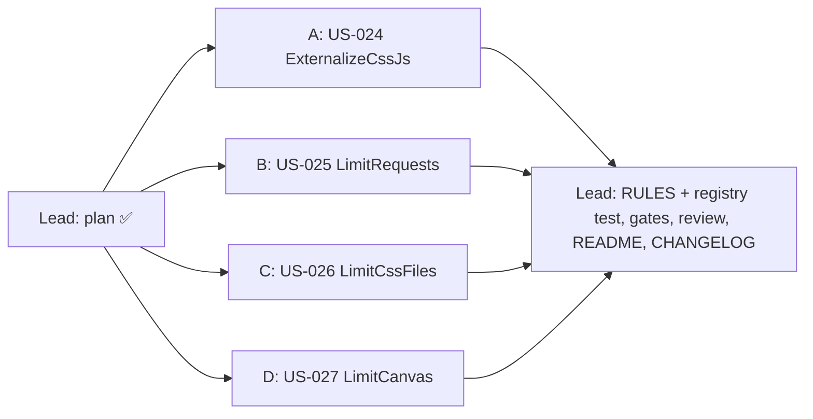

# [TECH-PLAN] US-024 → US-027: Epic BP3, four new best practices

- **Input:** [EPIC-BP3-conventions](../stories/EPIC-BP3-conventions.md), which inherits [EPIC-BP2-conventions](../stories/EPIC-BP2-conventions.md), and [US-024](../stories/US-024.md), [US-025](../stories/US-025.md), [US-026](../stories/US-026.md), [US-027](../stories/US-027.md) (READY FOR TDD).
- **Decisions:** no new ARCH-DECISION. The four rules fit the existing rule model unchanged:
  - [ARCH-DECISION-004](ARCH-DECISION-004-stateless-best-practice-rules.md): stateless `BestPracticeRule`, self-contained `collect()`, pure `evaluate()`;
  - [ARCH-DECISION-017](ARCH-DECISION-017-line-refs-for-file-names.md): `lineRefs` for lines naming a file. US-024 and US-027 lines name no file, so `capLines` omits `lineRefs` and the view renders them as plain text (`fileOrTextLine` → `{ kind: "text" }`).
  - No contract, port, protocol, model or UI change. `BestPracticeId` is a `string` and the four categories (`js`, `network`, `css`, `content`) already exist.
- **Branch:** `develop` (3e1150f). Nothing is committed.
- **Baseline:** 90 test files, 1 607 tests green; `tsc` 0 errors; ESLint 0 errors / 1 known warning (`browser-context.tsx`).

## 0. Ground rules for every sub-agent

1. **Stay inside your file ownership** (§3). Do not edit `best-practices/index.ts`, `rules-registry.test.ts`, `rule-lines.ts`, `request-helpers.ts`, `image-rule-helpers.ts`, the README, the CHANGELOG or any doc: the lead registers the rules and writes the docs at integration. If a helper is missing or wrong, **stop and report it**; keep any rule-specific helper private to your rule file.
2. **Strict TDD.** Write the test, run it, keep the failing (red) output for your report, then implement until green. Run your subset with `npx vitest run <your paths>`.
   - Other agents work in the same tree at the same time. A failure of `npm test` in a file you don't own is reported, not fixed.
3. **Type-check and lint:** `npx tsc --noEmit` and `npx eslint <your paths>`. `src/app/domain` must not import `infra/` or `ui/`, nor use `chrome`/`browser`.
4. **No `vi.mock` of project modules.** Plain fixtures, jsdom DOM built in the test, `Object.defineProperty` / prototype stubs restored in `finally`.
5. **Do not commit, push, stash, checkout or run `npm install`.** No new dependency. No git command that changes state.
6. **Wording:** UI strings in French, **exactly** as in the stories and §2 (character for character: apostrophes are `'`, "×" is U+00D7, the space before ":" is a regular space). `formatKo` and `formatCount` use `toLocaleString("fr-FR")`, whose grouping separator is U+202F: compare against the helper or a literal built with it. Code, comments and test names in English; 2-space indent, double quotes.
7. **Rule tests** (CLAUDE.md "Adding a best practice"): a `*.rule.test.ts` covering **every Gherkin scenario of the story** (test named after the scenario number), every grade boundary, the singular/plural forms, the line order and the 20-line cap.
   - A rule with `collect()` also tests, in its own file, under `// @vitest-environment jsdom`: the collector run on a real jsdom DOM; `new Function("return (" + rule.collect.toString() + ")")()` runs without throwing; its result survives `JSON.parse(JSON.stringify(…))`.
   - NFR timings: best of 10 runs with `performance.now()` (single runs flake under load).
8. **Final report:** files created and modified; tests added with one red-run excerpt per file; the `npx vitest run <your paths>` output and the `npm test` tail; the decisions you took, the limitations, and any contract issue.

## 1. Contract (existing, reused as is; owned by the lead)

| File | Used for |
|---|---|
| `domain/best-practices/rule.ts` | `BestPracticeRule<TPage>`, `RuleContext`, `RuleResult` |
| `domain/best-practices/rules/rule-lines.ts` | `RuleLine`, `fileLine(url, rest, prefix?, preview?)`, `capLines(lines)` → `{ offenders, lineRefs? }` (20 + "… et N autres"; `lineRefs` omitted when no line names a file), `plural(n, sing, plur)` (singular for 0 and 1), `formatCount(n)` |
| `domain/best-practices/rules/request-helpers.ts` | `isSuccess2xx`, `textFileType(request)` (US-008 §2: `"CSS"` for `text/css`, or generic/missing MIME + `.css`), `lastRequestPerUrl(requests, keep)` (last qualifying request per URL without fragment, first-seen order) |
| `domain/best-practices/rules/image-rule-helpers.ts` | `formatKo(bytes)` ("180 ko", integer, 1 ko = 1 000), `fileLabel(url)` |
| `domain/image-estimation/policy.ts` | `MAX_OFFENDER_LINES` (20) |

"Non évaluée" for a DOM rule is `{ detail: "La page n'a pas pu être inspectée" }` with **no `compliance`** when `page === undefined` (the engine passes `undefined` when the collector failed). Same as `avoid-media-autoplay.rule.ts`.

## 2. Decisions taken by the lead (to be confirmed by the owner)

1. **US-024 sizes, "0,4 ko".** The story asks for `formatKo` but its own example is "0,4 ko", and `formatKo` rounds to the integer ("0 ko"). The example wins: inline block sizes are shown with **at most one decimal**, `(chars / 1000).toLocaleString("fr-FR", { maximumFractionDigits: 1 }) + " ko"` (12 000 → "12 ko", 1 000 → "1 ko", 400 → "0,4 ko", 50 → "0,1 ko", 12 345 → "12,3 ko"). The helper is private to the US-024 rule file; `formatKo` is unchanged for every other rule.
2. **US-024 counted script types.** `type` attribute: absent, or `trim()` then `toLowerCase()`, then the part before the first `;` trimmed again. Counted when the result is `""`, `"module"`, or one of `text/javascript`, `application/javascript`, `application/ecmascript`, `text/ecmascript`, `application/x-javascript`. The `language` attribute is ignored. An `id` attribute that is empty after trimming counts as no id. SVG `<style>` elements of the document are counted (inline CSS too); `<template>` contents are not in the DOM tree and are not counted.
3. **US-024 line text** with an id: `<script id="gtm"> en ligne : 0,3 ko`; the id is written as is.
4. **US-026 weight of a 304.** The story says "the transferred size, or the decoded size when served from the cache". A `304` *is* served from the cache: its weight is `responseSize` when `> 0`, else `transferSize`. Any other status: `transferSize` when `> 0`, else `responseSize` (as US-013).
5. **US-027 "non affiché"** is exactly a 0 × 0 box (the `PreviewBox` convention). A box with one zero side (e.g. 300 × 0) is "displayed" with area 0: it sorts after the displayed canvases with a positive area and before the non-displayed ones.
6. **US-025 count** is `requests.length` (the "Requêtes" column is `pageAnalysed.requests.length`, and the engine receives that same array), shown with `formatCount` ("1 500 requêtes HTTP").
7. **Aggregated view (existing behaviour, limitation).** `aggregateBestPractices` deduplicates lines by text across and within pages. Two identical lines of one page (two 300-character anonymous `<script>`, two 300 × 150 canvases) are shown once, while the detail keeps the true count. Rule results keep every line. Not changed in this epic; to be raised as a follow-up if the owner wants it.
8. **Registration order** in `RULES`, after `AvoidMediaAutoplay`: `ExternalizeCssJs`, `LimitRequests`, `LimitCssFiles`, `LimitCanvas` (story order).

## 3. Scopes

Every scope creates two new files (scope B also adds one test to an existing use-case test file nobody else touches), so all four run in parallel.

---

### 3.A Scope A: US-024 `ExternalizeCssJs`

**Owns** (creates): `src/app/domain/best-practices/rules/externalize-css-js.rule.ts` and `externalize-css-js.rule.test.ts`.

**Metadata:** id `ExternalizeCssJs`, name "Externaliser les CSS et JavaScript", category `js`. Export `externalizeCssJsRule`.

**Page type** (exported): `ExternalizeCssJsPage = { blocks: Array<{ tag: "style" | "script"; id: string | null; size: number }> }`, in document order.

**`collect()`** (self-contained, no helpers outside the function; the MIME list is a literal inside it):
- `document.querySelectorAll("style, script")` once (document order, top frame, no shadow roots).
- `script` with a `src` attribute → skipped, even an empty one (`hasAttribute("src")`): the browser never runs the inline text of a `<script src>`.
- `script` whose type (§2.2) is not JavaScript → skipped.
- `size = (el.textContent ?? "").length`; skipped when `textContent.trim() === ""`.
- `id = el.getAttribute("id")`, trimmed; `null` when absent or blank.

**`evaluate()`**:
- `page === undefined` → `{ detail: "La page n'a pas pu être inspectée" }` (no compliance).
- n = `blocks.length`; s = number of `style`, j = number of `script`.
- A (n ≤ 2): n = 0 "Aucun CSS ni JavaScript en ligne"; else `` `${n} ${plural(n, "bloc", "blocs")} CSS ou JavaScript en ligne` `` ("1 bloc …", "2 blocs …"). **No lines.**
- B (3 ≤ n ≤ 5), C (n ≥ 6): detail `` `${n} blocs CSS ou JavaScript en ligne (${s} <style>, ${j} <script>) : à externaliser dans des fichiers mis en cache` ``.
- Lines (B and C): `` `<${tag}${id ? ` id="${id}"` : ""}> en ligne : ${size §2.1}` ``, sorted by `size` descending then document index; `capLines(lines)` (no `ref`, so no `lineRefs`).

**Tests:** scenarios 1–8 (scenario 4: exact detail, first line "<script> en ligne : 12 ko", full expected line array with the gtm script before the anonymous 300-character one; scenarios 5–7 through `collect()` on a jsdom DOM; scenario 7 appends 4 `<style>` with `document.head.appendChild` before collecting); boundaries 2/3/5/6; "1 bloc" singular; type matrix (case, parameters `text/javascript; charset=utf-8`, empty `type=""`, `module`, `importmap`, `speculationrules`, `text/x-template`, `application/json`); blank id; 25 blocks → 20 lines + "… et 5 autres"; `lineRefs` undefined; NFR: 500 elements collected + evaluated, best of 10, < 20 ms (if jsdom cannot meet it, say so with the measured numbers and also assert `evaluate` alone).

---

### 3.B Scope B: US-025 `LimitRequests`

**Owns** (creates): `src/app/domain/best-practices/rules/limit-requests.rule.ts` and `limit-requests.rule.test.ts`. **Also owns** one new `it` (or `describe`) appended to `src/app/domain/use-case/analyse-web-flow.test.ts` (no other scope edits it).

**Metadata:** id `LimitRequests`, name "Limiter le nombre de requêtes HTTP", category `network`. Export `limitRequestsRule: BestPracticeRule<never>` (no collector, like `limit-domains.rule.ts`).

**`evaluate({ requests })`**: n = `requests.length`, shown with `formatCount(n)`.
- A (n ≤ 40): `` `${formatCount(n)} ${plural(n, "requête", "requêtes")} HTTP` `` ("0 requête HTTP", "1 requête HTTP", "25 requêtes HTTP").
- B (41–70), C (≥ 71): `` `${formatCount(n)} requêtes HTTP (40 au plus recommandées)` ``.
- No offenders, no `lineRefs` (leave the properties undefined).

**Tests:** scenarios 1–4 and 6 at rule level (scenario 4: 38 × 200, 2 × 404, 1 × 304, 1 × 301 → n = 42, B; also duplicates of one URL count each); boundaries 40/41/70/71; `formatCount` for 1 500 (C); offenders undefined. **Scenario 5** in `analyse-web-flow.test.ts`: run the flow with `checkBestPractices: true` and `rules: [limitRequestsRule]` on a `MockBrowser` page with a few requests (including a 404 and a duplicate URL), and assert that the `LimitRequests` detail starts with `` `${page.requests.length} ` `` for the emitted `PageAnalysis`. Read the existing tests in that file to drive `MockBrowser` (fake timers).

---

### 3.C Scope C: US-026 `LimitCssFiles`

**Owns** (creates): `src/app/domain/best-practices/rules/limit-css-files.rule.ts` and `limit-css-files.rule.test.ts`.

**Metadata:** id `LimitCssFiles`, name "Limiter le nombre de fichiers CSS", category `css`. Export `limitCssFilesRule: BestPracticeRule<never>`.

**`evaluate({ requests })`**:
- Files: `lastRequestPerUrl(requests, (r) => (isSuccess2xx(r) || r.code === 304) && textFileType(r) === "CSS")`. n = map size.
- Weight: §2.4.
- B (n ≤ 2): n = 0 "Aucun fichier CSS : vérifier que les styles ne sont pas intégrés à la page" (no lines); n = 1 or 2 `` `${n} ${plural(n, "fichier", "fichiers")} CSS : vérifier que les styles ne sont pas regroupés dans un fichier trop volumineux ou intégrés à la page` ``.
- A (3–10): `` `${n} fichiers CSS` ``, **no lines**.
- C (≥ 11): `` `${formatCount(n)} fichiers CSS : à regrouper (10 au plus recommandés)` ``.
- Lines (B with n ≥ 1, and C): `fileLine(url.href, ` : ${formatKo(weight)}`)` **without preview** (the story adds none), sorted by weight descending then URL (`localeCompare`); `capLines`. `lineRefs` are therefore `{ url }` only; the view shows the US-004 name and no button (`legacyLinePreview` returns `undefined` for unknown rule ids: assert nothing about the UI, it is unchanged).

**Tests:** scenarios 1–7 (scenario 3: weights 180 000 and 2 000 → lines "app.css : 180 ko" then "fonts.css : 2 ko", `lineRefs` `[{ url: … }, { url: … }]` with no `preview`; scenario 5: 11 files all listed largest first, then 21 files → 20 + "… et 1 autre"; scenario 6: app.css twice, old.css 404, theme.css 304 → n = 2; scenario 7: `/assets/site.css` as `application/octet-stream`, and `/style.php` as `text/css`, plus `/x.css` served as `text/plain` is **not** counted, because `text/plain` is not in `GENERIC_MIME_TYPES` (`""`, `application/octet-stream`, `binary/octet-stream`, `application/binary`), and an empty MIME + `.css` is counted); boundaries 2/3/10/11; "1 fichier CSS" singular; 304 weight (§2.4); fragment duplicates (`a.css#x` and `a.css`) count once; a 500 response not counted; NFR 2 000 requests, best of 10, < 10 ms.

---

### 3.D Scope D: US-027 `LimitCanvas`

**Owns** (creates): `src/app/domain/best-practices/rules/limit-canvas.rule.ts` and `limit-canvas.rule.test.ts`.

**Metadata:** id `LimitCanvas`, name "Limiter l'utilisation des éléments canvas", category `content`. Export `limitCanvasRule`.

**Page type** (exported): `LimitCanvasPage = { canvases: Array<{ id: string | null; width: number; height: number }> }`, in document order.

**`collect()`**: `document.querySelectorAll("canvas")` (attached elements of the top frame only; detached and shadow-root canvases are not matched); per element one `getBoundingClientRect()`, `width`/`height` `Math.round`ed; `id` trimmed, `null` when absent or blank. No `getComputedStyle`.

**`evaluate()`**:
- `page === undefined` → `{ detail: "La page n'a pas pu être inspectée" }` (no compliance).
- n = 0 → A "Aucun élément canvas sur la page".
- n ≥ 1 → B `` `${formatCount(n)} ${plural(n, "élément", "éléments")} canvas : vérifier s'ils peuvent être remplacés par des éléments HTML` `` (the story keeps "s'ils" for one canvas too). Never C.
- Lines: `` `<canvas${id ? ` id="${id}"` : ""}> : ${width} × ${height} px` `` (numbers with `formatCount`), or `` `<canvas…> : non affiché` `` for a 0 × 0 box. Order (§2.5): displayed first, by area descending, then document index; non-displayed last, in document order. `capLines` (no `lineRefs`).

**Tests:** scenarios 1–6 (scenarios 4 and 5 through `collect()` on jsdom: stub `getBoundingClientRect` per element; scenario 5 creates a canvas with `document.createElement` without attaching it); scenario 3: 12 canvases → B with 12 lines, plus 25 canvases → 20 + "… et 5 autres"; singular "1 élément"; 300 × 0 ordering (§2.5); large sizes with `formatCount` ("1 920 × 1 080 px"); `lineRefs` undefined; NFR 200 canvases collected + evaluated, best of 10, < 10 ms.

---

### 3.R Lead integration (after the four reports)

- `best-practices/index.ts`: import and register the four rules (§2.8). `rules-registry.test.ts`: seventeen ids in order; collectors list gains `ExternalizeCssJs` and `LimitCanvas`.
- Gates: `npm run typecheck`, `npm run lint`, `npm test`, `npm run build`.
- `docs/reviews/REVIEW-US-024-027.md`; story statuses; README rule table (French); CHANGELOG.
