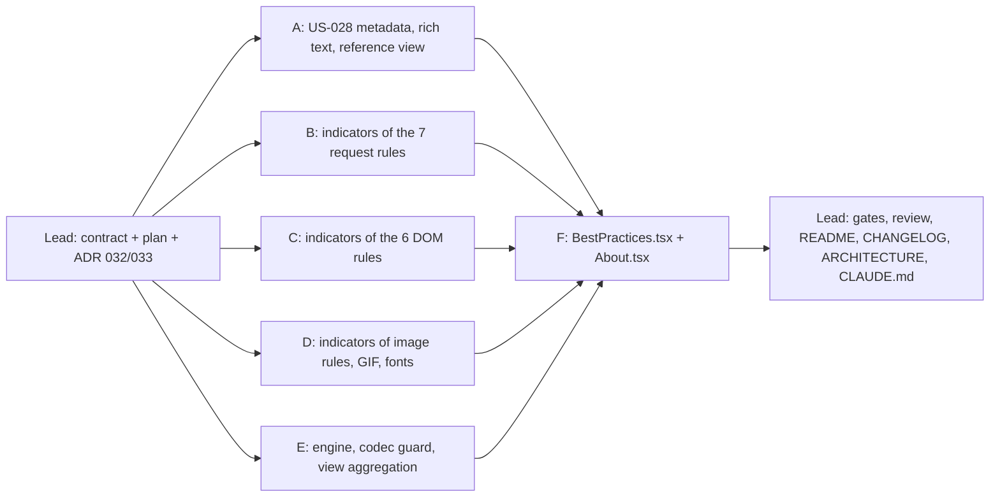

# [TECH-PLAN] US-028 and US-029: Epic BP-UX, clearer best-practice panels

- **Input:** [US-028](../stories/US-028.md), reference, description and link; and [US-029](../stories/US-029.md), the offenders indicator. Both are READY FOR TDD.
- **Decisions:**
  - [ARCH-DECISION-032](ARCH-DECISION-032-static-rule-metadata-table.md): static metadata in one domain table keyed by rule id, never persisted;
  - [ARCH-DECISION-033](ARCH-DECISION-033-persisted-best-practice-indicator.md): a persisted per-page indicator computed by `evaluate()`, aggregated in the view.
  - ADR 027 to 031 exist on `feat/impact-models-co2js`, so numbering continues at 032.
- **Branch:** `feat/best-practices-bp3`, from db7b4e0. Nothing is committed.
- **Baseline:** 94 test files and 1 684 tests, all green; `tsc` reports 0 errors.
- **Licence check (US-028 §3), done by the lead before planning:**
  - The RWEB referential (rweb.greenit.fr footer, and `LICENCE.md` of github.com/cnumr/best-practices) is under **CC BY-NC-ND 4.0**. It may be reused verbatim, in whole or in part, for non-commercial purposes, keeping the credit: GreenIT.fr, Collectif conception numérique responsable, with links to https://collectif.greenit.fr and https://www.ecoconceptionweb.com.
  - The RGAA (DINUM) is under Licence Ouverte 2.0.
  - Reuse is not forbidden, so the work goes ahead. The owner must confirm the non-commercial use (REVIEW §4).
- **Real rule names** are authoritative. The stories quote some from memory:
  - `DontResizeImagesInBrowser` is "Ne pas redimensionner les images dans le navigateur";
  - the id of `OptimisedFormats` is `UseOptimizedImageFormats` (`OPTIMISED_FORMATS_RULE_ID`);
  - `UseStandardFonts` is "Utiliser des polices standards".

## 0. Ground rules for every sub-agent

1. **Stay inside your file ownership** (§3). If a file you don't own must change, **stop and report**; do not edit it. The lead owns the README, the CHANGELOG, the docs, `models/best-practice.ts` and `rule.ts` (the contract below is already written there).
2. **Strict TDD.** Write the test, run it, and keep the failing (red) output for your report. Then implement until green. Run your subset with `npx vitest run <your paths>`. Other agents edit the same tree at the same time: report, don't fix, a failure in a file you don't own.
3. `npx tsc --noEmit` and `npx eslint <your paths>` must be clean. `src/app/domain` never imports `infra/` or `ui/` and never uses `chrome` or `browser`.
4. **No `vi.mock` of project modules.** No new dependency.
5. **No commit, push, stash, checkout, reset or `npm install`.** Don't run any git command that changes state.
6. **Do not change any grade, detail, threshold, line text or line order.** All existing assertions must stay green, untouched. Only add assertions.
7. **Wording:** UI strings in French, exactly as below, character for character:
   - the slash in "8 / 10" has regular spaces;
   - the space before "%" and ":" is a regular space;
   - "—" is U+2014.

   `formatCount` (`rules/rule-lines.ts`) groups digits with U+202F: build expected strings with it. Code, comments and test names are in English, with a 2-space indent and double quotes. The placeholder is `bastienhub@gmail.com`.
8. **Final report:**
   - files created and modified;
   - tests added, with one red-run excerpt per file;
   - the `npx vitest run <your paths>` output and the `npm test` tail;
   - your decisions, limitations and any contract issue.

## 1. Contract (written by the lead, read-only for members)

### 1.1 Indicator (US-029), in `src/app/domain/models/best-practice.ts`

```ts
export const RATIO_INDICATOR_UNITS = ["uncached-files", "autoplay-media", "uncompressed-files", "resized-images",
  "unminified-files", "unoptimised-images", "http1-requests", "missing-alternatives"] as const;
export const COUNT_INDICATOR_UNITS = ["inline-blocks", "canvas-elements", "css-files", "domains", "gif-files",
  "requests", "custom-fonts"] as const;
export const PRESENCE_INDICATOR_UNITS = ["print-css"] as const;
export type BestPracticeIndicator =
  | { kind: "ratio"; offenders: number; expected: number; unit: RatioIndicatorUnit }
  | { kind: "count"; offenders: number; unit: CountIndicatorUnit }
  | { kind: "presence"; present: boolean; unit: PresenceIndicatorUnit };
// BestPractice.indicator?: BestPracticeIndicator   and   RuleResult.indicator?: BestPracticeIndicator (rule.ts)
```

**Invariant:** a rule sets `indicator` **only in a result that has a `compliance`**. It never sets one in a pending result (`progress`), a "Non évaluée" result, or a "page could not be inspected" result, even where that legacy result grades A. `UseLazyLoading` never sets one. A ratio has `offenders <= expected`.

### 1.2 Per-rule indicator definitions (lead decisions from each rule's code; the rule's logic wins over the story)

| Rule id (real name) | Kind / unit | offenders | expected | Not set when |
|---|---|---|---|---|
| `AddCacheHeaders` | ratio `uncached-files` | `offenders.length` (non-compliant `cacheVerdict`) | `statics.length` | never: A included, 0/0 possible |
| `AvoidMediaAutoplay` | ratio `autoplay-media` | flagged media (`reasons(m).length > 0`) | `page.media.length` | `page === undefined` |
| `CompressTextFiles` | ratio `uncompressed-files` | offenders (none **and** weak/deflate, i.e. every listed line) | files that passed every filter (text type, ≥ `MIN_TEXT_FILE_BYTES`, non-empty headers), including good and unknown encodings | never: 0/0 possible (scenario 5) |
| `DontResizeImagesInBrowser` | ratio `resized-images` | findings classified `offender` | candidates **not** oversized, plus oversized findings in state `estimated` (not-evaluated and out-of-scope images are excluded) | `page === undefined` (legacy A), pending, "Non évaluée : aucune image…" |
| `ExternalizeCssJs` | count `inline-blocks` | `page.blocks.length` | | `page === undefined` |
| `LimitCanvas` | count `canvas-elements` | `page.canvases.length` | | `page === undefined` |
| `LimitCssFiles` | count `css-files` | `n` (distinct files) | | never |
| `LimitDomains` | count `domains` | `byHost.size` | | never |
| `LimitGifs` | count `gif-files` | `gifs.length` (≥ 5 ko only) | | never |
| `LimitRequests` | count `requests` | `requests.length` | | never |
| `MinifyTextFiles` | ratio `unminified-files` | `offenders.length` | `evaluated` (declared + analysed; "non évalués" excluded) | pending; `evaluated === 0` (no compliance). `files.length === 0` gives A with 0/0 |
| `UseOptimizedImageFormats` | ratio `unoptimised-images` | findings classified `offender` | WebP/AVIF requests (count, same filter as `compliantBytes`), plus findings in state `estimated`, plus findings skipped `already-optimised` | pending, "Non évaluée : aucune image…" |
| `PreferHttp2` | ratio `http1-requests` | `legacy` | `counted` (known version, cache hits excluded) | `counted === 0 && network > 0` (no compliance). `network === 0` gives A with 0/0 |
| `PrintStyleSheet` | presence `print-css` | `present: page > 0` | | `page === undefined` (legacy A) |
| `ProvideTextAlternatives` | ratio `missing-alternatives` | `missing.length + empty.length` (every listed element) | `page.elements.length` (every collected element; decorative ones and tracking pixels are checked and compliant) | `page === undefined` |
| `UseStandardFonts` | count `custom-fonts` | **distinct font URLs** (`lastRequestPerUrl(requests, isFont).size`, the line count) | | never |
| `UseLazyLoading` | none | | | always |

Deviations from the story's wording, recorded in REVIEW §4:
- `UseStandardFonts` counts distinct URLs, as the lines do and as scenario 8 requires. The grade and the detail count every font request, so they differ when one URL is requested twice.
- `PreferHttp2` lines are per host, so its offenders are requests, not lines.
- `MinifyTextFiles` and the image rules also list "non évalué(e)" lines, which are not counted as offenders.
- `ProvideTextAlternatives` counts empty alternatives ("à vérifier") as offenders, because they are listed.
- `PrintStyleSheet` and `DontResizeImagesInBrowser` show no indicator when the page was not inspected, although they grade A.

### 1.3 Rule metadata (US-028), created by scope A in `src/app/domain/best-practices/rule-metadata.ts`

```ts
export type RuleReferential = "RWEB" | "RGAA";
export interface RuleReference { referential: RuleReferential; code: string } // "0075", "1.1"
export interface RuleMetadata { reference?: RuleReference; description?: string; link?: string }
export const RULE_METADATA: Readonly<Record<BestPracticeId, RuleMetadata>>;
export function ruleMetadata(id: BestPracticeId): RuleMetadata; // {} for an unknown id
```

### 1.4 View helpers, consumed by scope F

- `ui/analysis/rich-text.ts` (scope A):
  - `type RichTextSegment = { text: string; bold: boolean }`;
  - `type RichTextLine = RichTextSegment[]`;
  - `parseRichText(text: string): RichTextLine[]`.
- `ui/analysis/best-practice-reference.ts` (scope A):
  - `interface BestPracticeReferenceView { label?: string; description?: RichTextLine[]; link?: { url: string; label: string }; source?: string }`;
  - `referenceViewFor(ruleId: BestPracticeId): BestPracticeReferenceView`.
- `ui/analysis/best-practices-view.ts` (scope E):
  - `AggregatedBestPractice` gains `indicator?: string`, the formatted journey indicator;
  - it also gains `pageIndicators: (string | undefined)[]`, parallel to `pages`, same index;
  - new exports: `formatIndicator(indicator: BestPracticeIndicator): string` and `journeyIndicator(indicators: readonly BestPracticeIndicator[]): string | undefined`.

## 2. Waves



Wave 1 (A to E) runs in parallel: each scope owns disjoint files. Wave 2 (F) owns the two `.tsx` files.

---

### 3.A Scope A: US-028 data, rich text, reference view

**Owns:**
- creates `src/app/domain/best-practices/rule-metadata.ts` and `rule-metadata.test.ts`;
- appends to `src/app/domain/best-practices/rules-registry.test.ts`, without modifying the existing tests;
- creates `src/app/ui/analysis/rich-text.ts` and `rich-text.test.ts`;
- creates `src/app/ui/analysis/best-practice-reference.ts` and `best-practice-reference.test.ts`.

**Data:**
- Copy the table and the descriptions of [US-028 §2](../stories/US-028.md) **verbatim**. Extract them from the markdown with a throwaway script in the scratchpad rather than retyping them, so the apostrophes (’ and ') and dashes (–) are kept as they are.
- Unescape the markdown escapes `\<video\>` and `\<audio\>` to `<video>` and `<audio>`.
- The `PreferHttp2` text is the fenced block: six lines joined with `\n`, with `**multiplexage**` and `**priorisation**`.
- `CompressTextFiles` is RWEB 0076.
- `ProvideTextAlternatives` is `{ referential: "RGAA", code: "1.1" }`.
- Leave these properties absent, never set to `""`:
  - the `LimitDomains` link;
  - the `DontResizeImagesInBrowser` description;
  - everything of `UseLazyLoading`, which gets an empty entry `{}`.
- The keys are the real ids, so `UseOptimizedImageFormats` is the key for `OptimisedFormats`.

**`parseRichText`:**
- split on `\n`, after normalising `\r\n`;
- in a line, `**x**` with non-empty `x` and a closing `**` on the same line gives a bold segment;
- an unmatched `**`, a single `*`, and `****` stay literal;
- adjacent plain text is merged into one segment, and an empty line is `[]`;
- it never interprets HTML: `<video>` is plain text.

**`referenceViewFor`:**
- `label` is `` `${referential} ${code}` ``;
- `description` is `parseRichText(description)`, when there is one;
- `link`, when there is a link and a reference:
  - RWEB: `{ url, label: "Consulter la fiche RWEB 0075" }`;
  - RGAA: `"Consulter le critère RGAA 1.1"`;
- `source`, when there is a reference:
  - RWEB: `"Source : référentiel RWEB (GreenIT.fr)"`;
  - RGAA: `"Source : RGAA 4.1 (DINUM)"`;
- an unknown id gives `{}`;
- missing properties are absent (`toEqual` with an exact object).

**Tests:**
- **Registry**, appended to `rules-registry.test.ts`:
  - the keys of `RULE_METADATA` equal the ids of `RULES`;
  - each reference and link matches the story table exactly (US-028 scenario 8, one `it.each` row per rule);
  - every link is `https://`, and every rule with a link has a reference;
  - `UseLazyLoading` is `{}`.
- **`rule-metadata.test.ts`:**
  - the descriptions are present or absent per the table;
  - spot checks: the AddCacheHeaders first sentence; `UseStandardFonts` ends with "par exemple.", and its systemfontstack URL is plain text; the AvoidMediaAutoplay text contains `<video>` and `<audio>`, with no backslash; the PreferHttp2 text has six lines and contains `**multiplexage**` (not `**multiplexage **`);
  - no description contains "xxxx", and none is empty;
  - `ruleMetadata("Unknown")` is `{}`.
- **`rich-text.test.ts`:** each rule above; the PreferHttp2 text gives 6 lines with "multiplexage" and "priorisation" bold (scenario 6); `<video>` stays a literal segment; `a * b` and an unclosed `**x` stay literal.
- **`best-practice-reference.test.ts`:** scenarios 1 to 5 (AddCacheHeaders, LimitRequests link URL `https://rweb.greenit.fr/fr/fiches/RWEB_0047-limiter-le-nombre-de-requetes-http`, RGAA wording, the three "missing data" rules, RWEB 0076); scenario 7 needs no persistence, because the lookup is by id.

---

### 3.B Scope B: indicators of the request rules

**Owns** (modifies) the rule and test files of `add-cache-headers`, `compress-text-files`, `prefer-http2`, `limit-domains`, `limit-requests`, `limit-css-files` and `minify-text-files` in `src/app/domain/best-practices/rules/`.

Add `indicator` to each `RuleResult` per §1.2, built from the variables the rule already computes. Don't add a second pass with other filters. `CompressTextFiles` needs a `checked` counter in its existing loop, incremented after the headers check.

**Tests**, appended per rule file:
- the indicator in every existing graded branch (A, B, C), and its absence in pending and non-evaluated branches;
- US-029 scenario 1: 8 of 10 static files uncached gives `{ kind: "ratio", offenders: 8, expected: 10, unit: "uncached-files" }`;
- scenario 3: 52 requests gives a count of 52;
- scenario 5: compression with no file in scope gives 0/0;
- scenario 6: minify while pending has no indicator;
- scenario 7: 2 declared `.min.js`, 3 analysed with 1 non-minified, and 1 "non évalué" give 1/5;
- scenario 8: for each rule with lines, with more than 20 offenders, `offenders` equals the number of distinct flagged elements before the cap. For PreferHttp2, it equals `legacy`: assert `legacy` from the detail ("(n sur m)");
- PreferHttp2: `network === 0` gives A with 0/0, and `counted === 0` gives no indicator;
- LimitDomains with 0 requests gives a count of 0.

---

### 3.C Scope C: indicators of the DOM rules

**Owns** (modifies) the rule and test files of `avoid-media-autoplay`, `provide-text-alternatives`, `externalize-css-js`, `limit-canvas`, `print-stylesheet` and `use-lazy-loading`. For `use-lazy-loading`, the test file only.

Add `indicator` per §1.2. Don't touch any `collect()`: the indicator is computed in `evaluate()` only.

**Tests:**
- every graded branch;
- `page === undefined` gives no indicator (PrintStyleSheet included, although it grades A);
- AvoidMediaAutoplay: 2 of 5 media flagged gives 2/5, and none flagged gives 0/n;
- ProvideTextAlternatives: missing plus empty out of all elements, decorative ones included in `expected`;
- ExternalizeCssJs: n = 2 (A, no lines) gives a count of 2;
- LimitCanvas: n = 0 gives a count of 0;
- PrintStyleSheet: `present: true` / `present: false`;
- UseLazyLoading: no indicator in any branch (US-029 scenario 10);
- scenario 8: more than 20 offenders gives `offenders` equal to the number of flagged elements.

---

### 3.D Scope D: indicators of the image rules, GIFs and fonts

**Owns** (modifies):
- `image-rule-helpers.ts` and its test;
- the rule and test files of `dont-resize-images`, `optimised-formats`, `limit-gifs` and `standard-fonts`.

**`summariseImageFindings`:**
- add an optional option `indicator?: { unit: "resized-images" | "unoptimised-images"; extraEvaluatedImages: number }`;
- in the graded branch only, set `indicator = { kind: "ratio", offenders, expected, unit }`, where `offenders` is the number of `offender` findings and `expected` is `extraEvaluatedImages` plus the number of findings in state `estimated`;
- never in the pending or "Non évaluée" branches;
- without the option, the result is unchanged. Existing callers in tests must still deep-equal.

**Rules:**
- `DontResizeImagesInBrowser` passes `extraEvaluatedImages = candidates.filter(c => !c.oversized).length`.
- `UseOptimizedImageFormats` passes the number of WebP/AVIF requests of `pageImages`, plus the number of findings skipped `already-optimised`. Extend `pageImages` to also return `compliantCount`.
- `LimitGifs`: a count of `gifs.length`.
- `UseStandardFonts`: a count of distinct font URLs.

**Tests:**
- every graded branch;
- pending and non-evaluated branches have no indicator;
- the dont-resize `page === undefined` case has none;
- OptimisedFormats: 2 PNG offenders, 1 PNG without gain, 1 WebP request and 1 already-optimised give 2/5;
- dont-resize: 1 oversized offender, 1 oversized below noise, 2 correctly sized and 1 too-large (not evaluated) give 1/4;
- LimitGifs: 3 GIFs of 5 ko or more plus 2 small ones give 3;
- UseStandardFonts: the same font URL requested twice plus another one give 2;
- scenario 8 with more than 20 offenders, before the cap, for each rule.

---

### 3.E Scope E: engine, persistence guard, view aggregation

**Owns:**
- `src/app/domain/best-practices/engine.ts` and its test;
- creates `src/app/domain/best-practices/indicator.ts` and `indicator.test.ts`;
- `src/app/store-codec.ts`, plus new tests appended to `src/app/store.test.ts`;
- `src/app/ui/analysis/best-practices-view.ts` and its test.

**Engine:**
- `evaluateRules` copies `res.indicator`, but only when `res.compliance !== undefined`;
- the key is absent otherwise, not set to `undefined`: build the result so that `toEqual` against old expectations still passes. Check the existing tests: `toEqual` ignores undefined properties, but keep the key absent anyway.

**`indicator.ts`:**
- `isBestPracticeIndicator(value: unknown): value is BestPracticeIndicator` accepts:
  - a known kind with a unit from its own list;
  - for `offenders` and `expected`, non-negative safe integers;
  - for a ratio, `offenders <= expected`;
  - for a presence, a boolean `present`.
- It rejects anything else.

**Codec:** in the `bestPractices` mapping, delete `indicator` when it is present but `!isBestPracticeIndicator(bp.indicator)`. Tests:
- a valid indicator round-trips;
- a malformed one is dropped (wrong kind, unknown unit, a negative or string number, ratio offenders above expected), while the rest of the practice stays;
- a legacy page has no `indicator` key.

**View (`best-practices-view.ts`):**
- **Unit labels:** an exhaustive `Record` for each union.
  - Ratio, singular / plural:
    - `uncached-files`: "ressource sans cache" / "ressources sans cache";
    - `autoplay-media`: "média en lecture ou chargement automatique" / "médias en lecture ou chargement automatique";
    - `uncompressed-files`: "fichier non compressé" / "fichiers non compressés";
    - `resized-images`: "image redimensionnée" / "images redimensionnées";
    - `unminified-files`: "fichier non minifié" / "fichiers non minifiés";
    - `unoptimised-images`: "image au format non optimisé" / "images au format non optimisé";
    - `http1-requests`: "requête HTTP/1" / "requêtes HTTP/1";
    - `missing-alternatives`: "contenu sans alternative textuelle" / "contenus sans alternative textuelle".
  - Count:
    - `inline-blocks`: "bloc CSS ou JavaScript en ligne" / "blocs CSS ou JavaScript en ligne";
    - `canvas-elements`: "élément canvas" / "éléments canvas";
    - `css-files`: "fichier CSS" / "fichiers CSS";
    - `domains`: "domaine" / "domaines";
    - `gif-files`: "fichier GIF" / "fichiers GIF";
    - `requests`: "requête HTTP" / "requêtes HTTP";
    - `custom-fonts`: "fichier de police personnalisé" / "fichiers de police personnalisés".
  - Presence: `print-css` has the label "CSS print" and the absent word "absente".
- **`formatIndicator`:**
  - ratio:
    - `expected === 0` gives "Aucun élément à vérifier";
    - otherwise `` `${formatCount(o)} / ${formatCount(e)} ${label(e)} (${p} %)` ``, where the unit agrees with **`expected`** (scenario 7: "1 / 5 fichiers non minifiés (20 %)");
    - `p = Math.round(100 * o / e)`, except "< 1" when `o > 0` and `p === 0`, and "> 99" when `o < e` and `p === 100`. This is a lead decision, consistent with the PreferHttp2 detail;
  - count: `` `${formatCount(n)} ${label(n)}` ``, singular for 0 and 1;
  - presence: "CSS print : oui" / "CSS print : non".
- **`journeyIndicator(indicators)`:**
  - empty gives `undefined`;
  - only indicators of the first one's kind and unit are kept;
  - ratio: offenders and expected are summed, then formatted;
  - count: the max; when `indicators.length > 1`, append " (page la plus chargée)";
  - presence:
    - k = number of absent, n = length;
    - k = 0 gives "CSS print : oui";
    - n = 1 gives "CSS print : non";
    - otherwise `` `CSS print absente sur ${k} ${plural(k, "page", "pages")} sur ${n}` ``.
- **`aggregateBestPractices`:**
  - for each page that has a `compliance` and an indicator, collect it for the journey;
  - push to `pageIndicators` in step with `pages` (one push per pushed page): the formatted per-page indicator, or `undefined`;
  - at the end, when `entry.progress !== undefined`, there is no journey indicator and every `pageIndicators` entry is `undefined`;
  - otherwise `indicator = journeyIndicator(collected)`; a key whose value would be `undefined` is left absent;
  - `createEntry` initialises `pageIndicators: []`.
- **Tests:**
  - US-029 scenarios 1 to 7 and 9 at view level, using the real rule names in the fixtures;
  - scenario 2: 8/10 and 4/30 give "12 / 40 ressources sans cache (30 %)", with page indicators "8 / 10 … (80 %)" and "4 / 30 … (13 %)";
  - scenario 3: 25, 80 and 41 give "80 requêtes HTTP (page la plus chargée)", and a single page gives "52 requêtes HTTP";
  - scenario 4: 4 pages, 3 absent;
  - scenario 6: a pending page means no indicator; a "Non évaluée" page is excluded from the sum and gets an `undefined` page indicator;
  - scenario 9: legacy pages have no indicator, and the other fields are unchanged;
  - the singular forms; "< 1 %" and "> 99 %"; "Aucun élément à vérifier";
  - NFR: aggregating 50 pages × 17 rules, best of 10 with `performance.now()`, takes under 5 ms for the indicator part. Measure `aggregateBestPractices` and report the number. If line building dominates, measure `journeyIndicator` over 50 indicators separately and say so.

---

### 3.F Scope F (wave 2): panel rendering

**Owns:** `src/app/ui/analysis/BestPractices.tsx` and `src/app/ui/about/About.tsx`.

There are no Solid component tests. Any logic beyond wiring goes into a pure helper owned by scope A or E. If one is missing, report it to the lead rather than creating it.

**Header button (US-028 §2, US-029):**
- badge or progress, as today;
- then, when `referenceViewFor(id).label` exists, `<span class="text-xs rounded px-1 mr-2 border border-border whitespace-nowrap">RWEB 0075</span>`;
- then the name;
- then the spacer;
- then `item.indicator`, when set, in `<span class="text-xs ml-2 text-right">`;
- then the chevron.

All of these are inside the `<button>`, so they form its accessible name, in that order.

**Expanded panel, in this order:**
1. **Description:** `<p class="mb-2">`. Each `RichTextLine` is a `<span class="block">`; bold segments are `<strong>`, the others are text. Use `<For>` and never `innerHTML`.
2. **Link:** `<button type="button" class="underline mb-1 block text-left">` with `onClick={() => browser.openUrlInNewTab(link.url)}`, where `browser` comes from `useBrowser()` (as in `EnvironnementalImpact.tsx`).
3. **Source:** `<p class="text-xs mb-2">`.
4. **Existing content:** the detail, the error, "Éléments concernés" and "Pages concernées".

Render nothing for a missing part.

**"Pages concernées":** use `<For each={item.pages}>{(page, i) => …}` with the text `` `${page}${ind ? ` — ${ind}` : ""}` ``, where `ind = item.pageIndicators[i()]`.

**About.tsx:** add a section "Crédits des bonnes pratiques" (French) with:
- "Les descriptions des bonnes pratiques référencées RWEB sont extraites du Référentiel d'écoconception web (RWEB), publié par GreenIT.fr dans le cadre des travaux du Collectif conception numérique responsable, sous licence Creative Commons BY-NC-ND 4.0.";
- links to https://rweb.greenit.fr, https://collectif.greenit.fr, https://www.ecoconceptionweb.com and https://creativecommons.org/licenses/by-nc-nd/4.0/deed.fr;
- "Le critère RGAA 1.1 provient du RGAA 4.1 (DINUM), sous Licence Ouverte 2.0.", with a link to https://accessibilite.numerique.gouv.fr.

Each link is a `<button type="button" class="underline">` that opens through `useBrowser().openUrlInNewTab`, as elsewhere in the app. Check that `About` is rendered inside the browser provider; if it isn't, report it.

**Checks:** `npx tsc --noEmit`, `npx eslint src/app/ui`, and `npm run dev`, if you can open it. Report what you could not see.

---

### 3.R Lead integration

- Gates: `npm run typecheck`, `npm run lint`, `npm test`, `npm run build`.
- Verify the descriptions verbatim against the story with a diff.
- Write `docs/reviews/REVIEW-US-028-029.md`; set the story statuses; update the README (French: indicator, references, credits), the CHANGELOG, `ARCHITECTURE.md` §3.3, and CLAUDE.md ("Adding a best practice": metadata and indicator).
