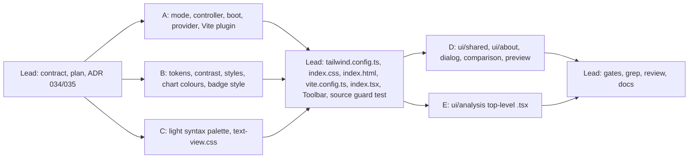

# [TECH-PLAN] US-030: Light mode, following the system preference, with a "Thème" selector

- **Input:** [US-030](../stories/US-030.md), READY FOR TDD.
- **Decisions:**
  - [ARCH-DECISION-034](ARCH-DECISION-034-theme-tokens-css-variables.md): colour tokens defined once in TypeScript, emitted as CSS custom properties per theme by a Tailwind plugin, switched by `data-theme` on `<html>`; charts and the syntax palette follow.
  - [ARCH-DECISION-035](ARCH-DECISION-035-pre-paint-theme-boot-script.md): a tiny external classic script, built from TypeScript by a Vite plugin, applies the stored mode before the first paint without relaxing the CSP.
  - ADR 027 to 031 exist on `feat/impact-models-co2js`, so numbering continues at 034.
- **Branch:** `feat/light-mode`, from `develop` (c4b460a). Nothing is committed.
- **Baseline:** 98 test files and 1 868 tests, all green; `tsc` 0 errors; `npm run lint` 0 errors and 1 warning; `npm run lint:firefox` 0 errors and 2 warnings; build OK.
- **Domain untouched.** Everything is in `src/app/ui/theme/`, the UI components, the shared styling files and the build.

## 0. Ground rules for every sub-agent

1. **Stay inside your file ownership** (§3). If a file you don't own must change, **stop and report**; do not edit it. The lead owns `tailwind.config.*`, `src/app/index.css`, `src/index.html`, `src/app/index.tsx`, `src/app/App.tsx`, `src/app/Toolbar.tsx`, `vite.config.ts`, `tsconfig.json`, `src/app/ui/theme/theme-types.ts`, `src/app/ui/theme/contrast.ts`, the docs, README and CHANGELOG.
2. **Strict TDD** for every `.ts` module. Write the test, run it, and keep the failing (red) output for your report. Then implement until green. Run your subset with `npx vitest run <your paths>`. Other agents edit the same tree at the same time: report, don't fix, a failure in a file you don't own.
3. `npx tsc --noEmit` and `npx eslint <your paths>` must be clean.
4. **No `vi.mock` of project modules.** Inject fakes. No new dependency. jsdom (`// @vitest-environment jsdom`) is allowed where a real DOM helps.
5. **No commit, push, stash, checkout, reset or `npm install`.** Don't run any git command that changes state.
6. **Dark must look exactly as today**, except the deliberate dark fixes of §1.3. Do not change any other dark colour, spacing or layout.
7. Code, comments and test names in English, 2-space indent, double quotes. UI strings in French. The placeholder is `bastienhub@gmail.com`.
8. **Final report:** files created and modified; tests added with one red-run excerpt per test file; the `npx vitest run <your paths>` output and the `npm test` tail; your decisions, limitations and any contract issue.

## 1. Contract (written by the lead)

### 1.1 Already in the tree (read-only for members)

- `src/app/ui/theme/theme-types.ts`: `ThemeMode` (`"system" | "light" | "dark"`), `ResolvedTheme` (`"dark" | "light"`), `THEME_MODES`, `RESOLVED_THEMES`, `DEFAULT_THEME_MODE`, `THEME_STORAGE_KEY` (`"ecoinsights.theme"`), `THEME_ATTRIBUTE` (`"data-theme"`), `LIGHT_SCHEME_QUERY` (`"(prefers-color-scheme: light)"`), `THEME_MODE_LABELS`, `THEME_TOKEN_NAMES`, `ThemeTokenName`, `ThemePalette`, and the injected ports `ThemeStorage`, `ColorSchemeQuery`, `ThemeRoot`, `StorageEventSource`.
- `src/app/ui/theme/contrast.ts`: `contrastRatio(a, b)`, moved verbatim from `syntax-palette.ts`.

**Resolution rule (everywhere):** `system` → `light` when `(prefers-color-scheme: light)` matches, else `dark` (so "no preference" is dark, the historical look). `<html data-theme>` always holds the **resolved** theme once JavaScript has run.

### 1.2 Colour tokens

Each token is a Tailwind colour backed by `--color-<kebab-name>` (for example `surfaceLight` → `--color-surface-light`), holding space-separated RGB channels (`"60 60 60"`) so that `rgb(var(--color-x) / <alpha-value>)` works. The TypeScript values are lowercase `#rrggbb`.

| Token | Dark (today unless §1.3) | Usage |
|---|---|---|
| `background` | `#282828` | page, cards, bottom sheet, preview areas. **Light is fixed to `#ffffff`** (scope C relies on it). |
| `surface` | `#3c3c3c` | toolbar, panels, inputs, dialogs |
| `surfaceLight` | `#505050` | hover of surface items and inputs |
| `onsurface` | `#bfc6ce` | default text (`<main>`), icons |
| `strong` | `#ffffff` | emphasised text that is `text-white` today (toolbar, dialogs, secondary buttons, headings) |
| `border` | `#474747` | separators and table borders (decorative) |
| `field` | `#e5e7eb` | Tailwind `borderColor.DEFAULT`: form fields and alert boxes (`border` without a colour) |
| `placeholder` | `#a1a8b2` | placeholders of form fields (§1.3; added by the lead during the review) |
| `focus` | `#ffffff` | focus outlines (`outline-white` today) |
| `btn` | `#1534ba` | primary button background, secondary button border |
| `btnHover` | `#2c3f71` | primary button hover (`primary-800` today) |
| `onBtn` | `#ffffff` | text on `btn`, `btnHover`, `dangerStrong`, `dangerHover` |
| `tableEven` | `#28292a` | table header |
| `tableOdd` | `#1f1f1f` | row hover in the page detail |
| `danger` | `#ef4444` | danger borders (secondary danger button, save error banner) |
| `dangerStrong` | `#dc2626` | danger button background (§1.3) |
| `dangerHover` | `#991b1b` | danger button hover |
| `warning` | `#eab308` | warning text (comparison status) |
| `tooltip` | `#555555` | tooltip background |
| `onTooltip` | `#ffffff` | tooltip text (§1.3) |
| `selected` | `#4a69bd` | selected table row (`primary-500` today), resizer while dragging |
| `selectedHover` | `#3b5497` | selected row hover (`primary-600` today) |
| `onSelected` | `#ffffff` | text of the selected row (§1.3) |
| `chip` | `#6b7280` | "Non évaluée" chip background |
| `onChip` | `#ffffff` | "Non évaluée" chip text |
| `iconMuted` | `#787878` | the "Add" icon |
| `loader` | `#3f51b5` | loader spinner |
| `marker` | `#ffffff` | metric markers (`bg-white` today) |
| `complianceA` | `#22c55e` | compliance square A |
| `complianceB` | `#eab308` | compliance square B |
| `complianceC` | `#ef4444` | compliance square C |
| `complianceNone` | `#6b7280` | compliance square, not evaluated |
| `chartText` | `#bfc6ce` | chart ticks, legend, title (§1.3) |
| `chartGrid` | `#474747` | chart grid lines (§1.3) |
| `chartLine` | `#36a2eb` | chart line; fill is the same colour at 0.5 alpha (Chart.js `Colors` default today) |

The `primary-*` scale stays in the Tailwind config, unchanged, as the brand scale, but components no longer use it directly. Grade colours from `ecoindex_reference` are unchanged.

**Dialog backdrop:** not a token (`::backdrop` does not inherit custom properties before Chrome 122 / Firefox 120). Values per theme in `THEME_BACKDROPS`: dark `rgba(0, 0, 0, 0.8)` (today), light chosen by scope B.

**Light palette:** scope B derives it, starting from this proposal and adjusting until every requirement of §1.4 passes: `background #ffffff`, `surface #f3f4f6`, `surfaceLight #e5e7eb`, `onsurface #374151`, `strong #111827`, `border #d1d5db`, `field #6b7280`, `focus #1534ba`, `btn #1534ba`, `onBtn #ffffff`, `tableEven #f3f4f6`, `tableOdd #e5e7eb`, `danger #dc2626`, `dangerStrong #dc2626`, `dangerHover #991b1b`, `warning #92400e`, `tooltip #374151`, `onTooltip #ffffff`, `selected #4a69bd`, `selectedHover #3b5497`, `onSelected #ffffff`, `chip #4b5563`, `onChip #ffffff`, `iconMuted #6b7280`, `loader #3f51b5`, `marker #111827`, `complianceA #15803d`, `complianceB #a16207`, `complianceC #dc2626`, `complianceNone #6b7280`, `chartText #374151`, `chartGrid #d1d5db`, `chartLine #1d4ed8`. The brand blue `btn` is kept.

### 1.3 Deliberate dark changes (lead decisions, recorded in REVIEW §4)

Today's dark theme fails WCAG AA text contrast in a few places; scenario 10 makes text contrast a hard criterion, so only these change:

| Element | Today | After | Why |
|---|---|---|---|
| Danger button background | `red-500` `#ef4444`, white 3.76:1 | `dangerStrong` `#dc2626`, 4.83:1 | text 4.5:1 |
| Tooltip text | inherits `#bfc6ce` on `#555`, 4.33:1 | `onTooltip` `#ffffff`, 7.46:1 | text 4.5:1 |
| Selected row text | `#bfc6ce` on `#4a69bd`, 3.01:1 | `onSelected` `#ffffff`, 5.19:1 | text 4.5:1 |
| Chart ticks and legend | Chart.js default `#666`, 2.57:1 | `chartText` `#bfc6ce`, 8.55:1; grid `chartGrid` `#474747` instead of an invisible `rgba(0,0,0,0.1)` | text 4.5:1 |
| Field placeholder | preflight `gray-400` `#9ca3af` on `#3c3c3c`, 4.34:1 | `placeholder` `#a1a8b2`, 4.60:1 (light `#5b6472`, 5.44:1) | text 4.5:1; found in review |
| EcoIndex badge | grade colour as text and border on the page: A 4.11:1, G 3.40:1 on `#282828`, about 1.2:1 on the selected row | **filled** with the grade colour, border in the grade colour, text black or white, whichever contrasts most (≥ 4.5:1 for all 7 grades), same in both themes | scenario 10, "the badge gets a readable text colour" |

Non-text pairs that fail 3:1 in dark today are **kept** (owner: dark unchanged) and listed as `DARK_CONTRAST_EXCEPTIONS` (§1.4); light must pass them.

### 1.4 Contrast requirements (scope B, `contrast-requirements.ts`)

```ts
export interface ContrastRequirement { foreground: ThemeTokenName; background: ThemeTokenName; minimum: 4.5 | 3; usage: string }
export const CONTRAST_REQUIREMENTS: readonly ContrastRequirement[];
export interface ContrastException { foreground: ThemeTokenName; background: ThemeTokenName; reason: string }
export const DARK_CONTRAST_EXCEPTIONS: readonly ContrastException[];
```

At least these pairs:

- **Text, 4.5:1:** `onsurface` on `background`, `surface`, `surfaceLight`, `tableEven`, `tableOdd`; `strong` on `background`, `surface`, `surfaceLight`, `tableOdd`; `onBtn` on `btn`, `btnHover`, `dangerStrong`, `dangerHover`; `onSelected` on `selected`, `selectedHover`; `onTooltip` on `tooltip`; `onChip` on `chip`; `warning` on `surface`, `background`; `chartText` on `background`, `surface`.
- **UI, 3:1:** `field` on `background`, `surface`; `focus` on `background`, `surface`, `surfaceLight`; `danger` on `background`; `complianceA`, `complianceB`, `complianceC`, `complianceNone` on `background`, `surface`; `marker` on `background`; `chartLine` on `background`, `surface`; `loader` on `background`; `iconMuted` on `background`; `btn` (secondary button border) on `background`, `surface`.
- **Dark exceptions** (expected today, verify with the helper): `complianceC`/`surface` 2.93, `complianceNone`/`surface` 2.28, `loader`/`background` 2.15, `btn`/`background` 1.57, `btn`/`surface` 1.17. **No text pair may be an exception.**

### 1.5 Module APIs

**Scope A** (`src/app/ui/theme/`):

```ts
// theme-mode.ts
export function parseThemeMode(value: unknown): ThemeMode;            // anything unknown -> "system"
export function resolveTheme(mode: ThemeMode, systemPrefersLight: boolean): ResolvedTheme;
export function readStoredMode(storage: ThemeStorage | undefined): ThemeMode;      // never throws
export function writeStoredMode(storage: ThemeStorage | undefined, mode: ThemeMode): boolean; // never throws; false on failure
export function safeStorage(getter: () => ThemeStorage | null | undefined): ThemeStorage | undefined; // getter may throw
export function applyResolvedTheme(root: ThemeRoot, theme: ResolvedTheme): void; // sets THEME_ATTRIBUTE

// theme-controller.ts
export interface ThemeState { mode: ThemeMode; resolved: ResolvedTheme }
export interface ThemeControllerDeps { storage?: ThemeStorage; query?: ColorSchemeQuery; root?: ThemeRoot; events?: StorageEventSource }
export interface ThemeController {
  state(): ThemeState;
  setMode(mode: ThemeMode): void;
  subscribe(listener: (state: ThemeState) => void): () => void;
  dispose(): void;
}
export function createThemeController(deps: ThemeControllerDeps): ThemeController;

// theme-boot.ts (pure, tested) and theme-boot.entry.ts (one line: bootTheme(window))
export interface ThemeBootEnv { localStorage?: unknown; matchMedia?: (query: string) => { matches: boolean }; document: { documentElement: ThemeRoot } }
export function bootTheme(env: ThemeBootEnv): ResolvedTheme | undefined;   // never throws

// ThemeProvider.tsx (no test, wiring only)
export interface ThemeContextValue { mode: Accessor<ThemeMode>; resolved: Accessor<ResolvedTheme>; setMode(mode: ThemeMode): void }
export function ThemeProvider(props: { controller: ThemeController; children: JSX.Element }): JSX.Element;
export function useTheme(): ThemeContextValue;
```

```js
// scripts/vite-theme-boot.mjs
export async function buildThemeBoot(entry: string): Promise<string>;   // esbuild, IIFE, minified, no import/export
export function themeBootPlugin(options: { entry: string; fileName?: string /* "theme-boot.js" */; htmlFile?: string /* "index.html" */ }): import("vite").Plugin;
```

**Scope B** (`src/app/ui/theme/` and `src/app/ui/shared/`):

```ts
// theme-tokens.ts
export const THEME_TOKENS: Readonly<Record<ResolvedTheme, ThemePalette>>;
export const THEME_BACKDROPS: Readonly<Record<ResolvedTheme, string>>;
export function tokenVariable(name: ThemeTokenName): string;           // "--color-surface-light"
export function hexToChannels(hex: string): string;                    // "#3c3c3c" -> "60 60 60"

// theme-styles.ts
export function tailwindThemeColours(): Record<ThemeTokenName, string>; // "rgb(var(--color-x) / <alpha-value>)"
export function themeBaseStyles(extraVariables?: Partial<Record<ResolvedTheme, Record<string, string>>>): Record<string, unknown>;

// chart-theme.ts
export interface ChartColours { text: string; grid: string; line: string; fill: string; tooltipBackground: string; tooltipText: string }
export function chartColours(theme: ResolvedTheme): ChartColours;
export function applyChartColours(target: { options: ChartOptionsLike; data: { datasets: DatasetLike[] } }, colours: ChartColours): void;

// ../shared/ecoindex-badge-style.ts
export function ecoIndexBadgeStyle(gradeColour: string): { "background-color": string; "border-color": string; color: string };
```

`themeBaseStyles(extra)` returns the object passed to Tailwind's `addBase`:

- `":root"`: every dark `--color-*`, `extra.dark`, `"color-scheme": "dark"` (default when no attribute and no JavaScript);
- `'@media (prefers-color-scheme: light)'` → `':root:not([data-theme="dark"])'`: every light variable, `extra.light`, `"color-scheme": "light"`; and `':root:not([data-theme="dark"]) dialog::backdrop'`;
- `':root[data-theme="light"]'`: the light variables, `extra.light`, `"color-scheme": "light"`;
- `"dialog::backdrop"` (dark) and `':root[data-theme="light"] dialog::backdrop'` (light).

**Scope C** (`src/app/ui/analysis/preview/syntax/syntax-palette.ts`):

```ts
export interface SyntaxThemePalette { background: string; text: string; gutter: string; focus: string; tokens: Record<TokenKind, string> }
export const SYNTAX_PALETTES: Readonly<Record<ResolvedTheme, SyntaxThemePalette>>;
export function syntaxThemeVariables(theme: ResolvedTheme): Record<string, string>;
// keys: --syntax-<kind> for every kind, --text-view-background, --text-view-text, --text-view-gutter, --text-view-focus
// kept as dark aliases: SYNTAX_PALETTE, TEXT_VIEW_BACKGROUND, TEXT_VIEW_TEXT, TEXT_VIEW_GUTTER; re-export contrastRatio from ../../../theme/contrast
```

The lead's `tailwind.config.ts` calls `themeBaseStyles({ dark: syntaxThemeVariables("dark"), light: syntaxThemeVariables("light") })`.

## 2. Waves



Wave 1 (A, B, C) runs in parallel on disjoint files. The lead then wires the shared files and writes `theme-sources.test.ts`, a source guard that fails while any dark-only colour remains. Wave 2 (D, E) sweeps the components in parallel, by folder, until the guard is green.

---

### 3.A Scope A: theme mode, controller, pre-paint boot, provider, Vite plugin

**Owns:** creates `src/app/ui/theme/theme-mode.ts`, `theme-controller.ts`, `theme-boot.ts`, `theme-boot.entry.ts`, `ThemeProvider.tsx`, their `*.test.ts`, and `scripts/vite-theme-boot.mjs` with `scripts/vite-theme-boot.test.mjs`.

**Required tests:**

- `theme-mode.test.ts`: `parseThemeMode` keeps the three modes and maps `null`, `""`, `"blue"`, `"Light"`, numbers and objects to `system`. `resolveTheme` for the 6 combinations. `readStoredMode`: missing storage, `getItem` throwing, stored `"blue"`, stored `"light"`; reads `THEME_STORAGE_KEY` only. `writeStoredMode` writes the key and returns `true`, returns `false` without throwing when `setItem` throws. `safeStorage` returns `undefined` when the getter throws or returns `null`. `applyResolvedTheme` sets `data-theme`.
- `theme-controller.test.ts` (fakes for storage, query, root and events, with listener lists):
  - initial state from storage and query (scenarios 1, 5, 7), and the root attribute applied at creation;
  - `setMode` writes storage, applies the attribute, notifies subscribers; same mode twice notifies once; a throwing storage still applies and keeps the mode for the session (scenario 7);
  - in `system`, a query `change` re-resolves, applies and notifies (scenario 2); in `light` or `dark` it changes nothing (scenario 3); back to `system` resolves against the current query (scenario 6);
  - a `storage` event for `THEME_STORAGE_KEY` adopts the new mode **without writing it back** (scenario 8); `newValue` `null` or `"blue"` gives `system`; `key: null` (storage cleared) gives `system`; other keys are ignored;
  - `subscribe` returns an unsubscribe; `dispose` removes the query and storage listeners;
  - missing deps (no storage, no query, no events) work: system resolves to dark when no query.
- `theme-boot.test.ts`: stored `light` with the system dark gives `data-theme="light"`; nothing stored follows `matchMedia(LIGHT_SCHEME_QUERY)`; a `localStorage` getter that throws (use `Object.defineProperty` with a throwing `get`), a missing `matchMedia` and a throwing `matchMedia` never throw and fall back; it returns the resolved theme.
- `scripts/vite-theme-boot.test.mjs`:
  - `buildThemeBoot("src/app/ui/theme/theme-boot.entry.ts")` returns code with no `import`/`export` statement, under 2 kB, that, run with `node:vm` in a context with fake `window`/`localStorage`/`matchMedia`/`document`, sets `data-theme` (stored `light`, and a throwing storage);
  - the plugin's `transformIndexHtml` returns one `script` tag with `src: "./theme-boot.js"`, `injectTo: "head-prepend"` and **no** `type="module"` for `index.html`, and nothing for `devtools.html`; its hook has `order: "post"`;
  - `generateBundle` calls `this.emitFile({ type: "asset", fileName: "theme-boot.js", source })` with the built code;
  - `configureServer` registers a middleware that answers `/theme-boot.js` (and `/theme-boot.js?t=1`) with `Content-Type: text/javascript` and the code, and calls `next()` for other URLs. Use plain fake `server`/`req`/`res` objects.

**State:** synchronous; no loading state. The controller is the single source of truth; `ThemeProvider` mirrors `state()` into a Solid signal through `subscribe`, and `onCleanup` unsubscribes. `useTheme()` throws a clear error outside the provider, like `useBrowser()`.

**Notes:** `theme-boot.ts` imports only `theme-types.ts` and `theme-mode.ts`; it must stay tiny and must not import Solid. The plugin must not affect `devtools.html`. Do not edit `vite.config.ts` or `index.html`: the lead wires them.

### 3.B Scope B: tokens, contrast requirements, base styles, chart colours, badge style

**Owns:** creates `src/app/ui/theme/theme-tokens.ts`, `contrast-requirements.ts`, `theme-styles.ts`, `chart-theme.ts`, `contrast.test.ts`, `theme-tokens.test.ts`, `theme-contrast.test.ts`, `theme-styles.test.ts`, `chart-theme.test.ts`, and `src/app/ui/shared/ecoindex-badge-style.ts` with its test.

**Required tests:**

- `contrast.test.ts`: black/white 21, equal colours 1, `#rgb` shorthand, symmetry.
- `theme-tokens.test.ts`: both palettes have exactly `THEME_TOKEN_NAMES`, lowercase `#rrggbb`; **the dark palette equals §1.2 exactly** (one table assertion); `THEME_TOKENS.light.background === "#ffffff"`; `THEME_BACKDROPS.dark === "rgba(0, 0, 0, 0.8)"`; `tokenVariable` kebab-cases (`surfaceLight` → `--color-surface-light`, `complianceA` → `--color-compliance-a`, `onBtn` → `--color-on-btn`); `hexToChannels`.
- `theme-contrast.test.ts` (scenario 10): every `CONTRAST_REQUIREMENTS` pair passes in light; every pair passes in dark except `DARK_CONTRAST_EXCEPTIONS`; every exception really fails in dark (so stale exceptions are removed) and no exception has a text minimum; the requirement list covers every token at least once as foreground or background (except `chartGrid` and `border`, decorative).
- `theme-styles.test.ts`: `tailwindThemeColours()` covers every token with `rgb(var(--color-…) / <alpha-value>)`; `themeBaseStyles(extra)` has the five selectors of §1.5 with every variable in channel form, the extra variables in both theme blocks, `color-scheme` per theme, the backdrops; light blocks are identical in the media rule and the attribute rule.
- `chart-theme.test.ts`: `chartColours("dark")` is `{ text: "#bfc6ce", grid: "#474747", line: "#36a2eb", fill: "rgba(54, 162, 235, 0.5)", tooltipBackground: "#555555", tooltipText: "#ffffff" }`; light from the light tokens; `applyChartColours` sets `options.color`, `options.borderColor`, both scales' `ticks.color` and `grid.color`, `plugins.legend.labels.color`, `plugins.title.color`, `plugins.tooltip.backgroundColor` / `titleColor` / `bodyColor`, and every dataset's `borderColor`, `backgroundColor`, `pointBackgroundColor`, `pointBorderColor`, creating missing nested objects and keeping unrelated options (for example `scales.x.type`).
- `ecoindex-badge-style.test.ts`: for each of the 7 grades (iterate `getEcoIndexGrade` over 0 to 100 and collect the distinct colours), the chosen text has ≥ 4.5:1 on the grade colour; background and border are the grade colour; it picks the higher-contrast of `#000000` and `#ffffff`.

**Notes:** these modules are loaded by `tailwind.config.ts` through jiti: **relative imports only, no Solid, no `chart.js` import, no browser globals, no `import.meta`**. `chart-theme.ts` uses local structural types (`ChartOptionsLike`, `DatasetLike`), not Chart.js types. Adjust the light proposal of §1.2 freely to satisfy §1.4, keeping `background #ffffff` and the brand `btn`; never change a dark value except as listed.

### 3.C Scope C: light syntax palette and text view CSS

**Owns:** `src/app/ui/analysis/preview/syntax/syntax-palette.ts`, `syntax-palette.test.ts`, `src/app/ui/analysis/preview/text-view.css`, `text-view-css.test.ts`, `TextPreviewBody.tsx`.

**Work:**

- `SYNTAX_PALETTES.dark` keeps today's colours exactly (background `#282828`, text `#d4d4d4`, gutter `#9a9a9a`, focus `#9cdcfe`, the 12 token colours). `SYNTAX_PALETTES.light` uses background `#ffffff` (the light `background` token) and a new light palette.
- Tests, applied to **both** themes with `it.each`: every token, text and gutter ≥ 4.5:1 on the palette background; focus ≥ 3:1; the distinctness tests of today (comment > 60 from text and every kind, the four triples > 40, every kind > 25 from text); the dark palette equals today's literals; light background `#ffffff`.
- `syntaxThemeVariables(theme)` returns the 16 custom properties of §1.5; test it for both themes. Remove `syntaxStyleVariables()` and its test; keep the dark aliases and re-export `contrastRatio`, and make the palette import `contrastRatio` from `../../../theme/contrast` (do not edit that file).
- `text-view.css`: `.text-view` uses `background: var(--text-view-background)` and `color: var(--text-view-text)`, `.text-gutter` uses `color: var(--text-view-gutter)`, `.text-view:focus-visible` uses `outline: 2px solid var(--text-view-focus)`. No hex literal remains in the file. Update `text-view-css.test.ts` accordingly (assert the `var(...)` declarations and that the file contains no `#` colour literal); keep every other assertion.
- `TextPreviewBody.tsx`: drop `...syntaxStyleVariables()` from the inline style (the variables now come from the stylesheet, so a theme change recolours an open preview without re-rendering, scenario 9). Keep `--gutter-ch`.

### 3.D Scope D (wave 2): shared components, about, dialogs and previews

**Owns:** `src/app/ui/shared/**` (except `ecoindex-badge-style.ts` and its test), `src/app/ui/about/**`, `src/app/ui/home/**`, `src/app/ui/analysis/dialog/**`, `src/app/ui/analysis/comparison/**`, `src/app/ui/analysis/preview/**` except scope C's files.

**Work** (replacement table in §4):

- icons: `fill="currentColor"`. Check each call site so the dark colour stays `#bfc6ce` (the inherited `onsurface`); `Add` gets `class="text-iconMuted"` on its `<svg>`. `Logo` keeps its brand colours (allowed by the guard).
- `Loader.css`: `rgb(var(--color-loader))`.
- `EcoIndexBadge.tsx`: style from `ecoIndexBadgeStyle(grade.color)`.
- `DomProfileChart.tsx`: `useTheme()`; build the chart, then `applyChartColours(chart, chartColours(theme.resolved()))`; a `createEffect` on `theme.resolved()` re-applies and calls `chart.update("none")` (within 100 ms, no animation). Drop the `Colors` plugin registration if the explicit colours make it redundant.
- `MetricsDetailSingle.tsx`, `ConfimDialog.tsx`, `SaveErrorBanner.tsx`, `DialogHost.tsx`, `ComparisonBody.tsx`, preview bodies: the class replacements.
- Extract any new logic into a tested `.ts` helper.

### 3.E Scope E (wave 2): analysis screens

**Owns:** `src/app/ui/analysis/*.tsx` at the top level only: `AnalysedPage`, `AnalysisResult`, `BestPractices`, `EnvironnementalImpact`, `ImageName`, `NewAnalysis`, `PendingAnalysis`, `SavedAnalysis`. Also `src/app/ui/analysis/*.ts` if a helper is needed (test it).

**Work:** the class replacements of §4, including the compliance squares (`bg-complianceA/B/C/None`), the "Non évaluée" chip (`bg-chip text-onChip`), the selected row (`bg-selected hover:bg-selectedHover text-onSelected`), the resizer (`active:border-selected`), `text-white` (`text-strong`) and `focus-visible:outline-white` (`focus-visible:outline-focus`).

## 4. Replacement table (wave 2)

| Today | After |
|---|---|
| `text-white` on a page, surface or dialog | `text-strong` |
| `text-white` on `btn`, danger or selected | `text-onBtn` / `text-onSelected` |
| `outline-white` | `outline-focus` |
| `bg-white` (marker) | `bg-marker` |
| `bg-gray-500 text-white` (chip) | `bg-chip text-onChip` |
| `bg-gray-500` (square) | `bg-complianceNone` |
| `bg-green-500` / `bg-yellow-500` / `bg-red-500` (squares) | `bg-complianceA` / `bg-complianceB` / `bg-complianceC` |
| `text-yellow-500` | `text-warning` |
| `border-red-500` | `border-danger` |
| `bg-primary-500 hover:bg-primary-600` (selected row) | `bg-selected hover:bg-selectedHover text-onSelected` |
| `active:border-primary-500` | `active:border-selected` |
| `fill="#bfc6ce"` / `fill="#787878"` | `fill="currentColor"` (+ `text-iconMuted` for `Add`) |
| `#3f51b5` (loader) | `rgb(var(--color-loader))` |

Allowed literals after the sweep (the guard's allow-list): `src/app/ui/theme/**` (token definitions), `syntax-palette.ts`, `Logo.tsx` (brand), the grade colours read from the domain, the fake loaders and fake estimator in `src/app/infra/**` (they draw content images, which keep their own colours), and test fixtures.

## 5. Lead integration (between the waves)

- `tailwind.config.ts` replaces `tailwind.config.js`: colours from `tailwindThemeColours()`, `borderColor.DEFAULT` → `field`, `outlineColor`/`ringColor` default → `focus`, the `primary` scale kept, a plugin calling `addBase(themeBaseStyles(...))` with the syntax variables; `tsconfig.json` includes it.
- `index.css`: component classes on tokens (§4), tooltip on `tooltip`/`onTooltip`, `html { background-color: rgb(var(--color-background)) }`, backdrop rule removed (now in the base styles).
- `vite.config.ts`: `themeBootPlugin({ entry: "src/app/ui/theme/theme-boot.entry.ts" })`. `index.html` unchanged apart from what the plugin injects.
- `index.tsx`: one `createThemeController` with `safeStorage(() => window.localStorage)`, `window.matchMedia(LIGHT_SCHEME_QUERY)`, `document.documentElement` and `window`; `<ThemeProvider>` outermost.
- `Toolbar.tsx`: `<label for="theme-mode">Thème</label>` and a native `<select id="theme-mode">` with the three options in `THEME_MODES` order, immediately left of "A propos", styled like the analysis selector; `text-white` → `text-strong`.
- `src/app/ui/theme/theme-sources.test.ts`: scans `src/app/**/*.{tsx,css}` (and `.ts` under `ui/`) for Tailwind palette colour classes (`white`, `black`, `gray`, `red`, `yellow`, `green`, `primary`… with any utility prefix and variant), hex literals, `rgb(`/`rgba(` literals and `fill="#`, outside the allow-list of §4.

## 6. Review checklist (lead)

- All gates: `npm run typecheck`, `npm run lint`, `npm test`, `npm run build`, `npm run lint:firefox` (2 warnings, as today), `scripts/manifest.test.mjs` unmodified.
- Built `dist/*/index.html`: the boot script is the first element of `<head>`, a classic script, `theme-boot.js` exists; the CSS contains the theme variables and the media query.
- Grep the colour inventory again; the guard test is green.
- Manual checks pending for the owner: first paint in Chrome and Firefox in each mode, live system switch, chart re-render, two panels, open text preview during a switch.
