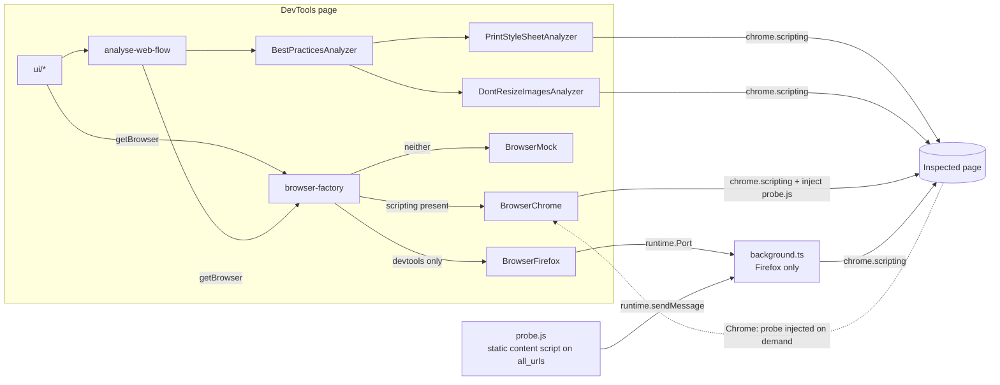
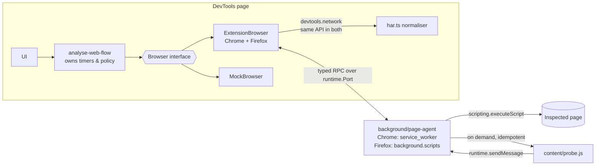

# EcoInsights Devtools: architecture review

- **Date:** 2026-10-17
- **Scope:** whole repository as of `24d6d46` plus the uncommitted best-practices work in the working tree
- **Short-term goals this review is measured against:**
  1. The extension works the same way on Chrome and on Firefox.
  2. Adding a sustainable-design best practice is cheap and always follows the same interface (content optimisation, standard fonts, and so on).

## Vocabulary

This review uses a small set of architecture terms:

- **Module:** anything with an interface and an implementation.
- **Depth:** how much behaviour a module hides behind a small interface.
- **Seam:** a place where behaviour can change without editing the callers.
- **Adapter:** one implementation that sits behind a seam.
- **Leverage:** how much one change buys you.
- **Locality:** whether one concept lives in one place.

The **deletion test** asks: if this module were deleted, would its complexity concentrate in one place, or just move somewhere else?

The "facade" mentioned in the brief is, in these terms, a **deep `Browser` module**. It has one small interface and hides every Chrome/Firefox difference behind it.

---

## 1. Executive summary

The intended layering is sound: `ui → domain → infra`, with a `Browser` interface as the seam and three adapters behind it (Chrome, Firefox, Mock). Two adapters make it a real seam, not a hypothetical one. The problems sit **inside** that seam:

1. **The Chrome and Firefox adapters differ in their transport, not in what they can do.**
   - Chrome calls `chrome.scripting` from the DevTools page.
   - Firefox relays through a background script.

   As a result, every capability is written two or three times: DOM polling exists in three copies, and the HAR mapping in four. The copies have already drifted. Best practices, page reload, permissions and new-tab handling all behave differently, or not at all, on Firefox.
2. **Best-practice analyzers are not domain code.**
   - They call `chrome.scripting.executeScript` directly with a `tabId`, so they only run in the Chrome adapter. On Firefox they are silently ignored.
   - They are stateful singletons, so state is shared between analyses.
   - Adding one rule means touching 3 to 5 files across 3 layers.
3. **The domain imports `infra`**: `analyse-web-flow.ts` calls `getBrowser()` itself, and the `Browser` interface imports a concrete domain class. This makes the domain untestable and leaves the seam leaky.
4. **There is no automated test**, so none of the drift above was caught.

**Top recommendation:** collapse Chrome and Firefox into **one extension adapter talking to one background "page agent"** through a typed RPC protocol (§4.1). The two browsers then share every line except the manifest. Do this **before** adding best practices, because the best-practice refactor (§4.2) depends on the seam exposing a browser-neutral "collect page data" capability.

---

## 2. Current architecture (as found)



Key observations:

- Best-practice analyzers reach the page **around** the `Browser` seam.
- `background.ts` exists only for Firefox. It re-implements DOM polling, URL tracking, reload and best-practice checks, each with a different response shape.
- The Firefox build injects the probe into **every page the user visits, all the time**, even with DevTools closed. That is a privacy cost and a sustainability cost, for an eco-design tool.

---

## 3. Discrepancies and defects

These are independent of the refactors below and should be fixed first (Phase 0). Several of them disappear by construction once §4.1 lands; they are marked ♻.

### 3.1 Chrome / Firefox behavioural drift

| # | Where | Chrome | Firefox | Impact |
|---|---|---|---|---|
| D1 | [browser-firefox.ts:93-152](../../src/app/infra/browser-firefox.ts#L93-L152) | `getPageInfo`, `getNetworkRequests`, `listenToDomProfile` and `listenToNetworkRequests` run the best-practice analyzer | Same methods **drop the `analyzer` argument** | **Best practices never run on Firefox.** Goal 2 is broken on one of the two target browsers. ♻ |
| D2 | [background.ts:289-296](../../src/scripts/background.ts#L289-L296), [browser-firefox.ts:192-218](../../src/app/infra/browser-firefox.ts#L192-L218) | n/a | `CHECK_BEST_PRACTICES` returns `{stylesheets:{checked}}`, a third shape, and the adapter has no `case` for it, so it only logs "unhandled" | Dead, divergent code path. ♻ |
| D3 | [browser-firefox.ts:181-183](../../src/app/infra/browser-firefox.ts#L181-L183) vs [browser-chrome.ts:228-268](../../src/app/infra/browser-chrome.ts#L228-L268) | `refreshCurrentPage` resolves when the tab reaches `status === "complete"` | Resolves **immediately**, before the reload | With "refresh on start", Firefox reads the HAR of the *old* page ([analyse-web-flow.ts:64-67](../../src/app/domain/use-case/analyse-web-flow.ts#L64-L67)). The two browsers give different measurements for the same journey. ♻ |
| D4 | [browser-chrome.ts:67-69](../../src/app/infra/browser-chrome.ts#L67-L69) | `checkPermission()` always returns `true` | Real check through `permissions.contains` | Chrome users can withhold host access ("On click" / "On specific sites"). `executeScript` then throws and the analysis hangs with no message. ♻ |
| D5 | [browser-firefox.ts:175-179](../../src/app/infra/browser-firefox.ts#L175-L179) | `tabs.create` from the DevTools page | Same call | Per MDN, Firefox DevTools pages do **not** get the `tabs` API. "Open in new tab" is likely broken on Firefox (to verify). ♻ |
| D6 | [manifestFirefox.json:19-24](../../src/public/manifestFirefox.json#L19-L24) vs [browser-chrome.ts:71-76](../../src/app/infra/browser-chrome.ts#L71-L76) | Probe injected on demand, `allFrames: true` | Probe declared statically on `<all_urls>`, top frame only | Different click detection in iframes, plus the always-on injection noted in §2. ♻ |
| D7 | [browser-chrome.ts:27-33](../../src/app/infra/browser-chrome.ts#L27-L33) | Tab found with `tabs.query({active, lastFocusedWindow})` | `devtools.inspectedWindow.tabId` | With **undocked DevTools**, the last focused window is the DevTools window. `tab` is `undefined`, and `tab.id` throws at startup. Use `inspectedWindow.tabId` in both. ♻ |
| D8 | [browser-factory.ts:11-18](../../src/app/infra/browser-factory.ts#L11-L18) | Detected through "`scripting` exists in the DevTools page" | Detected through "`devtools` exists" | Detection depends on undocumented API exposure. The builds are already per-browser, so detection should be decided at build time, or made unnecessary (§4.1). |
| D9 | [browser-chrome.ts:104](../../src/app/infra/browser-chrome.ts#L104) (and 3 copies) | `_transferSize` (Chrome HAR extension) | `_transferSize` is not guaranteed in Firefox HAR (to verify) | `transferSize` may always be `0` on Firefox. |

### 3.2 Defects (both browsers)

| # | Where | Defect | Failure scenario |
|---|---|---|---|
| B1 | [probe.ts:40](../../src/scripts/probe.ts#L40), [probeChrome.ts:36](../../src/scripts/probeChrome.ts#L36) | `window[TOKEN] === EcoInsightsProbe()` compares instead of assigning, so the single-instance guard never works. `tsc` flags it (TS7015). | Chrome re-injects the probe on every URL change and reload ([browser-chrome.ts:177](../../src/app/infra/browser-chrome.ts#L177), [:257](../../src/app/infra/browser-chrome.ts#L257)). Click listeners pile up and each click emits N `LINK_CLICKED` messages. |
| B2 | [background.ts:190](../../src/scripts/background.ts#L190) | URL-change subscription pushed into `_domProfileSubscriptions` | `STOP_LISTEN_URL_CHANGES` is a no-op, and the URL listener is only removed as a side effect of stopping DOM polling. |
| B3 | [background.ts:205-207](../../src/scripts/background.ts#L205-L207), [:217-219](../../src/scripts/background.ts#L217-L219) | `filter(el => el.tabId === tabId)` is inverted: it keeps the closed subscriptions and drops everyone else's | Inspect tab A and tab B, then close A's DevTools. B's subscriptions are dropped from the list **without** being closed, so B's 1 s `executeScript` loop runs forever, even after B's DevTools closes. |
| B4 | [best-practices-analyzer.ts:20-28](../../src/app/domain/best-practices/best-practices-analyzer.ts#L20-L28) | The `.map` callback has braces but no `return`, so `Promise.all([undefined, …])` resolves at once | Rules are never awaited. Every DOM tick publishes the **previous** tick's results, and errors become unhandled rejections. |
| B5 | [best-practice-manager.ts:5-20](../../src/app/domain/best-practices/best-practice-manager.ts#L5-L20) | Module singleton holding **stateful** rule instances shared by every `BestPracticesAnalyzer` | Results leak between analyses and pages. `clear()` does not reset `_complianceLevel` ([print-style-sheet.analyzer.ts:29-31](../../src/app/domain/best-practices/print-style-sheet.analyzer.ts#L29-L31), [dont-resize-images-in-browse.analyzer.ts:45-47](../../src/app/domain/best-practices/dont-resize-images-in-browse.analyzer.ts#L45-L47)). A new page therefore shows the previous page's grade with a "no issue" detail. |
| B6 | [analyse-web-flow.ts:182](../../src/app/domain/use-case/analyse-web-flow.ts#L182) | The form-submission listener is gated on `triggerNewPageOnLinkClicked` | The "new page on form submit" checkbox has no effect. |
| B7 | [onclick-listener.ts:71-75](../../src/scripts/shared/onclick-listener.ts#L71-L75) | The `onclick="window.location.href=…"` branch calls `chrome.runtime.sendMessage` directly instead of `onLinkClicked` | The callback seam is bypassed, so this path cannot be tested or redirected. |
| B8 | [get-resized-images.ts:25-31](../../src/scripts/shared/rules/get-resized-images.ts#L25-L31) | `src.includes("svg")` excludes any URL containing "svg". An image is flagged only if **both** dimensions differ by 2 px or more. The detail prints H×W. | False negatives on images scaled along one axis, and on URLs like `/assets/svgs/photo.jpg`. |
| B9 | [analyse-web-flow.ts:208-209](../../src/app/domain/use-case/analyse-web-flow.ts#L208-L209) | The page weight passed to EcoIndex is `responseSize` (decoded `content.size`) | EcoIndex / GreenIT-Analysis use **transferred** size. Confirm against `ecoindex_reference`: scores are probably pessimistic for compressed sites. |
| B10 | [store.tsx:102-104](../../src/app/store.tsx#L102-L104), [:24-32](../../src/app/store.tsx#L24-L32) | `addAnalysis` doesn't persist. All analyses with every request go into one `localStorage` key (about 5 MB quota). `setItem` throws when the quota is exceeded, and nothing catches it. | Long journeys silently fail to save once the quota is reached. |
| B11 | `tsc --noEmit` | 6 type errors (B1, plus `ConfimDialog.tsx:24`, `DomProfileChart.tsx:86`) | The build does not type-check, so `tsc` cannot be used as a CI gate today. |

### 3.3 Housekeeping

- `probeChrome.ts` is dead: Chrome injects `scripts/probe.js`. `INJECT_PROBE` and `GET_PAGE_DOM_SIZE` are unused protocol entries, and the `contextMenus` permission is unused (it only triggers a scarier install prompt).
- `manifestFirefox.json` has no `browser_specific_settings.gecko.id`, which AMO signing and stable storage need for MV3.
- `background.js` is bundled into the Chrome build, which doesn't use it. `npm run build` leaves **both** manifests in `dist/`, so the plain build is not loadable as-is.
- `.DS_Store`, `ecoinsights.zip` and `ecometrics-firefox.zip` are untracked in the repo root. Add them to `.gitignore` and generate zips into `dist/`.
- Naming collision: `best-practice-analyzer.ts` exports the *type* `BestPracticeAnalyzer`, while `best-practices-analyzer.ts` default-exports the *class* `BestPracticesAnalyzer`, which callers import under the name `BestPracticeAnalyzer`. The method is also misspelled `analyzerHar`.

---

## 4. Deepening opportunities

### 4.1 One extension adapter, one background page agent ★ Strong

**Files:** `infra/browser-chrome.ts`, `infra/browser-firefox.ts`, `infra/browser-factory.ts`, `scripts/background.ts`, `scripts/probe*.ts`, `bridge/connexion.ts`, `domain/models/browser.ts`, both manifests.

**Problem.** The Chrome/Firefox difference is about **who may call `chrome.scripting` and `chrome.tabs`**:

- Firefox DevTools pages may not call them.
- Chrome DevTools pages can in practice, but Chrome's own docs describe DevTools pages as limited to the content-script API subset. The Chrome adapter relies on behaviour the docs don't promise.

Because the difference was solved by writing two adapters, each capability has 2 to 3 implementations with no shared code, and §3.1 shows the drift. The `Browser` interface is also **shallow**:

- It has 12 methods.
- Three of them (`listenToUrlChanges`, `listenToLinkClicked`, `listenToFormSubmitted`) are the same concept: *navigation happened*.
- `listenToDomProfile` makes every adapter own a timer that belongs to the domain.

**Deletion test.** Delete `BrowserChrome`, then route Chrome through the same background relay as Firefox. No complexity moves elsewhere: it disappears, because both browsers support `scripting`, `tabs`, `permissions` and `browsingData` **from the background context** in MV3. The only remaining differences are in the manifest.

**Solution.**



**Refactor instructions.**

1. **Typed protocol.** Replace `bridge/connexion.ts` with `src/shared/protocol.ts`:

   ```ts
   // Every DevTools → background call. Adding a capability = one line here.
   export interface Requests {
     "permission.check": { params: void; result: boolean };
     "page.info": { params: void; result: PageInfos };
     "page.description": { params: void; result: PageDescription };
     "page.collect": { params: { ruleIds: string[] }; result: Record<string, unknown> };
     "page.reload": { params: { purgeCache: boolean }; result: void }; // resolves on status=complete
     "page.log": { params: { message: string }; result: void };
     "tab.open": { params: { url: string }; result: void };
     "navigation.watch": { params: { enabled: boolean }; result: void }; // injects/removes probe
   }
   export type NavigationEvent =
     | { kind: "url-changed"; url: string }
     | { kind: "link-clicked"; url: string }
     | { kind: "form-submitted"; url: string };

   export type ToAgent = { type: "request"; id: string; tabId: number; method: keyof Requests; params: unknown };
   export type FromAgent =
     | { type: "response"; id: string; result?: unknown; error?: string }
     | { type: "event"; event: NavigationEvent };
   ```

   - Responses are correlated by **`id`**, not by command type.
   - Every request gets a timeout (for example 5 s) that rejects with a typed error, so the UI can never hang on the loader.
2. **Background page agent** (`src/background/index.ts`):
   - Use a `handlers: { [M in keyof Requests]: (tabId, params) => Promise<Requests[M]["result"]> }` map instead of the `switch`.
   - Keep one `TabSession` per connected port. It holds the `tabs.onUpdated` listener and the probe state, and `port.onDisconnect` tears down **everything** for that tab. This removes B2 and B3 by construction.
   - The agent re-injects the probe itself on `tabs.onUpdated` with `status === "complete"` (this logic moves out of the Chrome adapter), and `page.reload` resolves only on completion (fixes D3).
   - `permission.check` uses `chrome.permissions.contains({ origins: [origin] })` on both browsers (fixes D4).
3. **Single DevTools adapter** (`src/app/infra/extension-browser.ts`):
   - Takes its tab from `chrome.devtools.inspectedWindow.tabId` (fixes D7).
   - Uses `chrome.devtools.network` directly, which behaves the same in both browsers.
   - Sends everything else over the port.
   - Delete `browser-chrome.ts`, `browser-firefox.ts` and `probeChrome.ts`.
4. **Shrink the `Browser` interface** (`domain/models/browser.ts`). It must import **only** domain models, never a class:

   ```ts
   export interface Browser {
     checkPermission(): Promise<boolean>;
     getPageInfo(): Promise<PageInfos>;               // also used for DOM-size polling
     getPageDescription(): Promise<PageDescription>;
     collectPageData(ruleIds: string[]): Promise<Record<string, unknown>>; // see §4.2
     getNetworkRequests(): Promise<NetworkRequest[]>;
     onNetworkRequest(listener: (r: NetworkRequest) => void): Closeable;
     onNavigation(listener: (e: NavigationEvent) => void): Closeable;
     reloadInspectedPage(opts: { purgeCache: boolean }): Promise<void>;
     openUrlInNewTab(url: string): void;
     log(message: string): void;
   }
   ```

   - **Move the 1 s DOM polling loop into `analyse-web-flow.ts`.** It already decides what a DOM sample means, so the timer belongs there. This deletes the three copied poll loops (Chrome adapter, background, mock).
   - Remove every `analyzer?` parameter: the domain calls `collectPageData` itself.
5. **One HAR normaliser** (`src/app/infra/har.ts`): `toNetworkRequest(entry)` replaces the 4 copies.
   - Fall back to `response.bodySize + response.headersSize` when `_transferSize` is absent (D9).
   - Exclude `data:`, `blob:` and extension schemes.
   - Keep the response headers rules need (`content-encoding`, `cache-control`, `content-type`).
6. **Probe** (`src/content/probe.ts`): a single file.
   - Fix the singleton guard (B1).
   - Route every branch through the callback (B7).
   - Remove the static `content_scripts` entry from the Firefox manifest (D6).
7. **Factory:** `getBrowser()` chooses only between `ExtensionBrowser` (when `chrome.devtools` exists) and `MockBrowser`. Browser sniffing goes away (D8).

**Benefits.**

- **Locality:** a new capability is one protocol line, one handler and one adapter method, identical for both browsers.
- **Leverage:** every fix lands in both browsers at once.
- **Tests:** the handler map can be tested with a fake `chrome`, and `analyse-web-flow` against `MockBrowser` with fake timers.
- **Behaviour:** removing the always-on Firefox content script also removes the privacy and footprint cost.

**Risks and checks.**

- Chrome's MV3 service worker idles out after about 30 s without events. Because polling now starts from the DevTools side (a request every second), each request wakes the worker. Nothing long-lived lives in the worker except per-port sessions, which are rebuilt on reconnect.
- Firefox MV3 host permissions are opt-in. Keep the existing "Permission requise" screen. `permissions.request` cannot be called from a DevTools page, so the instructions approach stays.

*Alternative considered:* run page functions through `chrome.devtools.inspectedWindow.eval` from the DevTools page in both browsers, with no background for queries. It is simpler, but it runs in the page's main world, where page scripts can tamper with globals. It also still needs a content script and a relay for push events (clicks). Rejected in favour of a single transport.

---

### 4.2 Best practices as stateless rules behind the `Browser` seam ★ Strong

**Files:** everything in `domain/best-practices/`, `domain/models/best-practice.ts`, `scripts/shared/rules/*`, `ui/analysis/NewAnalysis.tsx`, `ui/analysis/BestPractices.tsx`.

**Problem.**

- **Not domain code.** Analyzers call `chrome.scripting` with a `tabId`, which breaks the layering and is the root cause of D1.
- **Stateful.** Each analyzer mixes its *definition* (id, name) with *per-page results*, and lives in a shared singleton (B5).
- **Two kinds, told apart by duck typing.** `"analyzerHar" in entry` decides the kind, and nothing implements the HAR kind yet. Most sustainability rules need **both** inputs: a "standard fonts" rule needs `document.fonts` *and* the font requests in the HAR.
- **Low locality.** Adding a rule today touches the `scripts/shared/rules` collector, the domain analyzer, the manager registry, and on Firefox also the protocol enum, the background `switch` and the adapter. That is 3 to 6 files in 3 layers.
- **Wasteful.** Every rule's page script runs **every second**, at every DOM tick.

**Solution.** A rule is one file holding pure data plus two functions. The engine is the deep module: it batches collection through the `Browser` seam and evaluates purely.

```mermaid
flowchart LR
  subgraph rule file
    M[metadata] --- C["collect() — runs in page<br/>self-contained, JSON-serialisable"]
    C --- E["evaluate(ctx) — pure"]
  end
  UC[analyse-web-flow] -->|ruleIds| BR{{Browser.collectPageData}}
  BR --> AG[page agent] -->|"one executeScript,<br/>all collectors"| PAGE[(page)]
  AG --> UC
  UC --> ENG[evaluateRules<br/>ctx = page data + requests]
  ENG --> RES[BestPracticeResult[] stored on PageAnalysis]
```

**Refactor instructions.**

1. **Rule interface** in `src/app/domain/best-practices/rule.ts`. The background imports this directory too, so the files must stay free of `chrome.*` and of `ui/` and `infra/` imports:

   ```ts
   export type RuleCategory = "content" | "images" | "fonts" | "network" | "css" | "js";

   export interface RuleContext<TPage> {
     url: string;
     requests: readonly NetworkRequest[]; // normalised HAR for this page
     page: TPage | undefined;             // undefined if collection failed / rule has no collector
   }

   export interface RuleResult {
     compliance: BestPracticeCompliance;  // "A" | "B" | "C"
     detail: string;
     offenders?: string[];                // URLs / selectors, rendered as a list by the UI
   }

   export interface BestPracticeRule<TPage = void> {
     id: BestPracticeId;
     name: string;
     category: RuleCategory;
     /** Runs in the inspected page. MUST be self-contained (no imports, no closure). */
     collect?: () => TPage;
     /** Pure. No I/O, no state. */
     evaluate(ctx: RuleContext<TPage>): RuleResult;
   }
   ```

2. **Registry:** `src/app/domain/best-practices/index.ts` exports `RULES: BestPracticeRule<any>[]`, a plain array. Delete `best-practice-manager.ts`, `best-practice-analyzer.ts` and `best-practices-analyzer.ts`. `NewAnalysis.tsx` reads `RULES.length`.
3. **Engine** (pure, same directory):

   ```ts
   export function evaluateRules(rules, pageData: Record<string, unknown>, requests, url): BestPractice[]
   ```

   It wraps each `evaluate` in `try/catch`, so a broken rule yields a "not evaluated" result instead of breaking the analysis. It never holds state between pages, which fixes B4 and B5.
4. **Page agent:** `page.collect` looks up `RULES` by id and runs **one** `scripting.executeScript` whose `func` calls each collector inside its own `try/catch`, returning `{ [ruleId]: data | {error} }`. Delete `scripts/shared/rules/*`: each collector now lives in its rule file.
5. **Scheduling** belongs to the domain, in `analyse-web-flow.ts`:
   - Collect when the DOM size changed by more than a threshold since the last collection, at most every 5 s, and once just before a page closes on link click or form submit.
   - HAR-only rules are pure and cheap: re-evaluate them on every `sendAnalysis`.
   - Store `BestPractice[]` on `PageAnalysis` as today, so the UI stays almost unchanged.
6. **Port the two existing rules** into `print-stylesheet.rule.ts` and `dont-resize-images.rule.ts`, fixing B8 on the way.
7. **Lint guard** in `.eslintrc.json` (`overrides` for `src/app/domain/**`):
   - `no-restricted-globals: ["chrome", "browser"]`
   - `no-restricted-imports` for `**/infra/**` and `**/ui/**`

**Adding a rule afterwards** means one file plus one line in `RULES`, and it works on both browsers. Example for the brief's "standard fonts" case:

```ts
export const standardFontsRule: BestPracticeRule<{ families: string[] }> = {
  id: "UseStandardFonts",
  name: "Utiliser des polices standard",
  category: "fonts",
  collect: () => ({
    families: [...document.fonts].filter(f => f.status === "loaded").map(f => f.family),
  }),
  evaluate: ({ page, requests }) => {
    const fontFiles = requests.filter(r => r.type.startsWith("font/") || /\.(woff2?|ttf|otf)(\?|$)/.test(r.url.pathname));
    const kb = fontFiles.reduce((a, r) => a + r.transferSize, 0) / 1e3;
    const compliance = fontFiles.length === 0 ? "A" : fontFiles.length <= 2 && kb < 100 ? "B" : "C";
    return { compliance, detail: `${fontFiles.length} police(s) téléchargée(s), ${kb.toFixed(0)} ko`,
             offenders: fontFiles.map(f => f.url.href) };
  },
};
```

**Candidate backlog** (to prioritise with the product owner), checking that each one fits the interface:

| Rule | Input | Notes |
|---|---|---|
| Use standard / system fonts | page + HAR | example above |
| Compress text resources (gzip/br) | HAR (`content-encoding`) | needs headers kept in `har.ts` |
| Minify CSS/JS | HAR (+ content) | `getContent()` is async, so use a size heuristic first |
| Cache static resources (`cache-control`, `ETag`) | HAR | |
| Modern image formats (WebP/AVIF) | HAR | |
| Don't resize images in browser | page | existing |
| Lazy-load off-screen images | page | `loading="lazy"` vs viewport position |
| Images downloaded but not displayed | page + HAR | |
| Limit HTTP requests / domains | HAR | |
| Avoid redirections and HTTP errors (3xx/4xx/5xx) | HAR | |
| Avoid CSS `@import` | page (`document.styleSheets`) | |
| Provide a print stylesheet | page | existing |
| Limit cookie size | page (`document.cookie`) / HAR headers | |

Source catalogues: GreenIT-Analysis rules and the "115 bonnes pratiques d'écoconception web". Map each rule's `id` to its catalogue reference in the metadata.

**Benefits.**

- **Locality:** one rule is one file.
- **Leverage:** rules automatically work on Chrome, Firefox and the mock.
- **Tests:** `evaluate` is a pure function, so each rule gets a table-driven unit test with hand-written `RuleContext` fixtures. No browser is needed.

---

### 4.3 Inject `Browser` instead of reaching into `infra` ◆ Worth exploring

**Files:** [analyse-web-flow.ts:6](../../src/app/domain/use-case/analyse-web-flow.ts#L6), [NewAnalysis.tsx:6](../../src/app/ui/analysis/NewAnalysis.tsx#L6), [EnvironnementalImpact.tsx:2](../../src/app/ui/analysis/EnvironnementalImpact.tsx#L2), [index.tsx:6](../../src/app/index.tsx#L6).

**Problem.** The domain calls `getBrowser()`, a module-level singleton in `infra`. The use case therefore cannot run against a test adapter without module mocking, and the dependency points the wrong way.

**Instructions.**

- Change the signature to `analyseWebFlow(browser: Browser, params, consume)`.
- Create the browser once in `index.tsx` and provide it through a Solid context (`BrowserProvider` / `useBrowser()` in `src/app/infra/browser-context.tsx`).
- UI components call `useBrowser()`.
- Only `index.tsx` imports `browser-factory`.

**Benefits.** `MockBrowser` becomes the test adapter for the use case with no extra machinery. This turns the second adapter into an asset for tests, not only for `npm run dev`.

---

### 4.4 Per-target build and manifest generation ◆ Worth exploring

**Files:** `src/public/manifest*.json`, `build-finalizer.js`, `package.json`, `vite.config.ts`.

**Problem.**

- The two manifests are 90% duplicated and have already drifted.
- `npm run build` produces an unloadable `dist/`.
- Zips are produced by hand into the repo root.

**Instructions.**

1. Split the manifest into `src/manifest/base.json` plus overlays:
   - `chrome.json`: `{ "background": { "service_worker": "scripts/background.js" }, "minimum_chrome_version": "…" }`
   - `firefox.json`: `{ "background": { "scripts": ["scripts/background.js"] }, "browser_specific_settings": { "gecko": { "id": "…", "strict_min_version": "109.0" } } }`
2. Replace `build-finalizer.js` with `scripts/build.mjs --target=chrome|firefox`. It should:
   - run Vite with `outDir: dist/<target>`;
   - run esbuild for `background`, `probe` and `devtools`;
   - deep-merge the manifest;
   - zip to `dist/<target>.zip`.

   `npm run build` builds both targets.
3. Drop the `contextMenus` permission. Keep `scripting`, `tabs`, `browsingData` and `activeTab`, plus `host_permissions`.
4. Add `web-ext lint` for the Firefox target.
5. Optional: define `__TARGET__` through Vite `define` for the rare remaining branch. After §4.1 there should be none.

---

### 4.5 Persistence module ○ Speculative

`store.tsx` mixes Solid state with `localStorage` serialisation and hand-written date rehydration (B10).

- Extract an `AnalysisRepository` (`load()`, `save(analysis)`, `remove(id)`) backed by `chrome.storage.local` with `unlimitedStorage`, or IndexedDB, and store one record per analysis.
- Wait until users actually hit the quota. The minimum fix now is to call `save()` in `addAnalysis` and catch `QuotaExceededError` with a visible message.

---

## 5. Proposed target layout

```
src/
  manifest/                 base.json, chrome.json, firefox.json
  shared/protocol.ts        typed RPC (replaces bridge/connexion.ts)
  background/index.ts       page agent: handlers map + TabSession   (both browsers)
  content/probe.ts          navigation probe, injected on demand    (both browsers)
  devtools/index.ts         panel registration
  app/
    domain/
      models/               Browser interface imports models only
      use-case/             analyse-web-flow (owns timers & collection policy), ecoindex, export-csv
      best-practices/
        rule.ts             BestPracticeRule, RuleContext, RuleResult
        engine.ts           evaluateRules (pure)
        index.ts            RULES registry
        rules/*.rule.ts     one file per best practice
    infra/
      extension-browser.ts  the single Chrome+Firefox adapter
      mock-browser.ts       dev + test adapter
      har.ts                HAR → NetworkRequest
      browser-context.tsx   Solid provider
    ui/ …
```

---

## 6. Delivery plan

| Phase | Content | Done when |
|---|---|---|
| **0. Stabilise** (≈1–2 d) | Fix B1–B7 and B11; fix D7 in place; add **Vitest** (`npm i -D vitest`, `"test": "vitest"`) with first tests on `ecoindex.ts` and `isNotOnSamePage`; add `"typecheck": "tsc --noEmit"` and `"lint": "eslint src"` scripts | `typecheck`, `lint` and `test` pass. A journey on Chrome gives the same page count as before. |
| **1. Unify the seam** (§4.1 + §4.3) | Protocol, page agent, `ExtensionBrowser`, HAR normaliser, polling moved to the domain, `Browser` injected | The same journey on Chrome and Firefox produces the same page segmentation and request counts (±noise). `browser-chrome.ts`, `browser-firefox.ts` and `probeChrome.ts` are deleted. Handler and use-case tests pass against fakes. |
| **2. Rule engine** (§4.2) | Rule interface, engine, registry, the 2 existing rules ported, lint guard | Best practices appear on **Firefox**. Each rule has unit tests on `evaluate`. Adding a rule touches exactly 2 files (the rule and the registry line). |
| **3. Build** (§4.4) | Manifest overlays, per-target `dist/`, zips, `web-ext lint` | `npm run build` produces two loadable folders and two zips. |
| **4. Rules backlog** | Fonts, compression, cache, image formats, … (§4.2 table) | Driven by the product owner: one rule per PR. |

Phases 1 and 2 are sequential: the engine needs `collectPageData`. Phases 3 and 4 can run in parallel with them.

---

## 7. Proposed `GLOSSARY.md` seed

Future reviews and PRs should use these names.

| Term | Meaning |
|---|---|
| **Service** | The web product being measured (name, description, root URL). |
| **Analysis** | One recorded user journey on a Service, made of Page analyses. |
| **Page analysis** | Metrics for one page of the journey: requests, DOM profile, impact, best-practice results. |
| **DOM profile** | Time series of DOM-size samples for a page (SPA-aware). |
| **Impact** | EcoIndex score plus the GHG and water figures derived from it. |
| **Page agent** | Background module that executes in the inspected page on behalf of DevTools. |
| **Probe** | Content script that reports navigation intents (link click, form submit). |
| **Best-practice rule** | Metadata, an optional page collector and a pure `evaluate`, giving a **Compliance** grade A/B/C. |

---

## 8. Not verified in this review

- I did not load the extension in either browser. The claims about Firefox DevTools-page API availability (D5, D9) come from MDN and should be confirmed on a real Firefox build.
- Whether EcoIndex expects transferred or decoded size (B9) should be checked against the `ecoindex_reference` documentation before scores are changed.
- No ADRs exist yet. If any recommendation here is rejected for a lasting reason, record it in `docs/adr/` so it isn't proposed again.
